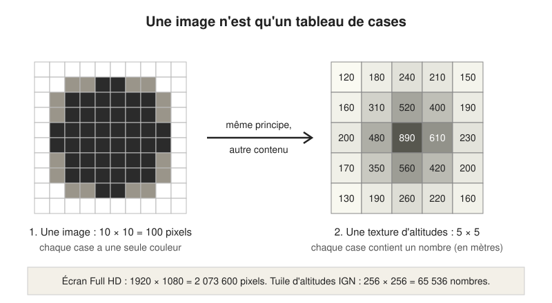
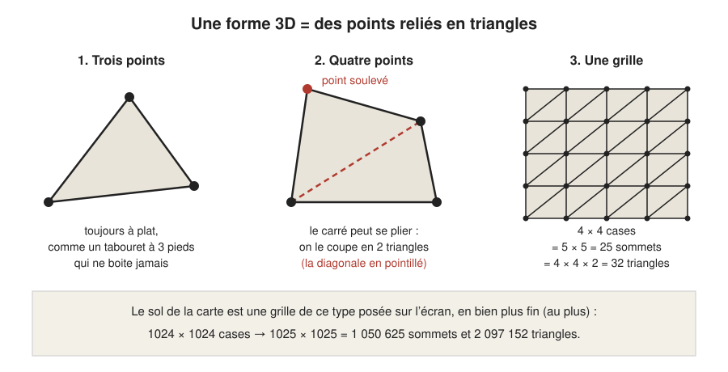
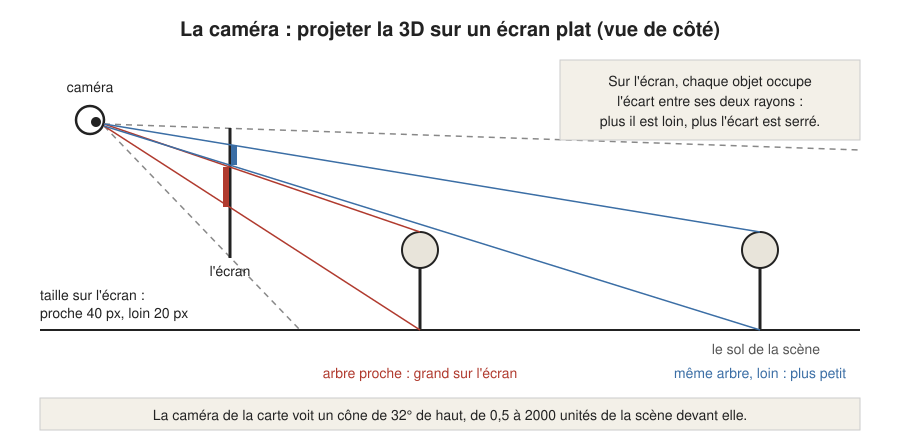
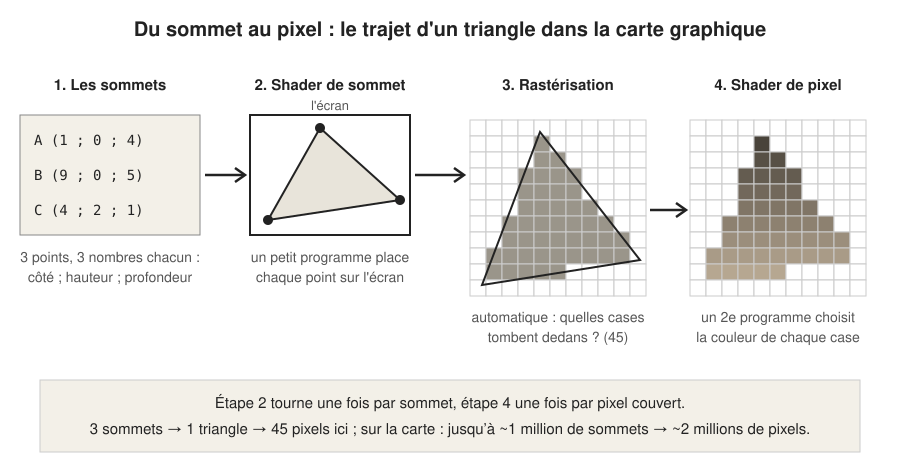
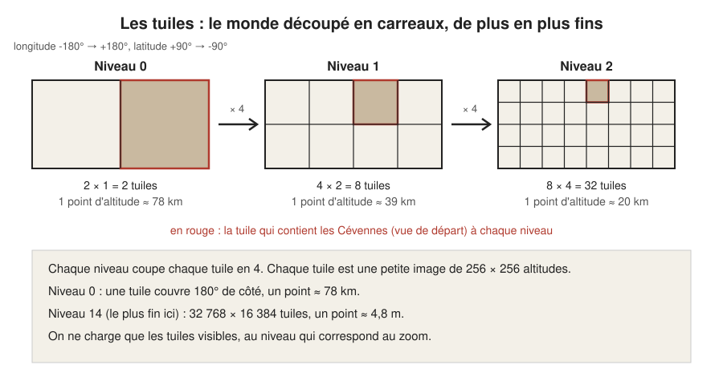

# Les bases : comment un navigateur dessine de la 3D

> **En une phrase :** l'écran est une grille de petites cases colorées, et la carte graphique recalcule la couleur de chacune 60 à 120 fois par seconde, à partir de points reliés en triangles qu'une caméra virtuelle « photographie ».

Ce chapitre n'a aucun prérequis. Il pose le vocabulaire utilisé partout ailleurs : si un mot vous bloque dans un autre chapitre, la réponse est probablement ici ou dans le [glossaire](glossaire.md).

## L'idée

Imaginez une **maquette** posée sur une table, et un photographe qui la prend en photo des dizaines de fois par seconde. Chaque photo est faite sur un papier quadrillé très fin, où chaque case ne peut recevoir qu'une seule couleur. Entre deux photos, on bouge un peu la maquette : à la suite, les photos font un film.

Un navigateur qui affiche de la 3D fait exactement ça :

- la **maquette**, ce sont des points dans l'espace reliés en triangles ; tout ce qu'elle contient s'appelle la **scène** ;
- le **photographe**, c'est une caméra virtuelle (un point de vue et un angle de vision) ;
- le **papier quadrillé**, c'est l'écran, une grille de [pixels](glossaire.md#pixel) (les cases) ;
- celui qui colorie les cases à toute vitesse, c'est la [carte graphique](glossaire.md#gpu) (le GPU).

Rien n'existe « vraiment » en 3D : à la fin, il n'y a qu'une image plate, refaite en permanence.

## Comment ça marche, en gros

### 1. Une image est un tableau de nombres

Un [pixel](glossaire.md#pixel) est une case de l'écran, d'une seule couleur. Un écran Full HD en a 1920 × 1080 = **2 073 600**. Une couleur, pour l'ordinateur, c'est trois nombres (rouge, vert, bleu). Une image n'est donc qu'un grand tableau de nombres.

Ce point est capital pour la suite : un tableau de nombres n'a pas besoin de représenter des couleurs. Il peut contenir **des altitudes**. C'est ce que fait la carte : elle télécharge des images dont chaque case contient la hauteur du sol en mètres. Une de ces images fait 256 × 256 cases, soit **65 536 altitudes** (voir [D'où viennent les données](3d/donnees.md) et [Construction du terrain](3d/terrain.md)).

### 2. La carte graphique : des milliers d'ouvriers en même temps

Le processeur principal de l'ordinateur (le [CPU](glossaire.md#cpu)) est un ouvrier très habile, mais il traite les tâches à peu près une par une. La [carte graphique](glossaire.md#gpu) (GPU) est l'inverse : des milliers de petits ouvriers moins habiles, qui font **tous la même opération en même temps**, chacun sur sa case.

Colorier 2 millions de pixels, c'est 2 millions de fois le même calcul avec des données différentes : le travail idéal pour un GPU. La carte utilise [WebGPU](glossaire.md#webgpu), la façon récente de parler au GPU depuis un navigateur ; si le navigateur ne la connaît pas, la bibliothèque [three.js](glossaire.md#threejs) (une boîte à outils de code déjà écrit, qu'on réutilise) se rabat sur l'ancienne façon, WebGL 2.

### 3. Une forme 3D = des points reliés en triangles

Une forme 3D se décrit par des [sommets](glossaire.md#sommet) (des points dans l'espace, avec trois coordonnées : gauche-droite, hauteur, profondeur) reliés en [triangles](glossaire.md#triangle). L'ensemble s'appelle un [maillage](glossaire.md#maillage), comme un filet.

Pourquoi des triangles et pas des carrés ? Parce que **trois points sont toujours à plat**. Un tabouret à trois pieds ne boite jamais ; une table à quatre pieds, si. Avec quatre points, il suffit d'en soulever un pour que le carré se plie : la carte graphique ne saurait plus quelle surface dessiner. On coupe donc chaque carré en deux triangles par une diagonale. Ce découpage s'appelle la [triangulation](glossaire.md#triangulation).

Le calcul pour une grille est simple. Une grille de N × N cases a (N + 1) × (N + 1) sommets (il y a toujours un poteau de plus que d'intervalles dans une clôture) et N × N × 2 triangles. Pour le sol de la carte, la grille va jusqu'à 1024 cases de côté : 1025 × 1025 = **1 050 625 sommets** et **2 097 152 triangles**. C'est un plafond : sur un plateau sans relief, la carte se contente de 512 ou 256 cases de côté (65 536 cases au lieu d'un million), et elle remonte à 1024 dès qu'une côte ou une vallée entre dans la vue.

### 4. La caméra : passer de la 3D à l'écran plat

La [caméra](glossaire.md#caméra) virtuelle a une position, une direction et un angle de vision. La carte en a une qui voit un cône de 32° de haut, de 0,5 à 2000 unités devant elle. Une unité est la règle graduée de la scène : combien de kilomètres elle vaut dépend du zoom. Passer de la 3D à l'écran s'appelle la [projection](glossaire.md#projection) : pour chaque point, on trace un rayon jusqu'à l'œil de la caméra et on regarde où ce rayon traverse l'écran. Conséquence naturelle : un objet deux fois plus loin paraît deux fois plus petit. C'est la [perspective](glossaire.md#perspective).

Particularité de cette carte, détaillée dans [Construction du terrain](3d/terrain.md) et [Navigation](navigation.md) : la caméra ne se promène pas au-dessus de la France. Elle reste toujours à la même distance du point regardé, au centre de la scène. Quand vous faites glisser la carte, c'est le **monde qui est recentré sous la caméra** ; quand vous zoomez, c'est l'échelle de la scène qui change (combien de kilomètres vaut une unité), pas la distance de la caméra. La caméra se contente de s'incliner (de 70° quand la vue est la plus serrée à 25° quand elle est la plus large, mesurés depuis la verticale), de tourner autour du point regardé, et de suivre un peu la souris pour donner du relief.

### 5. Les shaders : un petit programme par sommet, puis par pixel

Un [shader](glossaire.md#shader) est un petit programme que le GPU exécute **des millions de fois en parallèle**, une fois par élément. Il y en a deux sortes, qui se suivent :

1. **Le [shader de sommet](glossaire.md#shader-de-sommet)** tourne une fois par sommet. Son travail : dire où ce sommet tombe sur l'écran. Il peut aussi le déplacer en chemin, par exemple le soulever d'une altitude lue dans une texture. C'est ce que fait la carte pour le relief, avec une astuce : sa grille est posée à plat sur l'écran, comme un calque collé sur la vitre. Pour chaque point du calque, le shader de sommet cherche d'abord l'endroit du sol que la caméra voit derrière, puis il soulève le point de l'altitude de cet endroit (détails dans [Construction du terrain](3d/terrain.md)).
2. **La [rastérisation](glossaire.md#rastérisation)** n'est pas un programme qu'on écrit : la carte graphique regarde, pour chaque triangle posé sur l'écran, quelles cases il recouvre.
3. **Le [shader de pixel](glossaire.md#shader-de-pixel)** tourne une fois par case recouverte et choisit sa couleur. Sur la carte, c'est là que naissent les hachures, l'encre et le papier (voir [Le dessin à l'encre](dessin.md)).

Les shaders de la carte sont écrits en [TSL](glossaire.md#tsl), une façon d'écrire des shaders en JavaScript (le langage de programmation des pages web) proposée par three.js, qui les traduit ensuite dans la langue du GPU.

### 6. Les textures : des images qu'on colle, ou qu'on lit

Une [texture](glossaire.md#texture) est une image envoyée au GPU. On peut s'en servir de deux façons :

- **la coller** sur une surface, comme un papier peint (la trame du papier journal au fond de la carte) ;
- **la lire comme un tableau de nombres**, sans jamais l'afficher (les altitudes, que le shader de sommet consulte pour soulever le sol).

Lire une texture « entre deux cases » est gratuit pour le GPU : il mélange automatiquement les cases voisines. C'est ce qui permet au relief d'être lisse même quand les altitudes sont espacées.

### 7. L'animation : la boucle de rendu

Un film, c'est 24 images par seconde. Un écran d'ordinateur en affiche 60, souvent 120 sur les machines récentes. La carte vise **120 images par seconde**, soit 1000 / 120 = **8,3 millisecondes** pour fabriquer chaque image.

Le navigateur prévient le programme juste avant chaque rafraîchissement de l'écran. À chaque fois, la carte refait le même tour, qu'on appelle la [boucle de rendu](glossaire.md#boucle-de-rendu) :

1. mesurer le temps écoulé depuis l'image précédente (environ 8 ms à 120 images par seconde) ;
2. lire la souris, le clavier, le tactile ;
3. mettre à jour la scène : la vue glisse un peu vers l'endroit demandé, les voitures et les avions avancent selon ce temps ;
4. dessiner l'image (shaders de sommet, rastérisation, shaders de pixel, puis les effets d'encre par-dessus) ;
5. recommencer.

Le détail de cette boucle est dans [Le moteur](moteur.md).

Tout ce qui bouge se règle sur le **temps écoulé**, pas sur le nombre d'images : une voiture roule à la même vitesse sur un écran à 60 ou à 120 images par seconde. Si la machine n'arrive pas à suivre, la carte baisse discrètement la finesse de la scène 3D (jusqu'à 60 % de la taille de l'écran), en gardant nets l'encre et le papier.

### 8. Les coordonnées géographiques et les tuiles

Sur Terre, une position se donne par deux angles : la [longitude](glossaire.md#longitude) (de -180° à +180°, d'ouest en est) et la [latitude](glossaire.md#latitude) (de -90° au pôle sud à +90° au pôle nord). La vue de départ de la carte est centrée sur 3,581° de longitude et 44,121° de latitude, dans les Cévennes, sur 40 km de large.

Les données du monde entier ne tiennent pas dans un navigateur. On les découpe donc en [tuiles](glossaire.md#tuile) : des carreaux, comme un carrelage. Il existe plusieurs [niveaux](glossaire.md#niveau-de-zoom) de carrelage. Au niveau 0, le monde tient en 2 tuiles ; chaque niveau coupe chaque tuile en 4. Comme chaque tuile fait toujours 256 × 256 cases, plus le niveau monte, plus chaque case couvre une petite surface :

- niveau 0 : une case d'altitude ≈ 78 km ;
- chaque niveau divise par 2 ;
- niveau 14 : une case ≈ 78 km / 2¹⁴ ≈ **4,8 m**.

On ne télécharge que les tuiles qui sont à l'écran (plus une petite marge autour, pour ne pas voir de trou quand on glisse), au niveau qui correspond au zoom : inutile de charger des cases de 5 m pour voir toute la France. La carte choisit le niveau dont une case d'altitude a à peu près la taille de l'écart entre deux sommets de sa grille. Le chapitre [D'où viennent les données](3d/donnees.md) explique d'où viennent ces tuiles (le service gratuit de l'IGN).

Dernier pont entre la Terre et la scène 3D : la carte transforme les degrés en kilomètres autour du centre de la vue, comme si on posait une feuille plate sur le globe à cet endroit. Un degré de latitude fait environ 111 km partout ; un degré de longitude rétrécit vers les pôles (environ 80 km à la latitude des Cévennes).

## Pourquoi on a fait comme ça

- **Le navigateur, et pas une application à installer** : un lien suffit pour montrer le POC (le prototype, la « preuve de concept »). WebGPU donne aujourd'hui assez de puissance pour un rendu dessiné riche.
- **three.js** : la bibliothèque 3D la plus répandue sur le web, très documentée. Elle s'occupe de parler au GPU, on se concentre sur le dessin.
- **WebGPU plutôt que WebGL seul** : plus récent, plus rapide sur les machines qui le gèrent, et three.js retombe sur WebGL quand il manque.
- **TSL pour les shaders** : on écrit les shaders dans le même langage que le reste du code, et ils fonctionnent avec WebGPU comme avec WebGL sans les réécrire.
- **Des tuiles d'altitudes plutôt qu'un modèle 3D tout fait** : un vrai relief, partout en France, sans rien préparer à l'avance.
- **Une boucle réglée sur le temps** : l'objectif est la fluidité (120 images par seconde), et le temps écoulé garde les animations justes même quand une image prend du retard.

## Ce qu'on aurait pu faire autrement

- **Une bibliothèque de cartes toute faite** (Mapbox GL, MapLibre, Cesium) : elles gèrent tuiles, relief et caméra. Pas retenu : leur rendu est celui d'une carte d'usage, et le POC doit ressembler à un dessin à l'encre. Plier une de ces bibliothèques à ce style aurait coûté plus cher que d'écrire le peu de terrain dont on a besoin.
- **Un moteur de jeu exporté pour le web** (Unity, Godot) : outils très riches, mais fichiers lourds au chargement et intégration avec une page web plus raide. Excessif pour un POC qui doit s'ouvrir d'un clic.
- **Une vidéo ou des images précalculées** : parfait pour une démo figée, impossible dès qu'on veut naviguer librement.
- **Un vrai globe en 3D** au lieu d'une feuille plate posée sur la Terre (ce que fait Cesium) : exact partout, même en vue du monde entier. Pas retenu : bien plus de calculs et de cas particuliers (pôles, raccord des tuiles sur une sphère), pour un gain invisible à l'échelle d'une région. À envisager seulement si la carte doit montrer toute la planète.
- **WebGL seul** : marche partout, mais plus lent sur ce type de rendu et plus ancien. three.js garde ce repli, on ne perd donc rien à viser WebGPU.
- **En production**, on préparerait plutôt les données à l'avance sur un serveur (tuiles d'altitudes et de bâtiments regroupées, compressées), au lieu de tout assembler dans le navigateur à l'ouverture.

## Limites actuelles

- WebGPU n'est pas encore partout au même niveau selon les navigateurs et les machines ; le repli sur WebGL fonctionne mais peut être plus lent.
- 120 images par seconde est un objectif, tenu sur une machine récente. Sur un ordinateur modeste, la carte réduit la finesse de la scène plutôt que de ralentir.
- La « feuille plate posée sur le globe » est exacte au centre et se déforme en s'éloignant : sans importance à l'échelle d'une région, visible en vue du monde entier.

## Où c'est dans le code

| Étape | Fichier | Rôle |
|---|---|---|
| Choix de WebGPU | [`src/graphics/device/device.config.ts`](../src/graphics/device/device.config.ts) | dit au moteur d'utiliser WebGPU |
| Création du moteur 3D | [`src/_core/systems/ThreeDevice.ts`](../src/_core/systems/ThreeDevice.ts) | crée le moteur de rendu three.js sur la page |
| Boucle de rendu | [`src/_core/systems/RAF.ts`](../src/_core/systems/RAF.ts) | un tour par image : temps écoulé, entrées, mise à jour, dessin |
| Mise à jour et dessin | [`src/_core/systems/Output.ts`](../src/_core/systems/Output.ts) | met à jour la scène puis lance le dessin |
| Finesse adaptative | [`src/graphics/device/DynamicQuality.helper.ts`](../src/graphics/device/DynamicQuality.helper.ts) | baisse la finesse de la scène si les images arrivent en retard |
| Caméra | [`src/graphics/nodes/cameras/MapCamera.node.ts`](../src/graphics/nodes/cameras/MapCamera.node.ts) | angle de 32°, inclinaison, rotation, suivi de la souris |
| Finesse de la grille selon le relief | [`src/graphics/nodes/terrain/Terrain.node.ts`](../src/graphics/nodes/terrain/Terrain.node.ts) | choisit 256, 512 ou 1024 cases de côté selon le relief en vue |
| Grille de triangles du sol | [`src/graphics/terrain/GroundGeometry.ts`](../src/graphics/terrain/GroundGeometry.ts) | fabrique la grille de sommets et ses triangles |
| Shaders du sol | [`src/graphics/materials/Terrain.material.ts`](../src/graphics/materials/Terrain.material.ts) | soulève les sommets, colorie les pixels (en TSL) |
| Degrés vers kilomètres, grille de tuiles | [`src/graphics/terrain/GeoProjection.ts`](../src/graphics/terrain/GeoProjection.ts) | passage longitude/latitude vers la scène, numérotation des tuiles |
| Taille d'une case par niveau | [`src/graphics/terrain/HeightMosaic.ts`](../src/graphics/terrain/HeightMosaic.ts) | choix du niveau de tuiles selon le zoom |
| Téléchargement des tuiles | [`src/graphics/terrain/IgnElevationProvider.ts`](../src/graphics/terrain/IgnElevationProvider.ts) | demande les tuiles de 256 × 256 altitudes à l'IGN |
| Vue de départ | [`src/graphics/config/terrain.config.ts`](../src/graphics/config/terrain.config.ts) | centre, largeur de vue, finesse de la grille |
| Valeurs réellement utilisées | [`src/graphics/config/debug.values.json`](../src/graphics/config/debug.values.json) | réglages du panneau (1024 cases au plus, inclinaison de 70°) qui priment sur les valeurs par défaut |

## Pour aller plus loin

- [The Book of Shaders](https://thebookofshaders.com/) (Patricio Gonzalez Vivo et Jen Lowe) : l'introduction la plus douce aux shaders de pixel, avec des exemples à modifier en direct.
- [Scratchapixel](https://www.scratchapixel.com/) : cours gratuits sur la projection et la rastérisation, expliqués depuis zéro.
- [Manuel de three.js](https://threejs.org/manual/) : les notions de scène, caméra, maillage et texture, avec des exemples.
- [WebGPU sur MDN](https://developer.mozilla.org/en-US/docs/Web/API/WebGPU_API) : ce qu'est WebGPU et ce qu'il permet.
- [Slippy map tilenames, wiki OpenStreetMap](https://wiki.openstreetmap.org/wiki/Slippy_map_tilenames) : le principe des tuiles et des niveaux de zoom (sur une autre grille que celle de l'IGN, mais même idée).
