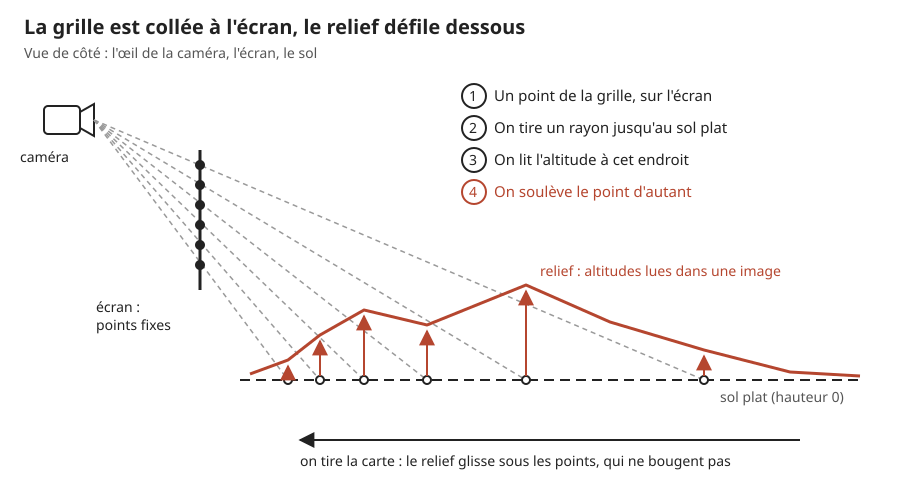
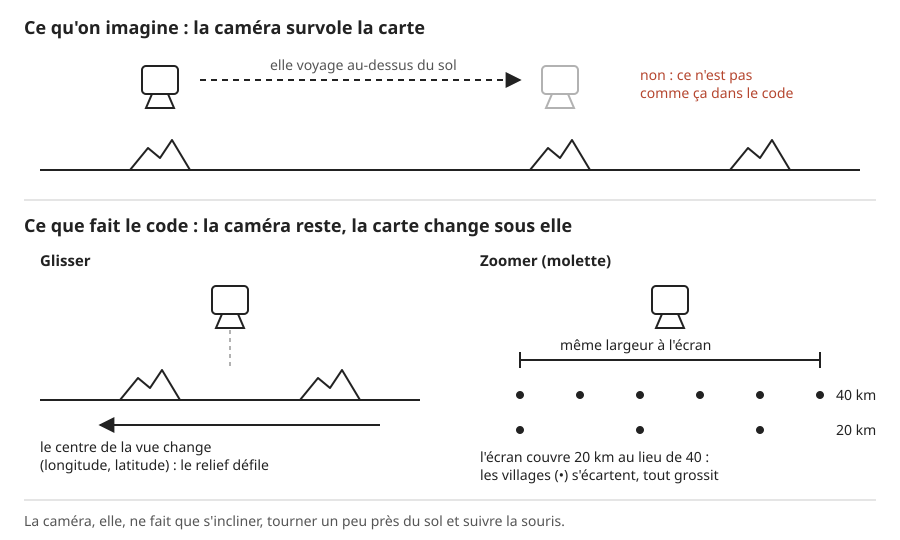
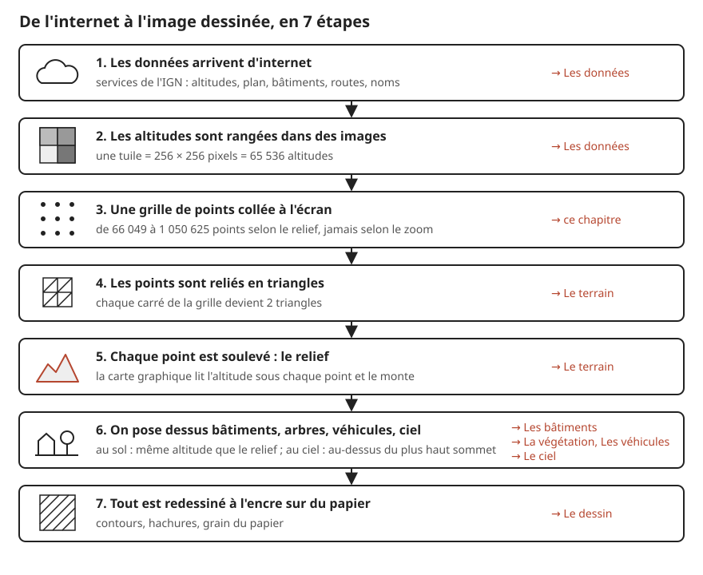

# La carte en 3D : vue d'ensemble

> **En une phrase :** une grille de points est collée à l'écran ; à chaque image, la carte graphique projette chaque point sur le sol, lit l'altitude à cet endroit et soulève le point ; quand on glisse ou qu'on zoome, c'est la carte qui change sous la grille, pas la caméra qui voyage.

Ce chapitre est la porte d'entrée de toute la 3D. Il explique l'astuce principale, puis la chaîne complète en une page. Chaque grande partie a ensuite son propre chapitre :

- [Les données](./donnees.md) : d'où viennent les altitudes, le plan et les noms ;
- [Le terrain](./terrain.md) : comment on passe d'une image d'altitudes à des points, puis à des triangles ;
- [Les bâtiments](./batiments.md) : le bâti, à plat ou en volumes ;
- [La végétation](./vegetation.md) : les arbres et les forêts ;
- [Les véhicules](./vehicules.md) : voitures et bateaux ;
- [Le ciel](./ciel.md) : avions et nuages.

## L'idée

Imagine un drap tendu devant tes yeux, percé d'une grille de trous bien réguliers. Sous le drap, une maquette en relief de la France glisse sur une table. Pour chaque trou, tu regardes à travers, tu vois un point de la maquette, et tu poses une perle à la hauteur de ce point. Avec toutes les perles, tu obtiens la forme du relief.

Le drap ne bouge jamais. Quand tu veux voir plus à l'est, tu ne te déplaces pas : tu fais glisser la maquette. Quand tu veux zoomer, tu ne te penches pas : tu remplaces la maquette par une maquette à plus grande échelle.

C'est exactement ce que fait le code :

- le drap, c'est une grille de [sommets](../glossaire.md#sommet) (des points de la surface 3D) posée sur l'écran, pas sur la carte ;
- regarder à travers un trou, c'est lancer un rayon depuis la [caméra](../glossaire.md#caméra) (l'œil virtuel qui regarde la scène) ;
- poser la perle à la bonne hauteur, c'est le travail d'un [shader](../glossaire.md#shader) (un petit programme qui tourne sur la carte graphique, pour chaque point en même temps) ;
- la maquette, ce sont des images d'altitudes téléchargées sur internet.

Une conséquence importante : **le nombre de sommets ne dépend pas de l'endroit où l'on regarde**. Que l'écran montre 2 km ou 12 000 km, la grille garde le même nombre de points. Les points sont toujours là où l'œil les voit, jamais gaspillés hors de l'écran.

Petite nuance par rapport à l'image du drap : la grille n'a pas une seule finesse pour toujours. Quand la vue s'arrête, le code mesure si le relief est accidenté et choisit entre trois finesses de grille (voir plus bas). Mais pendant qu'on glisse ou qu'on zoome, ce nombre ne change pas.

## Comment ça marche, en gros

1. **On fabrique la grille une seule fois.** C'est un quadrillage de 256 × 256 cases, donc 257 × 257 = 66 049 sommets. Chaque sommet porte deux nombres entre 0 et 1 : sa position sur l'écran (0 à gauche, 1 à droite ; 0 en bas, 1 en haut). La grille déborde un peu de l'écran : 4 % sur les côtés, 30 % en bas et 2 % en haut. Le débord du bas sert parce qu'une montagne au premier plan « monte » dans l'image : sans marge, son pied serait coupé.

2. **On relie les sommets en [triangles](../glossaire.md#triangle).** Une carte graphique (la puce de l'ordinateur spécialisée dans le dessin des images) ne sait dessiner que des triangles. Chaque case carrée est coupée en deux par sa diagonale : 256 × 256 × 2 = 131 072 triangles. Le détail de cette « triangulation » est dans [Le terrain](./terrain.md).

3. **Pour chaque sommet, on lance un rayon.** Le shader part de l'œil de la caméra, passe par le point de l'écran et prolonge la ligne jusqu'au sol plat, à la hauteur 0. Les distances se comptent en « unités », la mesure de longueur de la scène, comme les centimètres d'une maquette. Le calcul tient en une division : si l'œil est à 60 unités de haut et que le rayon descend de 0,5 unité à chaque unité parcourue, il touche le sol après 60 ÷ 0,5 = 120 unités. Un rayon qui part presque à l'horizontale toucherait le sol très loin : on l'arrête à 320 unités.

4. **On traduit ce point du sol en lieu réel.** La scène est un carré de 100 unités de côté qui représente la largeur de la vue. Au départ, la vue fait 40 km : une unité vaut donc 400 m. Le centre de la scène est toujours le centre de la vue (au départ, le mont Aigoual). Un point à 10 unités à l'est du centre est donc à 4 km à l'est de l'Aigoual.

5. **On lit l'altitude et on soulève le sommet.** Les altitudes sont rangées dans une [texture](../glossaire.md#texture) (une image dont chaque pixel contient un nombre au lieu d'une couleur). Le shader y lit l'altitude du lieu, retire l'altitude la plus basse de la vue (pour que le relief parte toujours du même socle, à l'Aigoual comme dans les Alpes), la multiplie par un facteur d'exagération pour que le relief se voie, et monte le sommet d'autant. Ce facteur vaut 2,5 pour une vue de 40 km ; il grandit un peu en vue large et diminue de près (il suit la racine carrée de la largeur de la vue : × 2 à 160 km, × 0,5 à 10 km), et le relief affiché est plafonné à 25 unités pour que les massifs ne deviennent pas des aiguilles. D'où viennent ces images : [Les données](./donnees.md). Comment on les lit sans marches d'escalier : [Le terrain](./terrain.md).

6. **Quand on glisse ou qu'on zoome, seuls deux chiffres changent.** Le premier est le centre de la vue (longitude, latitude). Le second est la largeur de la vue en kilomètres, de 2 km à 12 000 km. On les transmet au shader à chaque image affichée (le projet en vise 120 par seconde), et le relief se recalcule sous la grille. La vue ne saute pas d'un coup vers la position demandée : elle la rattrape en douceur, en comblant à peu près les deux tiers de l'écart en un quart de seconde (250 ms), puis le reste de plus en plus lentement. Les gestes eux-mêmes sont expliqués dans [La navigation](../navigation.md).

7. **La caméra, elle, bouge un peu, mais ne voyage pas.** Elle reste à la même distance du centre. Elle s'incline selon le zoom : presque rasante de près (70° depuis la verticale avec les réglages du panneau, une petite fenêtre de curseurs qui règle le rendu en direct), plus plongeante de loin (25°). Près du sol, glisser de côté la fait tourner autour du point visé. Elle suit aussi légèrement la souris (effet de [parallaxe](../glossaire.md#parallaxe) : les objets proches semblent bouger plus que les lointains) et penche dans les virages. Elle ne descend jamais sous le relief : on la garde au moins une demi-unité au-dessus.

8. **La grille s'adapte au relief, à l'arrêt seulement.** Quand plus rien ne bouge, le code lit une grille de 17 × 17 altitudes réparties sur la vue et mesure à quel point le terrain se plie. Plateau : 256 cases de côté (66 049 sommets). Montagne : 512 ou 1 024 (jusqu'à 1 050 625 sommets et environ 2,1 millions de triangles). Dès qu'une côte traverse la vue, 1 024, car le trait de côte se dessine sur les sommets. Le plafond, 1 024, est un réglage du panneau. On ne change jamais pendant un mouvement : le relief sauterait sous les yeux.

9. **Quand la carte est dessinée à l'encre, la grille se resserre sur la zone utile.** La carte n'est dessinée que dans une grande ellipse posée sur le sol ; ailleurs, c'est du papier blanc. Le code calcule où cette ellipse tombe sur l'écran et y concentre tous les sommets. Même nombre de points, sur une surface plus petite : plus de détail là où on regarde.

## La chaîne complète, en une page

Le relief n'est que le socle. Voici tout ce qui se passe entre internet et l'image finale.

1. **Les données arrivent d'internet.** Les services publics de l'IGN (l'institut géographique national) fournissent les altitudes, le plan (bois, eau, routes), les bâtiments et les noms. On les demande par petits carrés appelés [tuiles](../glossaire.md#tuile). → [Les données](./donnees.md)
2. **Les altitudes sont rangées dans des images.** Une tuile d'altitude fait 256 × 256 pixels, soit 65 536 altitudes. On colle les tuiles côte à côte en une seule grande image, plus une version floue et complète pour boucher les trous pendant le chargement. → [Les données](./donnees.md)
3. **Une grille de points collée à l'écran.** C'est l'astuce décrite plus haut. → ce chapitre
4. **Les points sont reliés en triangles.** Chaque case devient deux triangles. → [Le terrain](./terrain.md)
5. **Chaque point est soulevé : le relief.** Le shader projette, lit l'altitude, soulève, puis calcule la pente pour l'éclairage. → [Le terrain](./terrain.md)
6. **On pose des objets dessus.** Bâtiments, arbres, voitures et bateaux lisent les mêmes images d'altitudes que le sol. C'est indispensable : sinon une maison flotterait au-dessus du relief, ou s'y enfoncerait. Avions et nuages, eux, volent au-dessus du plus haut sommet de la vue ; seule l'ombre des avions se pose sur le relief. → [Les bâtiments](./batiments.md), [La végétation](./vegetation.md), [Les véhicules](./vehicules.md), [Le ciel](./ciel.md)
7. **Tout est redessiné à l'encre.** La scène 3D, éclairée normalement, est repeinte par une passe finale (un second traitement appliqué à l'image entière, comme un calque posé par-dessus) : contours, hachures, grain du papier. → [Le dessin](../dessin.md)

Deux variantes existent déjà et se règlent au panneau :

- **les bâtiments, avec ou sans volumes.** Avec « volumes », chaque bâtiment est une vraie boîte 3D, en vue rapprochée seulement : les volumes poussent quand la vue fait moins de 8 km de large, et sont complets sous 5 km. Avec « aucun », la carte reste à plat et le bâti n'est qu'imprimé sur le sol. → [Les bâtiments](./batiments.md)
- **le mode nuit.** Quand on coupe l'encre, la passe de dessin disparaît : on voit la scène 3D brute, éclairée, sur fond sombre. C'est la meilleure façon de voir ce que fait la 3D seule.

## Pourquoi on a fait comme ça

- **Le détail tombe là où on regarde, gratuitement.** Avec une grille posée sur la carte, les sommets lointains seraient serrés en quelques pixels et les proches trop espacés. Collée à l'écran, la grille donne à peu près la même densité de points partout dans l'image. C'est un [niveau de détail](../glossaire.md#niveau-de-détail) automatique, sans aucun code de gestion.
- **Pas de couture.** Les terrains classiques sont découpés en morceaux de finesses différentes, et il faut recoudre les bords entre morceaux pour éviter des fentes. Ici il n'y a qu'un seul morceau.
- **Pas de problème de précision.** Une carte graphique ne garde qu'environ 7 chiffres par nombre. Si la caméra voyageait vraiment de Marseille à Lille dans une scène en mètres, ses positions vaudraient des centaines de milliers de mètres : avec 7 chiffres, on ne peut plus noter les centimètres, et les petits détails se mettraient à trembler. En gardant toujours le centre de la vue au centre de la scène, on ne manipule que de petits nombres.
- **Le coût est prévisible.** Le nombre de sommets ne dépend ni du zoom ni du lieu. Pour un projet qui vise 120 images par seconde, c'est précieux : pas de mauvaise surprise en arrivant sur les Alpes.
- **Ça va vite à écrire.** La grille tient en une quarantaine de lignes de code, la projection en six. Pour un POC (une maquette qui sert à prouver qu'une idée marche), c'est le meilleur rapport effort/résultat.

## Ce qu'on aurait pu faire autrement

- **Un vrai terrain en morceaux, avec une caméra qui voyage.** C'est ce que font Google Earth, Cesium ou les cartes 3D de Mapbox : le monde est découpé en tuiles, chaque tuile a son propre maillage (son filet de triangles), plus fin près de la caméra. On coupe un carré en quatre, puis chaque quart en quatre là où il faut plus de détail : on appelle ça un « arbre à quatre branches », ou quadtree. Avantage : les sommets restent accrochés au terrain, rien ne « nage ». Inconvénients : il faut recoudre les bords entre morceaux, charger et jeter des morceaux en permanence, et régler le tremblement décrit plus haut quand on s'éloigne du point de départ. Plusieurs semaines de travail : trop pour un POC. **En production**, c'est probablement la voie à prendre, soit en codant une méthode connue (CDLOD, voir plus bas), soit en partant d'une bibliothèque existante.
- **Une grande grille fixe posée sur la carte, et une caméra qui se déplace.** C'est la version la plus simple à comprendre. Mais pour couvrir 12 000 km avec assez de finesse à 2 km, il faudrait une grille énorme, dont la plupart des points tomberaient hors de l'écran. C'est la solution des petites cartes (une vallée, une île), pas d'un pays entier.
- **Garder la grille d'écran, mais l'améliorer.** On pourrait « caler » les sommets sur le quadrillage des altitudes pour qu'ils ne glissent plus sur le relief quand la caméra bouge, ou mélanger doucement deux finesses de grille au lieu de sauter de 256 à 512. Pas fait : le gain visible est faible à 1 024 cases, et le temps est passé ailleurs (le dessin à l'encre). C'est la première amélioration à tenter si le relief qui « nage » gêne.

## Limites actuelles

- **Le relief fin peut « nager ».** Les sommets ne sont pas accrochés au terrain : quand la caméra bouge, ils glissent dessus et lisent des altitudes un peu différentes. Avec une grille lâche, une crête étroite semble onduler.
- **Trop de sommets coûte cher.** Au-delà d'environ 256 cases, certains triangles font moins de quelques pixels. La carte graphique colorie les pixels par paquets de 2 × 2 : des triangles minuscules font recalculer le même pixel 2 à 4 fois.
- **Un relief qui dépasse les marges est coupé.** Une très haute montagne au bord de l'écran peut sortir de la grille.
- **Viser un point de la carte n'est pas direct.** Le relief n'existe que dans la carte graphique : le processeur (la puce principale, qui fait tourner le reste du programme) ne connaît pas la forme des triangles. Pour les gestes, le code vise un sol plat à la hauteur 0, pas le vrai relief. Pour le survol, il vise ce sol plat, lit l'altitude trouvée là, puis recommence une fois à cette hauteur : une approximation, juste sur terrain doux, un peu décalée sur une pente raide. Le lieu trouvé est ensuite cherché dans les contours des communes et départements. Voir [La navigation](../navigation.md) et [Les lieux](../lieux.md).
- **Petit saut à l'arrêt.** Quand la grille change de finesse, le relief peut bouger d'un cran.
- **Déformation en vue très large.** Le passage des degrés aux kilomètres utilise l'échelle juste au centre de la vue. À l'échelle d'un pays, c'est invisible ; à l'échelle du monde, les bords s'étirent.

## Où c'est dans le code

| Étape | Fichier | Rôle |
|---|---|---|
| Grille d'écran et triangles | [GroundGeometry.ts](../../src/graphics/terrain/GroundGeometry.ts) | fabrique la grille 0..1 avec ses marges, coupe chaque case en 2 triangles |
| Rayon vers le sol, soulèvement | [Terrain.material.ts](../../src/graphics/materials/Terrain.material.ts) | `groundFromScreen` projette un point d'écran au sol ; le reste lit l'altitude et monte le sommet |
| Vue : centre, largeur, lissage | [Terrain.node.ts](../../src/graphics/nodes/terrain/Terrain.node.ts) | `center`, `extentKm`, `_ease`, `zoomAt`, `moveBy` ; envoie la vue au shader (`_syncUniforms`) |
| Finesse adaptative de la grille | [Terrain.node.ts](../../src/graphics/nodes/terrain/Terrain.node.ts) | `_wantedSegments`, `applySettings` |
| Grille resserrée sur la zone dessinée | [Terrain.node.ts](../../src/graphics/nodes/terrain/Terrain.node.ts) | `_fitGrid` |
| Caméra | [MapCamera.node.ts](../../src/graphics/nodes/cameras/MapCamera.node.ts) | distance fixe, inclinaison selon le zoom, rotation, parallaxe, roulis |
| Gestes | [TerrainGestures.helper.ts](../../src/graphics/nodes/cameras/TerrainGestures.helper.ts) | transforme glisser, molette et pincement en ordres pour la vue |
| Degrés ↔ kilomètres | [GeoProjection.ts](../../src/graphics/terrain/GeoProjection.ts) | projection locale autour du centre de la vue |
| Valeurs de départ | [terrain.config.ts](../../src/graphics/config/terrain.config.ts) | 40 km, Aigoual, 2 à 12 000 km, carré de 100 unités |
| Valeurs réellement utilisées | [debug.values.json](../../src/graphics/config/debug.values.json) | réglages du panneau (exagération 2,5, finesse max 1 024, inclinaison 70°, bâti « volumes », encre) : ils l'emportent sur la config |
| Assemblage de la scène | [Main.universe.ts](../../src/graphics/universes/impl/Main.universe.ts) | crée terrain, caméra, objets et passe d'encre, et les relie |

## Pour aller plus loin

- Claes Johanson, *Real-time water rendering – introducing the projected grid concept*, mémoire de master, université de Lund, 2004. L'origine de la grille projetée depuis l'écran, inventée pour dessiner la mer.
- Filip Strugar, *Continuous Distance-Dependent Level of Detail for Rendering Heightmaps* (CDLOD), Journal of Graphics, GPU, and Game Tools, 2009. La méthode « en morceaux » qu'on prendrait en production.
- Chris Thorne, *Using a Floating Origin to Improve Fidelity and Performance of Large, Distributed Virtual Worlds*, 2005. Pourquoi on garde le centre de la vue au centre de la scène.
- Documentation de three.js, la bibliothèque 3D utilisée : [threejs.org/docs](https://threejs.org/docs/).
