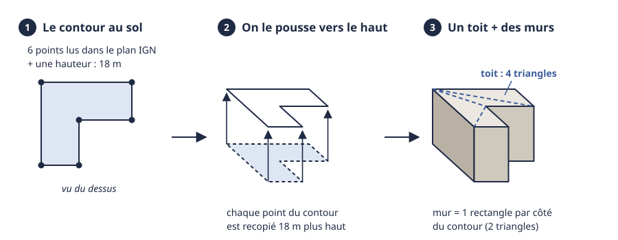
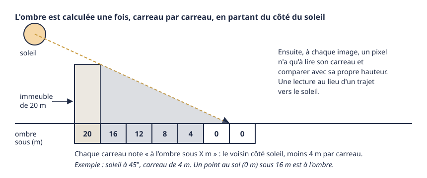
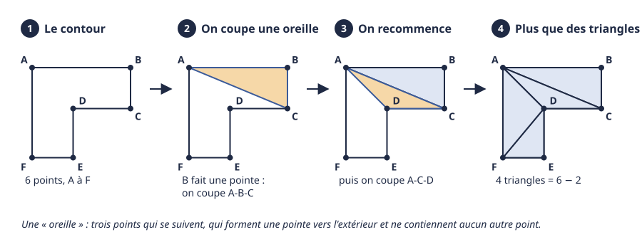
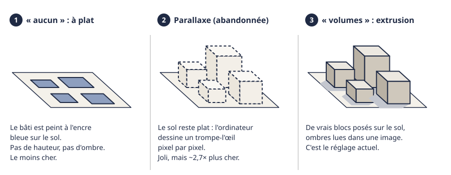

# Construire les bâtiments

> **En une phrase :** on prend le contour de chaque bâtiment dessiné sur le plan de l'IGN, on le pousse vers le haut de sa hauteur, on ferme le dessus avec des triangles, et c'est la carte graphique qui pose le tout sur le relief.

## L'idée

Imaginez un emporte-pièce. Vu du dessus, un bâtiment n'est qu'une forme plate : un rectangle, un L, un carré troué d'une cour. Si vous posez cette forme sur une plaque de pâte à modeler et que vous l'enfoncez de 18 mm, vous obtenez un petit bloc : un dessus (le toit) et des côtés (les murs). C'est exactement ce qu'on fait, en remplaçant les millimètres par des mètres. Le nom savant de ce geste est l'[extrusion](../glossaire.md#extrusion) : pousser un contour plat pour lui donner de l'épaisseur.

Le plan de l'IGN (l'Institut géographique national, qui fait les cartes officielles de France) nous donne les deux ingrédients : le contour au sol de chaque bâtiment (une suite de points) et sa hauteur en mètres. Il ne reste qu'à fabriquer le bloc. Un ordinateur ne sait pas dessiner un « toit en forme de L ». Il ne sait dessiner que des triangles. Il faut donc découper chaque toit en triangles : c'est la [triangulation](../glossaire.md#triangulation).

Le résultat est volontairement une maquette d'architecte : des blocs couleur argile, toits plats, sans fenêtres. La carte doit rester un dessin, pas une ville de jeu vidéo.

Une fois le bloc fabriqué, il reste à le poser sur les collines. C'est le travail d'un [shader](../glossaire.md#shader) : un petit programme que la carte graphique (la puce de l'ordinateur qui dessine l'image) exécute pour chaque point, des millions de fois par seconde.

## Comment ça marche, en gros

1. **On récupère le plan.** La carte charge le plan de l'IGN par [tuiles](../glossaire.md#tuile) : des carrés de carte téléchargés un par un, comme les carreaux d'un carrelage. Plus le niveau de zoom est grand, plus les tuiles sont petites et détaillées. Pour le bâti, on prend celles du niveau 15. À ce niveau, le tour de la Terre est coupé en 32 768 tuiles. À la hauteur de Paris, ce tour ne fait plus que 26 400 km environ (on est loin de l'équateur, le cercle est plus petit) : 26 400 km ÷ 32 768 ≈ 800 m de côté par tuile. Dans chaque tuile, la couche du bâti donne, pour chaque bâtiment, son contour et sa hauteur. Quand la hauteur manque (environ 8 % des bâtiments à Paris), on prend 9 m, un immeuble bas.

2. **On travaille en coulisses.** Tout le calcul qui suit est fait par un [worker](../glossaire.md#worker) : un second cuisinier qui prépare les plats dans l'arrière-cuisine pendant que le premier continue de servir. L'image ne se fige pas pendant qu'on fabrique une ville.

3. **On découpe au bord de la tuile.** Un bâtiment à cheval sur deux tuiles est coupé net par le bord du carré, comme une feuille qu'on rogne aux ciseaux. Les points de coupe tombent pile sur le bord, ce qui permet de les reconnaître ensuite : on ne mettra pas de mur le long d'une coupe, sinon on verrait une cloison au milieu du bâtiment.

4. **On découpe le toit en triangles.** C'est la méthode « des oreilles » (voir le croquis plus bas). On cherche trois points qui se suivent sur le contour et qui forment une pointe vers l'extérieur, sans qu'aucun autre point ne soit dedans : c'est une oreille. On la coupe, ce qui donne un triangle, et le contour a un point de moins. On recommence jusqu'à ce qu'il ne reste que des triangles. Un contour de *n* points donne toujours *n* − 2 triangles : un rectangle en donne 2, notre L de 6 points en donne 4. Les cours intérieures (des trous dans le toit) sont gérées par la même méthode : un bâtiment carré avec une cour carrée, c'est 8 points et 8 triangles.

5. **On prépare les murs.** Chaque côté du contour devient un mur. Plutôt que de fabriquer des milliers de murs différents, on fabrique **un seul** rectangle (4 [sommets](../glossaire.md#sommet), c'est-à-dire 4 coins, et 2 triangles) et on dit à la carte graphique : « dessine-le une fois par côté, voici les deux extrémités de chacun ». C'est l'[instanciation](../glossaire.md#instanciation), le principe du tampon encreur : un seul tampon, mille empreintes. Un immeuble rectangulaire coûte donc 4 points pour le toit et 4 empreintes du rectangle pour les murs.

6. **On range tout de façon compacte.** Une position n'est pas notée avec tous ses chiffres après la virgule, mais comme un cran sur une règle graduée de 65 536 crans (un nombre « 16 bits », en langage informatique). Sur une tuile de 800 m, un cran vaut 800 m ÷ 65 536 ≈ 1,2 cm. Les hauteurs utilisent la même règle, posée sur 0 à 512 m : un cran vaut environ 8 mm. C'est largement assez précis, et ça prend deux fois moins de place qu'un nombre ordinaire.

7. **C'est le shader qui pose les bâtiments.** On ne fabrique la tuile qu'une fois. Quand la vue bouge, on ne la reconstruit pas : on donne seulement au shader 4 nombres, qui disent où se trouve la tuile dans la vue et à quelle taille. Pour chaque sommet, le shader calcule où il tombe, lit l'altitude du relief à cet endroit et y pose le pied du bâtiment. C'est la même logique que pour le sol (voir [Construire le terrain](./terrain.md)) : on déplace les coordonnées sous la vue, pas les objets. Pour qu'un bâtiment posé sur une pente ne laisse pas voir le jour sous lui, ses murs descendent sous le sol de la moitié de leur hauteur.

8. **Les ponts.** Le plan ne contient pas de ponts en volume, seulement des routes et des chemins marqués « sur ouvrage ». Chaque tronçon devient un rectangle de la largeur de la route (4 m pour un chemin), prolongé d'une demi-largeur à chaque bout pour que les tronçons se recouvrent dans les virages. On l'extrude comme un bâtiment, mais en l'air : un tablier de 4,5 m à 7 m au-dessus du sol ou de l'eau.

9. **L'argile et la lumière.** Les blocs ont une couleur d'argile claire, mate. Pour savoir quel côté est au soleil et quel côté est sombre, on ne regarde pas les faces du bloc : on lit une image des hauteurs du bâti, la même qui sert aux ombres (point suivant). Cette image arrive un peu après les blocs. En attendant, on éclaire simplement les faces du bloc, puis on passe en fondu (0,7 s) à l'éclairage lu dans l'image. Pourquoi ce détour ? Une image a des pixels, donc ses contours sont un peu irréguliers, plus proches d'un dessin à la main. Et l'étape qui trace les traits d'encre (voir [Le dessin](../dessin.md)) retrouve ainsi les mêmes contours sur le sol et sur les blocs.

10. **Les ombres.** Le worker peint les hauteurs de tous les bâtiments dans une [texture](../glossaire.md#texture) : une image dont chaque pixel (on dira « carreau ») contient un nombre au lieu d'une couleur, ici une hauteur de 0 à 255 m. Puis il la parcourt une seule fois, en partant du côté du soleil. Chaque carreau reprend l'ombre de son voisin côté soleil, moins ce que le rayon de soleil descend d'un carreau à l'autre. Il note ainsi, pour chaque carreau, « ici, tout ce qui est sous X m est à l'ombre » (voir le croquis). Une image de 2 048 × 2 048 carreaux, soit plus de 4 millions de hauteurs, se traite en quelques dizaines de millisecondes. Ensuite, à chaque image, un pixel du sol ou d'un mur n'a qu'une lecture à faire.

11. **L'apparition au zoom.** Le bâti n'existe qu'en vue rapprochée. Au-dessus de 8 km de largeur de vue, rien ne dépasse du sol : sur un écran de 1 600 pixels, un pixel couvre alors 5 m, et un immeuble de 10 m ne ferait que 2 pixels. Entre 8 km et 5 km, les bâtiments montent peu à peu. Sous 5 km, ils sont à pleine hauteur. Quand une nouvelle tuile arrive, ses bâtiments sortent du sol en 1,4 seconde pour toute la tuile. Ils ne partent pas tous ensemble : chacun attend un peu, plus ou moins selon l'endroit où il se trouve (jusqu'à 0,7 s), puis monte en 0,7 s, vite d'abord, puis en douceur. Ils se colorent en même temps, par taches, comme un coup de crayon. Au plus 2 nouvelles tuiles sont ajoutées par image affichée, pour qu'une rafale d'arrivées ne fasse pas saccader.

12. **Moins de travail au loin et hors du dessin.** Hors de la zone dessinée (l'ellipse qui entoure le point visé), les bâtiments se replient sur le sol, comme le reste du dessin s'efface. Au loin, les plus petits (moins de 10 m de haut, valeur réglable dans le panneau de réglages de la carte) se replient sur leur centre : leurs triangles n'ont plus de surface et ne coûtent presque rien. En mode nuit, il n'y a pas d'ellipse : les volumes restent partout.

## Pourquoi on a fait comme ça

- **Construire une fois, déplacer pour rien.** Fabriquer les triangles d'une tuile prend du temps. Le faire une seule fois par tuile, dans le worker, puis la déplacer avec 4 nombres, permet de bouger la caméra sans jamais rien reconstruire. C'est ce qui garde la carte fluide.
- **Le tampon pour les murs.** Les murs sont tous des rectangles. Un seul rectangle réutilisé est plus léger en mémoire qu'un mur fabriqué pour chaque côté de chaque bâtiment.
- **Une triangulation déjà fournie.** La méthode des oreilles est livrée avec three.js, la boîte à outils 3D du projet (c'est la version d'Earcut, écrite par l'entreprise de cartes Mapbox). Elle est rapide, robuste et gère les cours. Pas besoin de la réécrire.
- **Des ombres cuites plutôt que calculées en direct.** Le soleil ne bouge pas pendant qu'on regarde. Calculer l'ombre une fois et la ranger dans une image coûte quelques dizaines de millisecondes, au lieu d'un calcul refait 60 fois par seconde ou plus.
- **Une image des hauteurs qui sert à tout.** La même image donne les ombres, l'éclairage des blocs et le petit creux sombre au pied des murs. Tout reste cohérent, et l'encre trouve les mêmes contours partout.

## Ce qu'on aurait pu faire autrement

Le panneau de réglage propose deux variantes du bâti, et une troisième a existé.

- **« aucun » : la carte à plat.** Les bâtiments restent peints à l'encre bleue sur le sol, comme sur un plan imprimé. Pas de hauteur, pas d'ombre, rien à fabriquer : c'est le moins cher. On perd la lecture de la ville en relief, qui est justement ce qu'on veut montrer en vue rapprochée. La variante reste utile pour comparer ou pour une machine faible.
- **La parallaxe : un trompe-l'œil sur un sol plat.** C'était la première technique du projet. Le sol restait parfaitement plat, et le shader, pour chaque pixel, lançait un rayon dans l'image des hauteurs pour trouver le premier toit traversé, comme un peintre qui dessine un relief sur un mur lisse. Le rendu était très beau, mais le calcul se faisait sur chaque pixel du sol, même là où il n'y avait aucun bâtiment. Les vrais volumes donnent la même image pour environ 2,7 fois moins de travail de la carte graphique : la parallaxe a été retirée. Son rayon n'a pas disparu : c'est lui qui lit l'image des hauteurs pour éclairer les volumes (point 9), mais il ne fait plus que 4 pas, en partant juste au-dessus du bloc (voir [la parallaxe](../glossaire.md#parallaxe) au glossaire).
- **« volumes » : la vraie extrusion.** C'est le réglage actuel, décrit dans ce chapitre.

D'autres pistes, non retenues pour un POC (un prototype, fait pour prouver que l'idée marche, pas pour être fini) :

- **Des bâtiments 3D détaillés, avec des toits en pente.** Il existe des jeux de bâtiments en 3D plus fins, avec la forme des toits. Ce sont des données beaucoup plus lourdes à télécharger, et une maquette à toits plats suffit pour une carte dessinée. Fabriquer soi-même des toits à deux pans à partir d'un contour est possible (méthode du « squelette droit »), mais c'est une méthode de calcul délicate, trop longue à écrire pour un prototype. À la place : des toits plats, et l'encre qui suggère le reste.
- **Des ombres classiques, recalculées à chaque image.** C'est ce que fait un jeu vidéo : la scène est redessinée depuis le soleil à chaque image. C'est plus souple (le soleil peut tourner), mais bien plus coûteux. Notre soleil est fixe : on n'en a pas besoin. Si un jour le soleil devait bouger, ce serait la piste à prendre.
- **Fusionner les tuiles.** Aujourd'hui, chaque tuile envoie son toit, ses murs, ses arbres et ses voitures séparément : en ville, cela fait des centaines d'ordres « dessine ceci » envoyés à la carte graphique pour chaque image, et chaque ordre a un coût fixe. Regrouper les tuiles en quelques gros paquets serait plus efficace, mais il faudrait savoir retirer une tuile du milieu d'un paquet quand elle sort de la vue : trop de travail pour un prototype.
- **En production**, on préparerait les tuiles de bâtiments à l'avance sur un serveur (un ordinateur distant) plutôt que dans le navigateur de chaque visiteur. On en ferait plusieurs versions, de plus en plus simples pour le lointain. Et on ne dessinerait que les tuiles réellement dans le champ de la caméra.

## Limites actuelles

- Tous les toits sont plats. Sur une forte pente, un toit peut être très légèrement penché, car chaque sommet est posé sur le relief sous lui.
- Une hauteur manquante devient 9 m, quel que soit le bâtiment.
- L'image des hauteurs (ombres, éclairage) note les hauteurs au mètre près et s'arrête à 255 m : une tour plus haute y est écrêtée. Les blocs eux-mêmes montent jusqu'à 512 m.
- L'ombre portée s'arrête au bout de 24 carreaux de l'image des hauteurs : une très longue ombre (soleil bas, tour isolée) est coupée net.
- Les ponts ont tous la même hauteur, sans piles ni rampes, et se chevauchent dans les virages.
- Un bâtiment coupé par le bord d'une tuile devient deux morceaux, chacun avec son propre centre : ils peuvent apparaître ou se replier légèrement à des moments différents.
- Les tuiles sont choisies large (la vue plus 25 % de chaque côté) et toutes envoyées à la carte graphique, même celles qui sortent du champ de la caméra. Au plus 400 tuiles restent en mémoire.
- L'éclairage de l'argile, qui relit l'image des hauteurs pixel par pixel, est la partie la plus coûteuse du bâti.

## Où c'est dans le code

| Étape | Fichier | Rôle |
|---|---|---|
| Réglages d'apparition (8 km, 5 km), marge, cache | [buildings.config.ts](../../src/graphics/config/buildings.config.ts) | les seuils et tailles |
| Découpe au bord, toits, murs, ponts, image des hauteurs, ombre cuite | [Buildings.ts](../../src/graphics/terrain/Buildings.ts) | la fabrication, sans affichage |
| Travail en coulisses, envoi des tuiles prêtes | [Landcover.worker.ts](../../src/graphics/terrain/Landcover.worker.ts) | le second cuisinier |
| Choix des tuiles, apparition, tri, variante en service | [Buildings.node.ts](../../src/graphics/nodes/buildings/Buildings.node.ts) | le chef d'orchestre |
| Réception de l'image des hauteurs et de l'ombre cuite | [Landcover.helper.ts](../../src/graphics/nodes/terrain/Landcover.helper.ts) | le passeur entre worker et carte graphique |
| Réglages du panneau (« aucun » / « volumes », hauteur, simplifier au loin) | [Main.universe.ts](../../src/graphics/universes/impl/Main.universe.ts) | les boutons |
| Pose sur le relief, montée, argile, repli au loin | [Buildings.material.ts](../../src/graphics/materials/Buildings.material.ts) | le shader des blocs |
| Bâti dessiné à plat, ombre reçue par le sol, éclairage lu dans les hauteurs | [Terrain.material.ts](../../src/graphics/materials/Terrain.material.ts) | la partie bâti du shader du sol |
| Valeurs actuelles du panneau (variante « volumes ») | [debug.values.json](../../src/graphics/config/debug.values.json) | le réglage en service |
| Tests de la découpe et de l'ombre | [Buildings.test.ts](../../tests/graphics/terrain/Buildings.test.ts) | vérifications automatiques |

## Pour aller plus loin

- [Earcut, la triangulation par oreilles de Mapbox](https://github.com/mapbox/earcut) : le code et les explications de la méthode utilisée.
- [Polygon triangulation (Wikipédia, en anglais)](https://en.wikipedia.org/wiki/Polygon_triangulation) : la méthode des oreilles et ses cousines, avec des schémas.
- [Shadow mapping (Wikipédia, en anglais)](https://en.wikipedia.org/wiki/Shadow_mapping) : la technique d'ombre « classique » des jeux vidéo, celle qu'on n'a pas prise.
- Sutherland et Hodgman, « Reentrant Polygon Clipping », 1974 : l'article d'origine de la découpe d'un contour par un carré.
- Policarpo, Oliveira et Comba, « Real-Time Relief Mapping on Arbitrary Polygonal Surfaces », 2005 : la base de la parallaxe abandonnée, dont le rayon éclaire encore les volumes.
