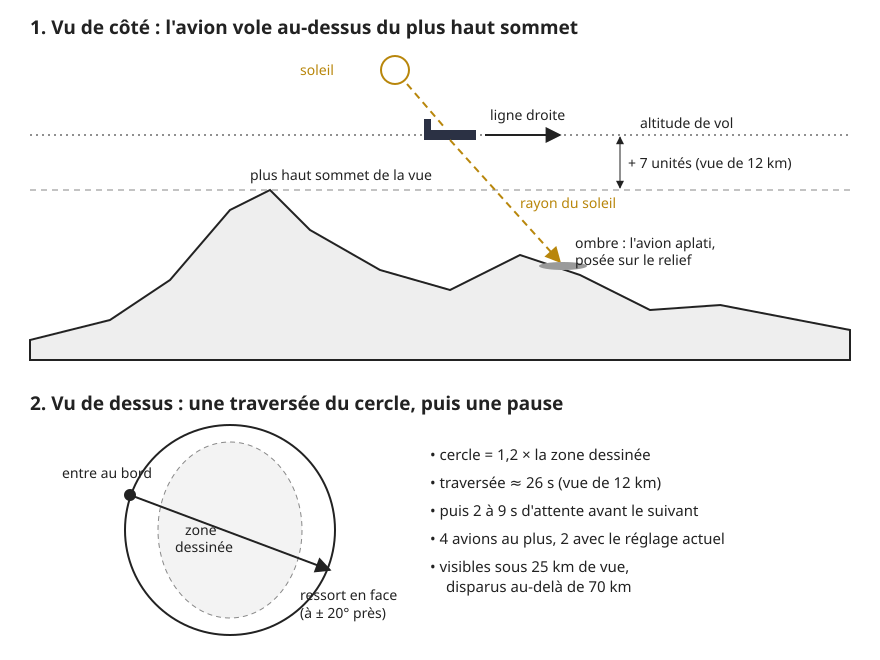
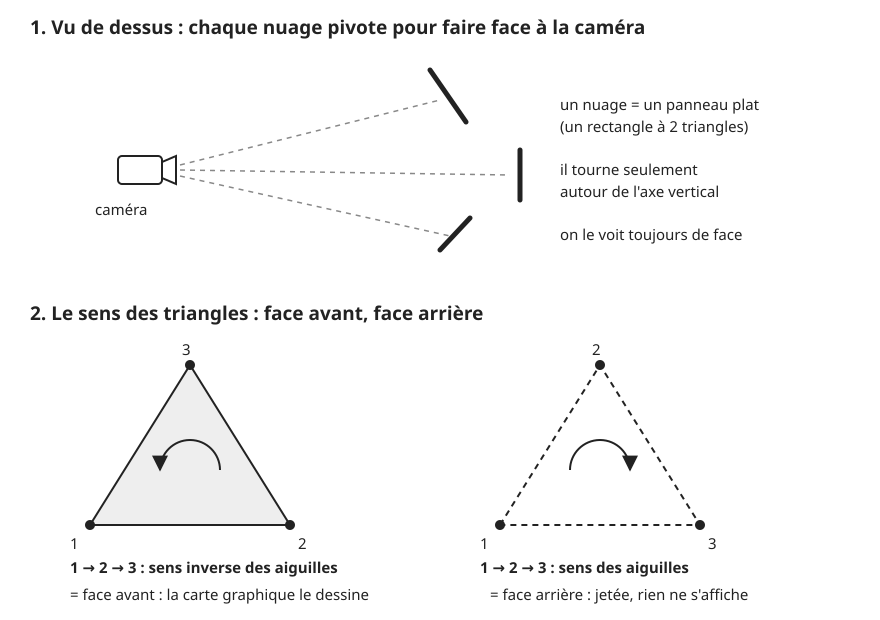
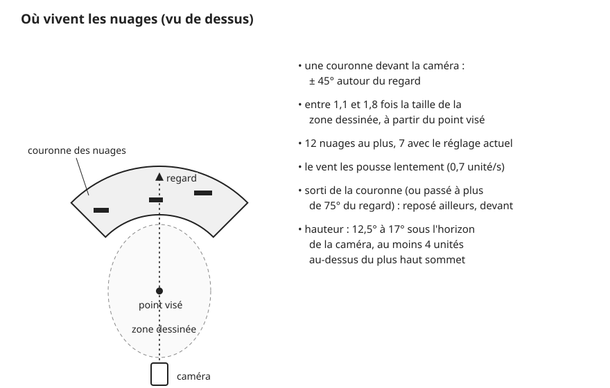

# Le ciel : avions et nuages

> **En une phrase :** quelques avions en boîtes traversent la carte en ligne droite avec leur ombre au sol, et une poignée de nuages dessinés à l'encre, peints sur des panneaux plats qui se tournent vers nous, flottent juste au-dessus de l'horizon.

## L'idée

Le ciel ne sert pas à faire joli. Il sert à deux choses : donner l'**échelle** (un avion qui passe dit « ceci est grand ») et donner de la **vie** (une image où rien ne bouge ressemble à une capture d'écran).

Pense à une maquette de train. On n'y met pas une vraie météo. On colle un nuage peint sur un carton derrière le décor, et on suspend un petit avion à un fil. De loin, ça marche. C'est exactement ce qu'on fait :

- **Les avions** sont de petites maquettes : quatre boîtes collées (le corps, les ailes, et deux pièces de queue : une petite aile à plat et un aileron debout). Ils volent au-dessus du plus haut sommet, en ligne droite, et leur ombre glisse sur le relief. L'ombre est ce qui fait comprendre leur hauteur.
- **Les nuages** sont des cartons peints. Un dessin de nuage à l'encre est collé sur un rectangle plat, et ce rectangle pivote pour toujours nous faire face. On ne voit jamais sa tranche, donc on ne devine jamais que c'est plat. C'est ce qu'on appelle un [panneau face caméra](../glossaire.md#panneau-face-caméra).

Avions et nuages suivent la carte : quand tu la fais glisser, ils glissent avec elle. Quand tu zoomes, les avions grandissent avec elle ; les nuages, eux, gardent leur taille mais s'écartent ou se rapprochent avec la carte. Ils vivent « sur la carte », pas « sur l'écran ». C'est la même logique que le terrain, où ce sont les coordonnées qui défilent sous une vue fixe (voir [Construction du terrain](./terrain.md)).

## Comment ça marche, en gros

### Les avions

1. **On fabrique un seul avion.** Quatre boîtes sont fusionnées en une seule forme : un corps de 1 unité de long, des ailes de 1 unité d'un bout à l'autre, et les deux pièces de queue. Une *unité*, c'est la mesure de longueur de la scène 3D, comme le centimètre d'une maquette. Le tout est agrandi 3,2 fois. Cette forme est envoyée une seule fois à la carte graphique (la puce de l'ordinateur qui fabrique les images).
2. **On le dessine 4 fois au plus.** Chaque avion est une [instance](../glossaire.md#instanciation) : la même forme, posée à un endroit différent, comme un tampon qu'on appuie plusieurs fois. Avec le réglage actuel (« avions » à 0,5), on en montre 4 × 0,5 = **2**.
3. **Il attend, puis il part.** Au début, le premier avion attend 0,5 s, le deuxième 4,5 s. Quand son tour vient, il entre au bord d'un cercle un peu plus grand que la zone dessinée (1,2 fois sa taille) et vise le côté opposé, à environ ± 20° près pour ne pas passer toujours par le centre.
4. **Il traverse en 26 secondes (vue de 12 km).** Sa vitesse est réglée pour parcourir le diamètre du cercle en 26 s quand la vue fait 12 km de large ; à d'autres zooms, ce temps change (voir le point 6). Dès qu'il dépasse le bord, il disparaît et attend entre 2 et 9 s, puis repart d'ailleurs.
5. **Il vole au-dessus du plus haut sommet.** Son altitude, c'est la hauteur du plus haut relief de la vue (montagnes étirées en hauteur pour mieux se voir : c'est l'[exagération du relief](../glossaire.md#exagération-du-relief)), plus une marge de 7 unités pour une vue de 12 km (la marge suit le zoom, comme la taille). Il ne peut donc jamais traverser une montagne.
6. **Sa taille suit le zoom.** Tout est réglé pour une vue de 12 km de large. À 24 km de large, l'avion est 2 fois plus petit, et 2 fois plus lent : il met 52 s à traverser. À 6 km, 2 fois plus grand (13 s de traversée). Plus près que 6 km, on n'agrandit plus : la caméra ne recule pas quand on zoome, et un avion énorme lui foncerait dessus.
7. **Il s'efface à grande échelle.** Un avion de la taille d'une ville n'a pas de sens sur une carte de pays. Sous 25 km de vue, tous les avions prévus sont là ; entre 25 et 70 km, leur nombre baisse ; au-delà de 70 km, plus aucun. Comme le nombre est arrondi, avec 2 avions prévus on passe à 1 vers 36 km et à 0 vers 59 km.
8. **On pose son ombre.** On part de l'avion et on suit le rayon du soleil jusqu'au sol. Le calcul : on mesure la hauteur entre l'avion et le sol, on la divise par la pente du rayon, et on recule d'autant dans la direction du soleil. À cet endroit, on pose la même forme d'avion, écrasée à 2 % de son épaisseur, en gris, 0,05 unité au-dessus du relief. Si le soleil est presque couché (trop bas), l'ombre se met simplement sous l'avion.
9. **Il s'efface hors de la zone dessinée.** Comme le reste de la carte, l'avion fond dans le papier quand il sort de l'ellipse dessinée (le cadre ovale où la carte est tracée). En mode nuit, cet effacement est coupé.
10. **Il garde l'image vivante.** Quand rien ne bouge, l'application ne redessine l'image que 15 fois par seconde pour économiser la machine. Tant qu'un avion vole, elle passe à 30. Les voitures, les bateaux et le vent dans les arbres font de même ; comme le vent est allumé par défaut (réglage « vent » à 1), en pratique l'image est déjà à 30 : l'avion compte surtout quand on coupe le vent.

### Pourquoi un avion peut devenir invisible : le sens des triangles

Tout objet 3D est fait de [triangles](../glossaire.md#triangle). Chaque triangle a un recto et un verso. Pour gagner du temps, la carte graphique ne dessine que le recto : le verso d'un objet fermé est de toute façon caché derrière, inutile de le peindre. C'est le [tri des faces arrière](../glossaire.md#face-arrière).

Comment sait-elle quel côté est le recto ? Par l'**ordre** de ses trois coins. Si, vus depuis la caméra, les coins 1 → 2 → 3 tournent dans le sens inverse des aiguilles d'une montre, c'est le recto. Dans l'autre sens, c'est le verso, et le triangle est jeté sans un bruit.

Le piège : certaines opérations **retournent** cet ordre sans qu'on le voie.

- Un **miroir** (agrandir par un nombre négatif) inverse tous les triangles. L'objet entier passe au verso et disparaît.
- Construire une forme en mesurant ses positions comme sur l'**écran** fait pareil : sur l'écran, on compte les hauteurs vers le bas ; dans la scène, vers le haut. La forme est alors retournée comme dans un miroir. C'est arrivé sur ce projet avec les noms de lieux : tout était juste, rien ne s'affichait. Deux séances perdues. La correction : demander à la carte graphique de peindre aussi le verso des noms de lieux.

Les avions évitent le piège. Ce sont des boîtes fermées : de n'importe où, on voit des faces recto. Et l'ombre est écrasée par un nombre positif (0,02), pas par un miroir : l'ordre des coins ne change pas. Si un jour quelqu'un écrase l'ombre avec -0,02 « pour la retourner », elle disparaîtra.

### Les nuages

1. **On dessine 4 nuages, une fois.** Au premier moment où le navigateur n'a rien à faire (au plus tard après 3 s), le programme dessine lui-même une grande [texture](../glossaire.md#texture) (une image posée sur un objet) de 4 096 × 512 pixels. Elle contient 4 nuages côte à côte, chacun dans une case de 1 024 × 512 pixels, soit 524 288 pixels par nuage.
2. **Un nuage = des bulles.** Chaque nuage est un tas de cercles qui se chevauchent : une rangée basse sur toute la largeur, 2 à 4 bulles plus hautes au milieu. La base est plate, comme un vrai cumulus.
3. **On l'éclaire, puis on le hachure.** Le soleil vient d'en haut à gauche. Pour chaque pixel, on regarde de quel côté de sa bulle il se trouve : face au soleil, il est clair ; à l'opposé ou sous le nuage, il est sombre (c'est l'[éclairage de Lambert](../glossaire.md#éclairage-de-lambert)). Puis on traduit cette ombre en traits horizontaux légèrement ondulés, un tous les 0,32 unité : dans l'ombre, des traits épais et continus ; dans la lumière, des traits fins et rompus ; tout au bord, rien. Pas de contour. C'est la manière des graveurs.
4. **On colle chaque dessin sur un panneau.** Il y a 12 panneaux. Chacun reçoit au hasard l'un des 4 dessins. Un panneau mesure 100 × 24 unités à pleine taille, puis entre 50 % et 100 % de ça. Avec le réglage actuel (« nuages » à 0,6), on en montre 12 × 0,6 ≈ **7**.
5. **On les place devant la caméra.** Les nuages vivent dans une **couronne** autour du point que tu regardes : entre 1,1 et 1,8 fois la taille de la zone dessinée, et seulement dans un éventail de ± 45° devant la caméra. Pas tout autour : pour en voir deux, il en faudrait des dizaines.
6. **On règle leur hauteur sur l'horizon.** Chaque nuage se tient entre 12,5° et 17° sous l'horizon de la caméra, la bande de ciel qu'on voit juste au-dessus de la carte. Calcul : une pente de 12,5° descend de 22 pas quand on avance de 100 (0,22). Un nuage à 150 unités de la caméra (mesurées à plat) et à 12,5° sous l'horizon se tient donc 150 × 0,22 ≈ 33 unités sous l'œil. Plus il est loin, plus il descend. Jamais à moins de 4 unités au-dessus du plus haut sommet, pour ne pas sortir d'une montagne.
7. **Ils se tournent vers nous.** À chaque image, chaque panneau pivote pour faire face à la caméra, comme une porte qui tourne sur ses gonds. Il tourne seulement de gauche à droite : le nuage reste debout, il ne bascule pas vers le ciel.
8. **Le vent les pousse.** Ils dérivent lentement, 0,7 unité par seconde, toujours dans la même direction. Quand un nuage sort de la couronne, ou quand tu as tourné la vue et qu'il se retrouve à plus de 75° de ton regard, il est reposé ailleurs, devant.
9. **Ils sont à l'encre.** Le nuage est peint de la couleur de l'encre, et on ne garde que les pixels où le trait est assez fort. Le réglage « traits des nuages » ne change donc pas la teinte : il change le **nombre de traits** gardés. Pourquoi pas un gris ? Parce que la passe de dessin (l'étape finale qui transforme l'image 3D en gravure) rend les tons clairs au papier : un nuage gris disparaîtrait (voir [Le dessin à l'encre](../dessin.md)).
10. **Pas de cadre autour.** La passe de dessin trace un contour partout où la distance à la caméra saute d'un coup, comme au bord d'un objet. Autour d'un panneau, ça dessinerait un rectangle dans le ciel. Les nuages portent donc une étiquette qui lui dit : pas de contour ici.

## Pourquoi on a fait comme ça

- **Le style d'abord.** La carte est une gravure. Un ciel photographique casserait tout. Des nuages hachurés comme dans un vieil atlas, et des avions en silhouettes simples, restent dans le dessin.
- **Presque gratuit.** 2 avions, 2 ombres et 7 rectangles : grâce au tampon des instances, la carte graphique ne reçoit que trois commandes de dessin, et la texture n'est calculée qu'une fois. Le projet vise 120 images par seconde ; le ciel ne doit rien coûter.
- **Toujours lisible.** Voler au-dessus du plus haut sommet et garder les nuages au-dessus du relief évite les objets qui traversent les montagnes. Effacer les avions à grande échelle évite les avions-villes.
- **L'ombre dit la hauteur.** Sans elle, un avion au-dessus d'une carte ressemble à un insecte sur l'écran. Avec elle, l'œil comprend tout de suite qu'il vole.
- **Les nuages sont reproductibles, les avions non.** Les nuages utilisent un [générateur pseudo-aléatoire](../glossaire.md#générateur-pseudo-aléatoire) (un tirage au sort qui redonne toujours la même suite si on part du même nombre, la *graine*) avec une graine fixe : au chargement, les mêmes dessins et les mêmes places de départ, ce qui aide à comparer deux réglages. Les nuages reposés ensuite dépendent du moment où chacun sort de la vue. Pour les avions, on a pris le hasard du navigateur, plus simple.

## Ce qu'on aurait pu faire autrement

| Alternative | Pourquoi on ne l'a pas fait | En production |
| --- | --- | --- |
| **Nuages en volume** (calculés comme une vraie fumée, en traversant un brouillard pixel par pixel) | Très coûteux, et le résultat est photographique, pas gravé. Hors sujet pour un dessin. | Non, sauf changement de style. |
| **Une bande de ciel peinte tout autour de la scène**, comme un décor de théâtre circulaire | Il faut un décor très long, et les nuages ne bougent pas en profondeur quand on se déplace. La texture garde d'ailleurs une trace de cette idée : elle se raccorde d'un bord à l'autre. | Possible en fond, derrière les panneaux. |
| **Nuages dessinés par un illustrateur** (images fichiers) | Plus beaux, mais il faut les commander, les charger, et ils ne suivent pas les réglages. Le code dessine les 4 nuages et le papier en environ 100 ms. | Oui, probablement : une planche de 10-20 nuages dessinés. |
| **Vrais avions en direct** (positions publiques des vols) | Dépend d'un service extérieur, de son débit, de sa disponibilité. Trop pour un POC (un prototype qui sert à prouver une idée) dont le but est l'image. | À étudier si le projet raconte le trafic aérien. |
| **Modèle 3D détaillé d'avion** | Fichier à charger, plus de triangles, et un niveau de détail qui jure avec le dessin. | Une silhouette un peu plus fine suffirait. |
| **Vraie ombre portée** (la scène vue depuis le soleil, technique dite *shadow map*) | Il faut dessiner la scène une deuxième fois à chaque image. Notre ombre « à la main » ne coûte qu'une mesure de hauteur. | Seulement si les montagnes doivent cacher l'ombre. |
| **Panneaux qui basculent aussi vers le haut** | Vu de haut, le nuage se coucherait comme un tapis. Pivoter seulement à la verticale le garde debout. | On garde ainsi. |

## Limites actuelles

- **Les nuages ne sont que devant.** Si tu fais un demi-tour rapide, ils réapparaissent d'un coup devant toi.
- **Bords nets.** Un pixel de nuage est gardé ou jeté, sans demi-transparence. De près, le bord peut paraître en escalier.
- **Seulement 4 dessins.** Avec 7 nuages, on voit parfois deux fois le même.
- **L'ombre traverse le relief.** Elle est posée là où tombe le rayon, sans vérifier qu'une montagne est sur le chemin.
- **Les avions vont tout droit.** Pas de virage, pas de montée ni de descente.
- **Les avions ne se répètent pas.** Leurs départs changent à chaque chargement : impossible de refaire exactement la même vidéo.
- **Le dessin des nuages prend du temps une fois.** Environ 100 ms de calcul au premier moment libre, partagés avec la texture de papier. Avant, le ciel est vide.

## Où c'est dans le code

| Étape | Fichier | Rôle |
| --- | --- | --- |
| Forme, vol, ombre, effacement des avions | [Planes.node.ts](../../src/graphics/nodes/sky/Planes.node.ts) | Maquette en boîtes, traversées, ombre projetée selon le soleil |
| Placement, vent, orientation des nuages | [Clouds.node.ts](../../src/graphics/nodes/sky/Clouds.node.ts) | 12 panneaux dans la couronne, tournés vers la caméra |
| Dessin des 4 nuages hachurés | [InkStyle.ts](../../src/graphics/postprocessing/effects/InkStyle.ts) | Texture calculée au premier moment libre (bulles, éclairage, traits) |
| Masque de la zone dessinée, hauteur du relief, soleil | [Terrain.material.ts](../../src/graphics/materials/Terrain.material.ts) | Réglages partagés que lisent avions et nuages |
| Création du ciel, cadence 15 / 30 images par seconde, réglages du panneau | [Main.universe.ts](../../src/graphics/universes/impl/Main.universe.ts) | Branche avions et nuages, lie « avions », « nuages », « traits des nuages » |
| Le piège du sens des triangles, côté noms de lieux | [Label.material.ts](../../src/graphics/materials/Label.material.ts) | Exemple corrigé : dessin des deux côtés |

## Pour aller plus loin

- three.js, documentation des instances : [InstancedMesh](https://threejs.org/docs/#api/en/objects/InstancedMesh).
- three.js, quel côté des triangles est dessiné : [Material.side](https://threejs.org/docs/#api/en/materials/Material.side).
- LearnOpenGL, le tri des faces et l'ordre des coins expliqués pas à pas : [Face culling](https://learnopengl.com/Advanced-OpenGL/Face-culling).
- Park et Miller, « Random number generators: good ones are hard to find » (Communications of the ACM, 1988) : le générateur utilisé pour les nuages.
