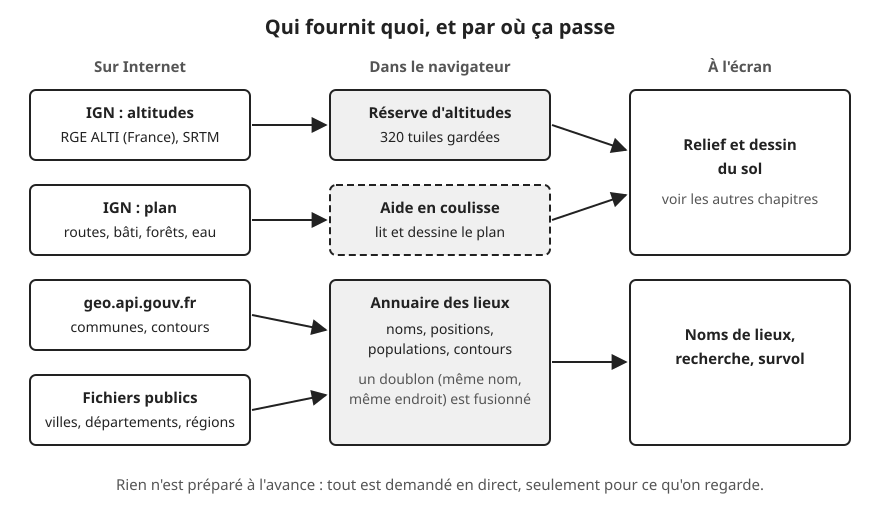
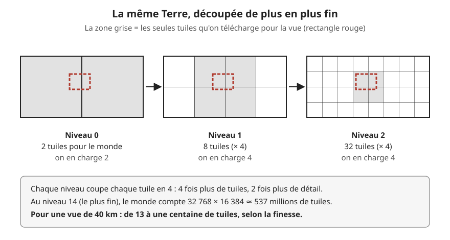
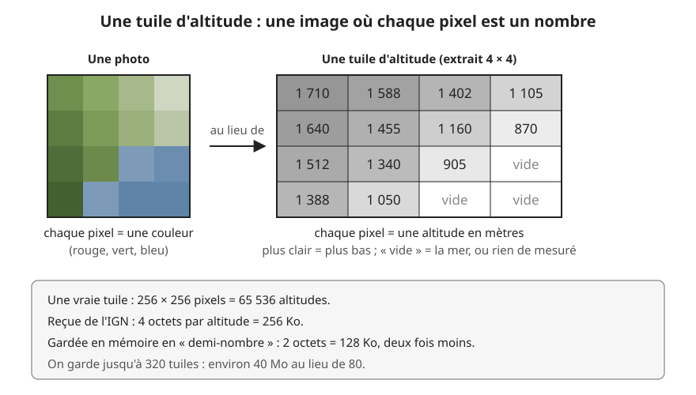

# D'où viennent les données

> **En une phrase :** la carte ne contient aucune donnée à l'avance ; à chaque mouvement, elle demande en direct à l'IGN et à quelques services publics les morceaux de France qu'on regarde, les garde un moment en mémoire, et jette le reste.

## L'idée

Imagine un atlas géant de la France, si détaillé qu'on y verrait chaque maison. Il ferait des millions de pages. Personne ne l'imprime en entier : on photocopie seulement la page de l'endroit qu'on visite, et on la range dans un classeur pour ne pas la refaire si on revient.

La carte fait exactement ça. L'« atlas », ce sont des serveurs publics (des ordinateurs qui répondent aux demandes venues d'Internet : ceux de l'IGN, de l'État, ou qui hébergent des fichiers ouverts à tous). Les « pages », ce sont des **[tuiles](../glossaire.md#tuile)** (des carrés de carte découpés à l'avance par le fournisseur). Le « classeur », c'est le **[cache](../glossaire.md#cache)** (une réserve en mémoire des tuiles déjà reçues).

On a besoin de trois sortes d'informations :

1. **Le relief** : à quelle hauteur est chaque point du sol.
2. **Le plan** : où sont les routes, les maisons, les forêts, l'eau.
3. **Les lieux** : le nom des villes et communes, leur population, leur contour.

## Comment ça marche, en gros

### 1. Le découpage en tuiles et en niveaux

Le monde est découpé en carrés, à plusieurs **[niveaux de zoom](../glossaire.md#niveau-de-zoom)** (des échelles de découpage, du plus grossier au plus fin). À chaque niveau, chaque carré est recoupé en 4. Donc 4 fois plus de tuiles, chacune 2 fois plus détaillée.

Les chiffres pour le relief de l'IGN :

- niveau 0 : 2 tuiles couvrent la Terre entière ;
- niveau 9 : 1 024 × 512 = un demi-million de tuiles, chacune d'environ 39 km de haut ;
- niveau 14 (le plus fin) : 32 768 × 16 384, soit environ 537 millions de tuiles.

On ne demande jamais tout un niveau. On calcule quelles tuiles touchent la vue (plus une marge d'un quart de sa largeur de chaque côté), et on ne demande que celles-là. Les niveaux grossiers partent en premier, le détail ensuite ; dans chaque niveau, on commence par le centre (là où l'œil regarde) et on finit par les bords. Pour une vue de 40 km, cela fait de 13 à une centaine de tuiles en tout, selon la finesse.

### 2. Le relief : une image dont les pixels sont des nombres

Une tuile d'altitude ressemble à une image de 256 × 256 pixels. Mais au lieu d'une couleur, chaque pixel contient un nombre : l'altitude en mètres. Cela fait 256 × 256 = 65 536 altitudes par tuile.

Deux sources, toutes deux servies par la Géoplateforme de l'IGN :

- **RGE ALTI**, très précis (jusqu'à un point tous les 5 m environ), seulement en France métropolitaine et en Corse, du niveau 6 au niveau 14 ;
- **SRTM**, une mesure du monde entier faite depuis l'espace (de 56° sud à 61° nord), moins précise (un point tous les 76 m au mieux), du niveau 1 au niveau 10.

La règle est simple : en France, on demande d'abord RGE ALTI. S'il reste des trous (la mer, un pays voisin, une zone non mesurée), on les bouche avec SRTM. Hors de France, on prend directement SRTM. Au-delà du niveau 10, SRTM n'a plus rien à donner : les trous restent, et c'est l'aperçu plus grossier (plus bas) qui les comble. La mer arrive avec une valeur absurde (−99 999 m) : on la marque « vide ».

Quel niveau choisir ? On prend celui dont l'écart entre deux pixels ressemble à l'écart entre deux sommets (un [sommet](../glossaire.md#sommet) = un point de la grille 3D du sol, voir [Construction du terrain](./terrain.md)). La grille compte de 256 à 1 024 cases de côté selon le relief : peu en plaine, beaucoup en montagne ou sur une côte. Avec une vue de 40 km et 256 cases, deux sommets sont à 40 000 / 256 ≈ 156 m ; au niveau 9, deux pixels sont à environ 153 m : on prend le niveau 9. Avec 1 024 cases, les sommets sont à 39 m : on prend le niveau 11 (38 m).

En plus de ce niveau « détail », on charge un **aperçu** 3 niveaux plus grossier (le niveau 6 ou 8 dans ces deux exemples) sur une zone trois fois plus large, et quelques niveaux encore plus grossiers. Ainsi, s'il manque une tuile de détail, il y a toujours quelque chose de moins précis en dessous. Le sol n'est jamais plat ni troué, juste flou un instant.

### 3. Le plan : une recette de dessin plutôt qu'une image

Pour les routes et les bâtiments, l'IGN envoie des **[tuiles vectorielles](../glossaire.md#tuile-vectorielle)**. Une photo dit « ce pixel est gris ». Une tuile vectorielle dit plutôt « il y a une route départementale qui passe par ces 12 points » ou « un bâtiment de 9 m de haut a ce contour ». C'est une recette : on peut la redessiner à n'importe quelle taille sans flou.

On ne garde que ce qui sert : bâtiments (avec leur hauteur), végétation, eau (surfaces et rivières), routes (avec leur classe et leur sens), chemins, et les noms de rues et de rivières.

Le dessin se fait dans une grande image de 2 048 × 2 048 pixels qui couvre 2,5 fois la zone de détail. Exemple à 40 km : 100 km sur 2 048 pixels, soit environ 49 m par pixel. On choisit le niveau de plan qui donne cette finesse (le niveau 10 ici), et on dessine le centre 2 niveaux plus fin (le niveau 12, jamais au-delà du 15), pour se rapprocher des niveaux 14-15, les seuls où l'IGN montre tous les bâtiments.

Ce que devient ce dessin (couleurs du sol, volumes) est expliqué dans [Construction des bâtiments](./batiments.md).

### 4. Les lieux : villes, communes, départements

- **Villes du monde** (Natural Earth) : un fichier ouvert d'environ 7 300 villes, avec la population de l'agglomération. On ne garde que les villes françaises.
- **Communes françaises** (geo.api.gouv.fr, le service de l'État) : quand la vue fait moins de 250 km de large, on pose 9 « sondes » (3 × 3 points) sur la vue et on demande : « dans quel département est ce point ? ». Pour chaque nouveau département, on télécharge une seule fois la liste de ses communes : 10 à 100 Ko, au lieu de 3,9 Mo pour la France entière.
- **Contour d'une commune** : demandé seulement au survol de la souris, une commune à la fois.
- **Départements et régions** : un fichier ouvert déjà simplifié (96 départements en 556 Ko, 13 régions en 220 Ko), car le service de l'État ne fournit pas leur contour.

Tous ces lieux vont dans un même annuaire, trié du plus peuplé au moins peuplé. Si deux sources donnent le même nom à moins de 0,25° en longitude comme en latitude (une vingtaine de kilomètres), c'est le même lieu : on garde la plus grande population et on fusionne ce que chacun sait (code de commune, contour). Pour les départements et régions, qui n'ont pas de population, on les classe par leur superficie.

### 5. Le cache : ne jamais télécharger deux fois

Pour le relief, on garde jusqu'à **320 tuiles** en mémoire. Quand la réserve est pleine, on oublie celle qu'on a regardée il y a le plus longtemps (comme un classeur où l'on jette la page la plus poussiéreuse). Une vue fine en demande une centaine : si on revient sur l'une des dernières vues, tout est déjà là.

Si la vue bouge avant qu'une tuile arrive, on annule sa demande : inutile de recevoir une page qu'on ne lira plus. Au plus 6 demandes partent en même temps vers l'IGN. Si une demande échoue, on réessaie après 0,3 s puis 0,9 s, et on abandonne une tentative au bout de 10 s. En cas d'échec final, la tuile est notée vide et l'aperçu grossier la remplace.

Le plan a son propre classeur, mesuré en poids plutôt qu'en nombre (une tuile de ville pèse environ 1,5 Mo une fois lue) : jusqu'à 96 Mo de tuiles lues et 160 Mo de dessins prêts.

### 6. Le travail en coulisse

Lire une tuile vectorielle et dessiner des milliers de routes prend du temps. Si on le faisait au même endroit que le dessin de la 3D, l'image se figerait à chaque nouvelle tuile.

On confie donc ce travail à un **[worker](../glossaire.md#worker)** (un aide qui travaille en parallèle, dans les coulisses du navigateur, sans toucher à l'écran). Il télécharge (jusqu'à 16 tuiles à la fois : d'abord les volumes des bâtiments, puis le centre détaillé, puis le reste), lit, dessine, puis renvoie l'image finie. La nouvelle image se fond dans l'ancienne en 1 seconde. Pour ne pas saturer la carte graphique (la puce de l'ordinateur qui fabrique l'image), une nouvelle demande part au plus toutes les 0,2 s (0,6 s pendant un déplacement).

### 7. Les demi-nombres : deux fois moins de mémoire

Un octet est la plus petite case de mémoire d'un ordinateur. L'IGN envoie chaque altitude sur 4 octets : une tuile pèse 256 Ko (kilo-octets). On la convertit en **[demi-flottant](../glossaire.md#demi-flottant)** (un nombre à virgule rangé sur 2 octets au lieu de 4). Une tuile ne pèse plus que 128 Ko, et les 320 tuiles du cache environ 40 Mo (mégaoctets, mille fois plus que le Ko) au lieu de 80.

Le prix à payer : moins de précision. Entre 1 024 et 2 048 m, un demi-flottant avance par pas de 1 m. Entre 2 048 et 4 096 m, par pas de 2 m. Au sommet du mont Blanc, par pas de 4 m. Sur une carte dessinée à l'encre, c'est invisible. La carte graphique sait lire ce format directement.

### 8. Passer des degrés aux kilomètres

Les données parlent en longitude et latitude (des degrés). La scène 3D parle en kilomètres. On fait la conversion la plus simple. 1° de latitude (vers le nord) vaut environ 111 km partout. 1° de longitude (vers l'est) rétrécit à mesure qu'on monte vers le pôle, comme les quartiers d'une orange qui se resserrent vers la queue : 111 km à l'équateur, environ 80 km au mont Aigoual (44° nord), le point de départ. Le calcul de ce rétrécissement se fait avec un outil de géométrie, le cosinus. Le calcul est exact au centre de la vue et dérive un peu vers les bords, sans que ça se voie à l'échelle d'une vue de quelques dizaines de kilomètres.

## Pourquoi on a fait comme ça

- **Tout en direct, rien de préparé** : pas de serveur à nous, pas de fichiers à fabriquer ni à héberger. Pour un POC (un prototype qui sert à prouver qu'une idée marche), on démarre la carte et elle marche partout en France. Les données sont aussi toujours à jour.
- **Seulement le visible** : télécharger la France entière en RGE ALTI ne tiendrait ni dans le navigateur ni dans la patience de quiconque. Avec les tuiles, une vue coûte au plus une centaine de tuiles, qu'on regarde un village ou une région.
- **L'IGN d'abord** : c'est la meilleure source en France, gratuite et ouverte. SRTM couvre le reste du monde pour que la carte ne s'arrête pas net à la frontière.
- **Un aperçu sous le détail** : le pire défaut visuel serait un trou ou un sol plat qui « saute » quand la tuile arrive. Avec l'aperçu, on voit d'abord un relief flou, puis il s'affine.
- **Le worker** : l'objectif du POC est une image fluide. Le dessin du plan est le travail le plus lourd, il part donc en coulisse.
- **Notre propre lecteur de tuiles vectorielles** : on lit seulement les quelques informations utiles, sans ajouter de bibliothèque (du code tout fait, écrit et partagé par d'autres).

## Ce qu'on aurait pu faire autrement

- **Préparer nos propres tuiles.** On télécharge une fois l'IGN, on fabrique des tuiles compactes (relief et plan déjà fusionnés, déjà dans la bonne grille), et on les sert depuis notre hébergement. Résultat : plus rapide, plus léger, et indépendant de l'IGN. Pas fait : il faut une chaîne de fabrication, du stockage et des mises à jour. Trop lourd pour un POC. **En production, c'est ce qu'on ferait**, au moins pour la France.
- **Des altitudes rangées dans des images compressées** (certains fournisseurs codent l'altitude dans les couleurs d'un PNG). Téléchargement plus léger. Pas fait : l'IGN sert ses altitudes en nombres bruts, et les convertir demanderait justement de préparer nos tuiles. À faire en même temps que le point précédent.
- **Un cache qui survit au rechargement** (le navigateur peut garder des fichiers sur le disque d'un jour à l'autre). Revenir sur la carte serait instantané. Pas fait : le cache en mémoire suffit pendant une visite, et un cache permanent pose des questions de taille et de péremption.
- **Un relais entre nous et l'IGN** (un serveur intermédiaire qui garde les tuiles pour tous les visiteurs). Protège des pannes et des limites de débit. Pas fait : il n'y a pas de serveur dans ce POC.
- **Une bibliothèque toute faite pour lire les tuiles vectorielles.** Plus robuste face aux cas rares. Pas fait : notre lecteur est court et ne lit que ce qui sert, donc plus léger à charger. À reconsidérer si le format évolue ou si on a besoin d'autres informations.
- **Charger toutes les communes de France d'un coup** (3,9 Mo). Plus simple, recherche complète partout. Pas fait : par département, on ne paie que ce qu'on regarde.

## Limites actuelles

- **Pas d'Internet, pas de carte.** Si l'IGN est lent ou en panne, le relief reste flou et le plan n'arrive pas.
- **Le cache s'efface au rechargement de la page.**
- **Couverture inégale** : RGE ALTI s'arrête à la métropole et à la Corse ; SRTM ne va pas au-delà de 61° nord ; les contours de départements et de régions ne couvrent que la métropole.
- **Deux grilles différentes** : le relief est découpé en longitude/latitude, le plan de l'IGN dans une autre grille (celle des cartes web, dite Mercator, qui aplatit la Terre d'une autre façon : ses carrés ne tombent pas sur ceux du relief). Le worker doit donc redessiner le plan pour qu'il se superpose exactement au relief, comme on recalque un dessin sur un fond de carte différent. Ça coûte du calcul.
- **Le bâti n'est complet qu'à partir des niveaux 14-15** : en vue très large, on ne peut pas dessiner chaque maison.
- **Des fichiers tiers sans version figée** : les contours de départements et régions viennent d'un fichier partagé publiquement sur Internet, lu tel qu'il est le jour de la visite ; si son auteur le modifie, la carte change sans prévenir.
- **Précision des demi-nombres** : pas de 2 à 4 m en haute montagne. Invisible ici, gênant si on voulait mesurer.

## Où c'est dans le code

| Étape | Fichier | Rôle |
|---|---|---|
| Relief : demande à l'IGN | [IgnElevationProvider.ts](../../src/graphics/terrain/IgnElevationProvider.ts) | RGE ALTI puis SRTM, trous, 6 demandes max, nouvelles tentatives |
| Relief : cache | [TileCache.ts](../../src/graphics/terrain/TileCache.ts) | 320 tuiles, oubli des plus anciennes, annulation |
| Relief : demi-nombres | [HalfFloat.ts](../../src/graphics/terrain/HalfFloat.ts) | conversion 4 octets → 2 octets |
| Relief : choix des tuiles | [TerrainHeights.helper.ts](../../src/graphics/nodes/terrain/TerrainHeights.helper.ts) | niveaux détail et aperçu, ordre du centre vers les bords |
| Relief : assemblage | [HeightMosaic.ts](../../src/graphics/terrain/HeightMosaic.ts) | choix du niveau, tuiles recollées en une image |
| Grilles et degrés → km | [GeoProjection.ts](../../src/graphics/terrain/GeoProjection.ts) | conversion, tuiles qui couvrent une zone |
| Plan : lecture | [VectorTile.ts](../../src/graphics/terrain/VectorTile.ts) | lecteur maison des tuiles vectorielles |
| Plan : couches et niveaux | [Landcover.ts](../../src/graphics/terrain/Landcover.ts) | adresse IGN, couches gardées, niveau du plan, dessin d'une tuile |
| Plan : travail en coulisse | [Landcover.worker.ts](../../src/graphics/terrain/Landcover.worker.ts) | téléchargement, priorités, classeurs en Mo, dessin |
| Plan : côté carte | [Landcover.helper.ts](../../src/graphics/nodes/terrain/Landcover.helper.ts) | envoie les demandes, reçoit et fond les images |
| Lieux : sources | [PlaceSources.ts](../../src/graphics/places/PlaceSources.ts) | Natural Earth, communes par département, contour au survol |
| Lieux : départements, régions | [AdminAreas.ts](../../src/graphics/places/AdminAreas.ts) | fichiers simplifiés, classement par superficie |
| Lieux : annuaire | [PlaceIndex.ts](../../src/graphics/places/PlaceIndex.ts) | tri, fusion des doublons, recherche |
| Lieux : contours | [Rings.ts](../../src/graphics/places/Rings.ts) | lecture des contours, « ce point est-il dedans ? » |
| Lieux : survol | [AreaMask.helper.ts](../../src/graphics/places/AreaMask.helper.ts), [AreaAccents.helper.ts](../../src/graphics/places/AreaAccents.helper.ts) | contour survolé posé sur le sol |
| Sondes de départements | [FrenchCommunes.helper.ts](../../src/graphics/nodes/labels/FrenchCommunes.helper.ts) | 3 × 3 sondes, un département une seule fois |
| Réglages | [terrain.config.ts](../../src/graphics/config/terrain.config.ts) | taille du cache, marges, niveau max |

## Pour aller plus loin

- [Géoservices de l'IGN](https://geoservices.ign.fr) : la Géoplateforme, ses couches d'altitude (RGE ALTI) et le Plan IGN.
- [Slippy map tilenames, wiki OpenStreetMap](https://wiki.openstreetmap.org/wiki/Slippy_map_tilenames) : le calcul des tuiles et des niveaux de zoom dans la grille des cartes web (celle du plan), avec exemples.
- [Mapbox Vector Tile Specification](https://github.com/mapbox/vector-tile-spec) : le format des tuiles vectorielles.
- [API Découpage administratif](https://geo.api.gouv.fr) : communes, départements, régions.
- [Natural Earth](https://www.naturalearthdata.com) : les données ouvertes de villes du monde.
