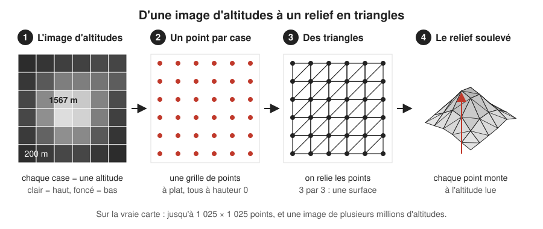
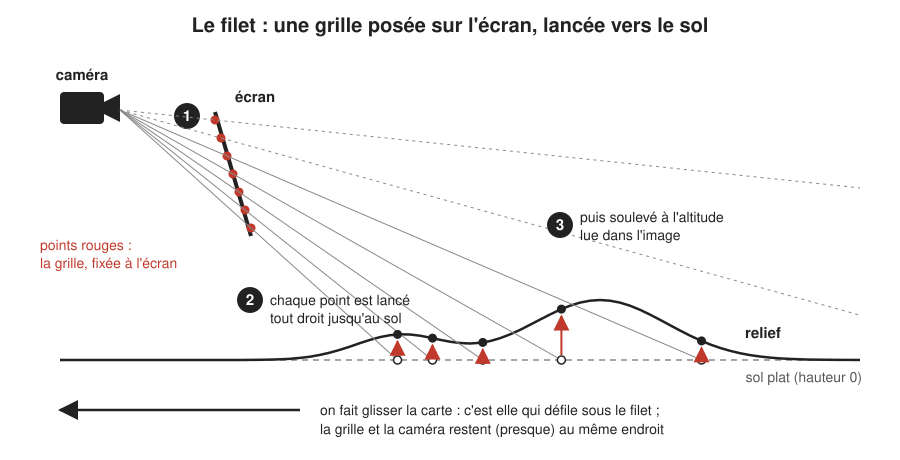
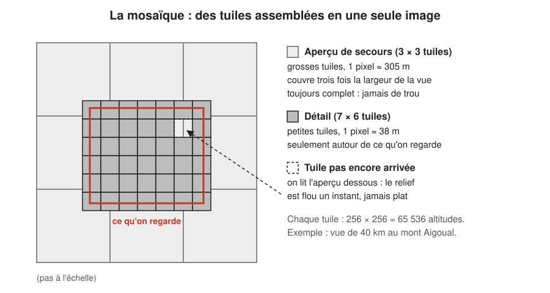
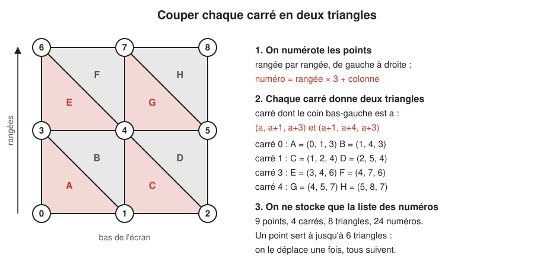
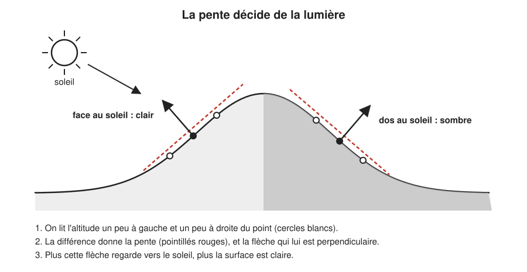
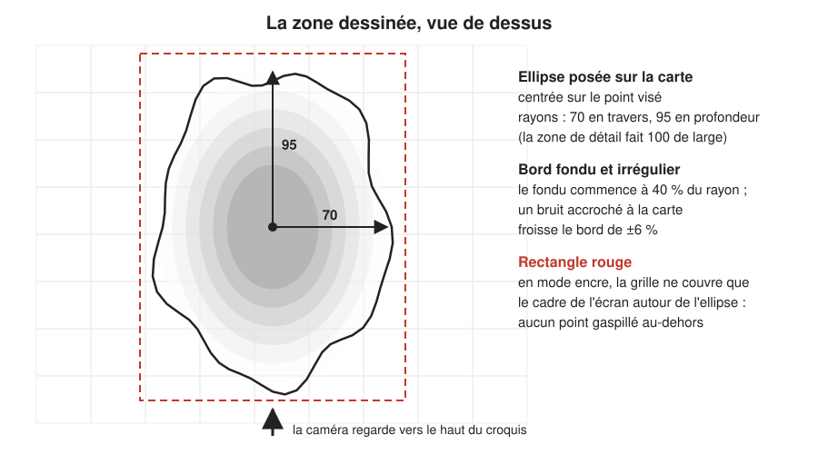

# Construire le terrain : d'une image d'altitudes à un relief en triangles

> **En une phrase :** on télécharge des images où chaque pixel est une altitude, on pose sur l'écran un filet de points, on le lance vers le sol, puis on soulève chaque point à l'altitude lue dans l'image ; les points reliés trois par trois forment la surface du relief.

## L'idée

Imaginez un drap posé à plat sur une table, et sous la table un tampon encreur qui sait dire, pour chaque endroit, « ici, c'est haut de tant ». On pousse chaque point du drap vers le haut de la bonne hauteur : le drap épouse les montagnes. Le terrain de la carte, c'est exactement ça.

Trois ingrédients :

- **Une image d'altitudes.** Une photo en noir et blanc où chaque [pixel](../glossaire.md#pixel) (une case de l'image) ne porte pas une couleur mais une hauteur en mètres. Clair = haut, foncé = bas.
- **Une grille de points.** Les [sommets](../glossaire.md#sommet) (les points de la grille 3D, ceux qu'on va soulever). Au départ, ils sont tous à plat.
- **Des triangles.** On relie les sommets trois par trois. Une carte graphique (le [GPU](../glossaire.md#gpu), le processeur spécialisé dans l'image) ne sait dessiner que des triangles : un relief, pour elle, c'est un tapis de petits triangles.

Le croquis simplifie : sur la vraie carte, un point ne tombe pas pile sur un pixel. Il lit l'image là où il se trouve, en mélangeant les 4 pixels voisins. On s'arrange seulement pour qu'un pixel corresponde à peu près à l'écart entre deux points.

Le point le plus surprenant : **le drap ne bouge pas, c'est la carte qui glisse dessous.** La grille de points est accrochée à l'écran, pas à la France. Quand vous faites glisser la carte vers Montpellier, aucun point ne voyage : chacun relit simplement l'altitude du nouvel endroit qui passe sous lui. La caméra, elle, ne se déplace pas au-dessus de la France ; elle vise toujours le même point de la scène, à la même distance. Elle s'incline selon le zoom, se balance un peu avec la souris et tourne quand on fait pivoter la vue, mais elle reste sur place (voir [la navigation](../navigation.md)).

## Comment ça marche, en gros

### 1. Récupérer les images d'altitudes

Les altitudes viennent de l'IGN (l'Institut national de l'information géographique, qui fait les cartes officielles), en [tuiles](../glossaire.md#tuile) (des carrés d'image qu'on télécharge un par un, comme les dalles d'un carrelage). Chaque tuile fait 256 × 256 pixels, soit **65 536 altitudes**. En France, la source précise descend à environ 5 m par pixel ; ailleurs dans le monde, on se contente d'environ 76 m. D'où viennent ces tuiles et comment on les demande : voir [les données](./donnees.md).

Les tuiles existent en plusieurs tailles, rangées par niveaux, comme les zooms d'un appareil photo : du plus grossier que la carte demande (le monde entier en 8 tuiles) jusqu'à des tuiles d'environ 1 km de côté. On choisit la taille où **un pixel vaut à peu près l'écart entre deux points de la grille**. Exemple au mont Aigoual, vue large de 40 km, grille de 1 024 cases : 40 km ÷ 1 024 ≈ 39 m entre deux points, donc on prend les tuiles où un pixel vaut 38 m.

### 2. Assembler la mosaïque

Une seule tuile ne couvre pas la vue : on en colle plusieurs bord à bord pour faire une seule grande image, la [mosaïque](../glossaire.md#mosaïque). Il y en a deux, superposées :

- **le détail** (on parlera ensuite de « zone de détail ») : les tuiles fines qui couvrent ce qu'on regarde, plus une marge de 5 % (on télécharge à l'avance un quart de vue de plus de chaque côté). Dans l'exemple : 7 × 6 = 42 tuiles, une image de 1 792 × 1 536 pixels, soit 2,75 millions d'altitudes ;
- **l'aperçu de secours** : une version floue, trois niveaux plus grossière au mieux (1 pixel ≈ 305 m), trois fois plus large que la vue, et **toujours complet** : si ses tuiles ne sont pas toutes arrivées, on descend d'un niveau, et un trou est bouché avec la tuile parente agrandie. Dans l'exemple : 3 × 3 tuiles.

Quand une tuile du détail n'est pas encore arrivée (réseau lent, mer, trou dans les données), on lit l'aperçu à cet endroit. Le relief est flou un instant, mais il n'est jamais plat.

### 3. Poser la grille de points

La grille est un carré de cases, posé sur l'écran comme une feuille de papier millimétré. Avec N cases de côté, il y a (N + 1) × (N + 1) points et 2 × N × N triangles (chaque case est coupée en deux) :

| Cases de côté | Points | Triangles |
|---|---|---|
| 256 | 257 × 257 = 66 049 | 131 072 |
| 512 | 513 × 513 = 263 169 | 524 288 |
| 1 024 | 1 025 × 1 025 = 1 050 625 | 2 097 152 |

Le réglage actuel autorise jusqu'à 1 024 cases. La grille déborde un peu de l'écran (4 % de chaque côté, 30 % en bas, 2 % en haut) : le relief qui monte ou la caméra qui se balance ne doivent jamais laisser voir son bord.

La finesse s'adapte à ce qu'on regarde. Quand la vue s'arrête, on mesure si le terrain est bosselé (une grille de 17 × 17 altitudes testées) : un plateau reçoit 256 cases, un relief moyen 512, une montagne 1 024. Dès qu'une côte traverse la vue, c'est 1 024, car le trait de côte se dessine sur les points de la grille. Le nombre de points change donc, mais seulement à l'arrêt, jamais pendant un déplacement.

### 4. La triangulation : relier les points

[Trianguler](../glossaire.md#triangulation), c'est découper une surface en triangles. Sur une grille régulière, c'est simple :

1. **On numérote les points** rangée par rangée, de gauche à droite, en partant du bas de l'écran : numéro = rangée × (nombre de points par rangée) + colonne.
2. **Chaque carré donne deux triangles.** Si le coin bas-gauche du carré porte le numéro *a*, et qu'il y a *n* points par rangée, les triangles sont (*a*, *a*+1, *a*+*n*) et (*a*+1, *a*+*n*+1, *a*+*n*).
3. **On ne stocke que la liste des numéros**, trois par triangle. Un point est partagé par jusqu'à six triangles : on le soulève une seule fois, et tous ses triangles suivent sans se décoller.

Exemple avec 3 × 3 points (*n* = 3) :

Pour la vraie grille de 1 024 cases : 2 097 152 triangles × 3 = 6,3 millions de numéros. L'ordre des trois numéros compte. Un triangle a un endroit et un envers, comme une feuille, et la carte graphique ne dessine que les triangles qui nous montrent leur endroit. C'est le sens dans lequel on lit les trois coins (comme les aiguilles d'une montre, ou à l'inverse) qui dit quel côté est l'endroit. Ici, tous tournent dans le même sens à l'écran : tous font face à la caméra.

### 5. Lancer le filet vers le sol, puis soulever

Tout ce qui suit se passe dans le [shader](../glossaire.md#shader) (le petit programme que le GPU exécute pour chaque point, des millions de fois en parallèle). Pour chaque point :

1. On part de sa place sur l'écran et on trace une ligne droite depuis la caméra, à travers ce point, jusqu'au sol plat (hauteur 0). Comme un projecteur qui projette la grille sur le plancher.
2. On repère l'endroit touché sur la mosaïque. C'est une simple règle de trois : la vue couvre un rectangle connu de longitudes et de latitudes.
3. On lit l'altitude à cet endroit : le détail s'il est là, sinon l'aperçu. La mer est ramenée à 0 m (on ne dessine pas le fond marin), puis descendue d'un cran (0,3 unité) sous la côte pour qu'on la voie plus basse que la terre.
4. On soulève le point de cette altitude, convertie en unités de la scène. Une unité, c'est la règle graduée de notre maquette 3D : une mesure arbitraire, qui ne vaut pas un nombre fixe de mètres.

Le soulèvement est **exagéré exprès**, sinon tout paraîtrait plat : vue de loin, une montagne de 1 500 m sur 40 km de carte, c'est une bosse de moins de 4 % de la largeur. La zone de détail (ce qu'on regarde) mesure toujours 100 unités de large, quel que soit le zoom. À 40 km de large, 1 unité vaut 400 m au sol, et 1 m d'altitude devient 0,00625 unité, soit 2,5 fois plus haut que la réalité (l'exagération choisie dans le panneau de réglages vaut 2,5). Si le point le plus bas de la vue est à 300 m, le sommet de l'Aigoual (1 567 m) monte de 1 267 × 0,00625 ≈ 8 unités, 8 % de la largeur de la vue.

Deux corrections :

- **On mesure depuis le point le plus bas de la vue**, pas depuis la mer. Le socle du relief reste à la même place, à l'Aigoual comme dans l'Himalaya.
- **L'exagération grandit avec le dézoom, mais moins vite que lui** (elle suit la racine carrée de la largeur : 15 fois plus large, à peu près 4 fois plus d'exagération). À 600 km de large, elle passe à 2,5 × √(600 ÷ 40) ≈ 9,7 : sinon, à l'échelle de la France, les Alpes seraient une ride. À l'inverse, à 4 km elle tombe à 2,5 × √(4 ÷ 40) ≈ 0,8 : de près, le relief ne se hérisse pas. Un plafond empêche le relief de dépasser 25 unités, un quart de la vue : les massifs ne deviennent pas des aiguilles.

### 6. Calculer la lumière par la pente

Pour éclairer, il faut savoir de quel côté regarde la pente. Pour chaque point, on lit l'altitude un peu à gauche et un peu à droite (1,5 pixel de chaque côté), puis un peu devant et un peu derrière. Les différences donnent la pente, et la [normale](../glossaire.md#normale) (une flèche perpendiculaire à la surface, qui dit où elle « regarde »). Plus la normale pointe vers le soleil, plus le versant est clair. On le fait une fois par point plutôt qu'une fois par pixel : il y a bien moins de points que de pixels.

Le même principe sert à assombrir les creux : si les alentours sont plus hauts que le point, il est au fond d'une vallée et reçoit moins de lumière. L'encre et les hachures, elles, viennent après : voir [le dessin à l'encre](../dessin.md).

### 7. Découper la zone dessinée : le masque elliptique

La carte ne remplit pas l'écran comme un jeu vidéo : elle est dessinée dans une zone ovale aux bords fondus, comme une illustration sur une page. Ce [masque](../glossaire.md#masque) est une ellipse **posée sur la carte**, centrée sur le point visé, pas un cache collé sur l'écran : elle s'incline avec le terrain.

- un rayon de 70 unités en travers du regard et de 95 en profondeur, soit un ovale de 140 × 190 unités (la zone de détail en fait 100 de large) ;
- bord fondu à partir de 40 % du rayon, froissé de ± 6 % par un bruit (un motif aléatoire mais fixe, comme le grain d'un papier) accroché à la carte, pour que le bord ait l'air dessiné à la main ;
- le code prévoit de l'agrandir en vue large (jusqu'à 3 fois, de 4 km à 600 km de large), mais jamais au-delà de 95 unités du centre, sinon on verrait où le sol s'arrête. Avec la profondeur actuelle de 95, cette limite est déjà atteinte : en pratique, l'ellipse garde la même taille à toutes les échelles.

Bonus : en mode encre (le rendu dessiné par défaut, voir [le dessin à l'encre](../dessin.md)), la grille de points ne couvre que le cadre de l'écran où l'ellipse apparaît. Hors de l'ellipse tout est effacé en papier, inutile d'y gaspiller des points. Ils se resserrent donc sur ce qu'on voit.

Tout ceci vaut pour le rendu à l'encre, le réglage par défaut. Le panneau propose une variante, le mode nuit : pas d'ellipse, pas de cadre resserré, la grille couvre tout l'écran et le sol s'éteint simplement vers le noir entre 95 et 150 unités du centre.

### 8. Le quadrillage des coordonnées

Le quadrillage (méridiens et parallèles, avec leurs coordonnées) est posé sur le relief comme le reste. Son pas (l'écart entre deux lignes) est choisi parmi des valeurs rondes de cartographe, de 15 secondes d'arc (un degré se découpe en 60 minutes, une minute en 60 secondes ; 15 secondes, c'est environ 460 m du nord au sud) à 45 degrés, et il n'y a jamais plus de 6 méridiens sur la largeur de la zone de détail (le sol, trois fois plus large, en porte d'autant plus). Les étiquettes s'écrivent « 3°E », « 3°34′E » ou « 3°34′15″E » selon le pas. Chaque ligne est découpée en 360 petits segments, et chaque segment lit l'altitude sous lui pour épouser le relief.

## Pourquoi on a fait comme ça

- **Un seul filet pour toutes les échelles.** De 2 km à 12 000 km de large, c'est le même filet : seules l'image lue et la conversion changent. Pas de cas particulier « vue région » ou « vue pays ».
- **Tous les points servent l'image.** Le [maillage](../glossaire.md#maillage) (l'ensemble des points et des triangles) n'a rien à cacher hors de l'écran. Comme le filet est accroché à l'écran, ses points sont répartis régulièrement sur ce qu'on voit, au premier plan comme au fond. Un maillage posé au sol, lui, gaspille ses points derrière la caméra ou hors champ.
- **Pas de coutures.** Un terrain découpé en morceaux de finesses différentes crée des fentes là où deux morceaux se touchent. Un filet d'un seul tenant n'en a pas.
- **Le déplacement ne coûte presque rien.** Glisser la carte ne reconstruit rien : on change quelques réglages et le GPU relit les altitudes. Seules les nouvelles tuiles sont téléchargées.
- **L'aperçu de secours évite le « pop »** (un élément qui apparaît ou change d'un coup sous les yeux). Ne jamais montrer un sol plat qui se gonfle brusquement était une priorité du POC (la « preuve de concept », un prototype qui sert à valider l'idée).

## Ce qu'on aurait pu faire autrement

**Un maillage adaptatif « local ».** C'est ce que font les globes 3D (Cesium, Google Earth) : beaucoup de triangles sur une crête, peu sur une plaine, beaucoup près de la caméra, peu au loin. Deux grandes familles :

- **ROAM** : on part de deux grands triangles et on les coupe en deux, encore et encore, là où le relief l'exige. On recommence à chaque image.
- **L'arbre de dalles (en anglais *quadtree*)** : la carte est coupée en 4 carrés, chacun en 4, etc. Près de la caméra on descend dans les petits carrés, au loin on garde les gros. Cesium envoie même des triangles déjà calculés par le serveur.

Pourquoi on ne l'a pas fait : c'est un projet en soi, des semaines de travail pour un POC. Il faut recoudre les bords entre dalles de finesses différentes, gérer l'apparition progressive des dalles, et souvent préparer les données côté serveur. Pour une vue qui reste centrée et inclinée, le filet d'écran donne déjà « plus de points près, moins au loin » sans rien coder. Notre adaptation est plus grossière : toute la grille passe de 256 à 1 024 cases selon la vue. En production, avec des vues rasantes ou des montagnes très découpées, un arbre de dalles de la famille « CDLOD » (des dalles dont la finesse change en douceur avec la distance, sans couture) serait le choix naturel.

**Une grille posée au sol, fixe sur le terrain.** Plus simple à comprendre, et le relief ne « nage » pas (voir les limites). Pourquoi pas : il faut alors la déplacer et la recharger en suivant la vue, et ses points se répartissent mal à l'écran : trop serrés au fond, trop lâches devant.

**Des triangles calculés à l'avance par le serveur.** On télécharge directement un maillage qui suit le relief (peu de triangles en plaine). Très efficace. Pourquoi pas : il faut un serveur qui le fabrique, et l'IGN fournit des images d'altitudes, pas des maillages.

**Pas de triangles du tout pour le détail fin.** Pour le bâti, on peut faire « semblant » de relief en décalant l'image pixel par pixel (la technique dite de parallaxe), sans ajouter un seul triangle. Le POC le propose en variante au panneau : voir [les bâtiments](./batiments.md).

## Limites actuelles

- **Le relief « nage » un peu.** Comme les points restent fixes à l'écran pendant que la carte glisse, un même sommet de montagne est lu par des points différents d'une image à l'autre. Avec une grille lâche, les petits détails ondulent légèrement pendant le mouvement.
- **La finesse change d'un coup.** Le passage de 256 à 1 024 cases se fait à l'arrêt, en une fois : un léger saut est possible à l'arrivée.
- **Les petits triangles coûtent cher.** Le GPU colorie les pixels par paquets de 2 × 2. Quand un triangle ne couvre que quelques pixels, il déborde sur plusieurs paquets et le même calcul est refait plusieurs fois pour rien. Mesure du 20 septembre 2026 : Alpes à 30 km, passer de 256 à 512 cases fait passer le temps de dessin du sol de 23,7 à 48,9 millisecondes par image pour seulement 9 % de pixels changés.
- **La hauteur affichée d'une montagne dépend de ses voisines** : le plafond de 25 unités est calculé sur le relief de toute la vue.
- **Des marches en haute montagne.** Pour gagner de la mémoire, les altitudes sont stockées en nombres « demi-précision », qui prennent deux fois moins de place mais sont moins fins : au-dessus de 4 096 m, ils ne savent compter que de 4 m en 4 m. À très petite échelle, on peut voir des marches.
- **Le cadre de la grille est un rectangle** autour de l'ellipse : ses coins sont calculés pour rien.
- **Le quadrillage choisit son pas d'après la largeur en longitude seulement**, et l'applique aussi aux latitudes.

## Où c'est dans le code

| Étape | Fichier | Rôle |
|---|---|---|
| Réglages (largeur de vue, finesse, plafond, masque) | [terrain.config.ts](../../src/graphics/config/terrain.config.ts) | valeurs de départ |
| Valeurs réellement utilisées | [debug.values.json](../../src/graphics/config/debug.values.json) | exagération 2,5, finesse 1 024 au plus, rayons du masque 70 et 95 |
| 1. Téléchargement des tuiles | [IgnElevationProvider.ts](../../src/graphics/terrain/IgnElevationProvider.ts) | demande les tuiles à l'IGN |
| 1. Grille des tuiles, conversion lon/lat | [GeoProjection.ts](../../src/graphics/terrain/GeoProjection.ts) | quelles tuiles couvrent la vue |
| 1-2. Choix du niveau, mosaïque, trous | [HeightMosaic.ts](../../src/graphics/terrain/HeightMosaic.ts) | colle les tuiles, comble depuis le parent |
| 2. Détail et aperçu, envoi au GPU | [TerrainHeights.helper.ts](../../src/graphics/nodes/terrain/TerrainHeights.helper.ts) | deux mosaïques, priorités de chargement |
| 3-4. Grille et triangles | [GroundGeometry.ts](../../src/graphics/terrain/GroundGeometry.ts) | points, numéros des triangles |
| 3. Finesse adaptative, exagération, cadre de la grille | [Terrain.node.ts](../../src/graphics/nodes/terrain/Terrain.node.ts) | mesure du relief, échelle verticale |
| 5-7. Projection, soulèvement, pente, masque | [Terrain.material.ts](../../src/graphics/materials/Terrain.material.ts) | le shader du sol |
| 8. Pas et étiquettes du quadrillage | [Graticule.ts](../../src/graphics/terrain/Graticule.ts) | valeurs rondes, écriture en degrés |
| 8. Lignes posées sur le relief | [Survey.node.ts](../../src/graphics/nodes/survey/Survey.node.ts) | dessine le quadrillage |

## Pour aller plus loin

- Claes Johanson, « Real-time water rendering – introducing the projected grid concept », mémoire de master, Lund University, 2004 : l'idée du filet accroché à l'écran, inventée pour l'océan.
- Mark Duchaineau et al., « ROAMing Terrain: Real-time Optimally Adapting Meshes », IEEE Visualization, 1997 : le découpage adaptatif en triangles.
- Filip Strugar, « Continuous Distance-Dependent Level of Detail for Rendering Heightmaps » (CDLOD), Journal of Graphics, GPU, and Game Tools, 2009 : le quadtree de terrain qu'on choisirait en production.
- Christian Sigg et Markus Hadwiger, « Fast Third-Order Texture Filtering », GPU Gems 2, 2005 : la lecture lissée de l'aperçu, sans facettes.
- [Documentation three.js : BufferGeometry](https://threejs.org/docs/#api/en/core/BufferGeometry) : comment on donne points et triangles à la carte graphique.
