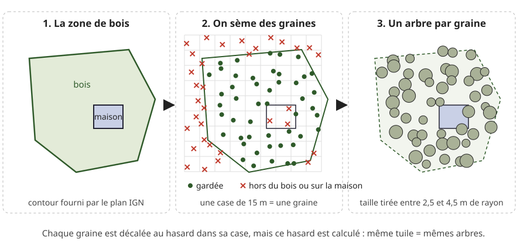
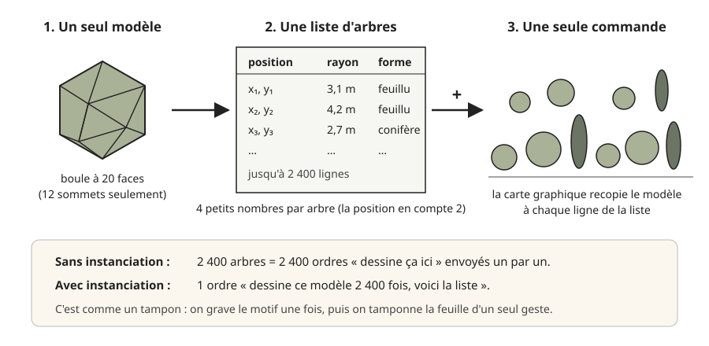
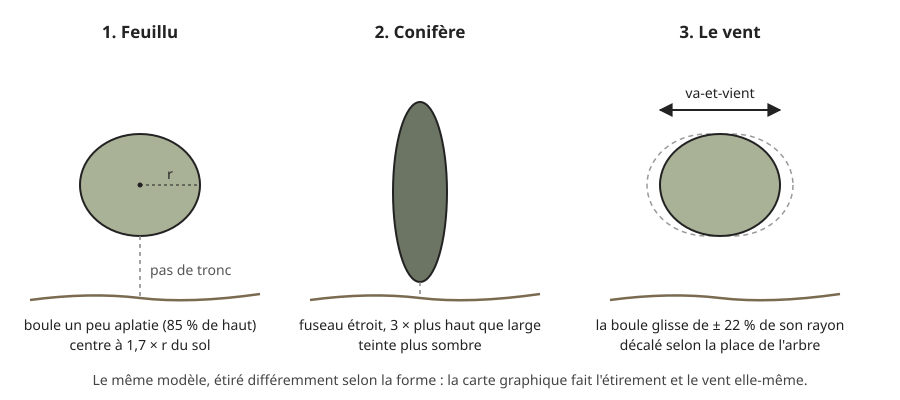

# La végétation : planter des arbres

> **En une phrase :** on prend les zones de bois dessinées sur le plan de l'IGN, on y sème des graines sur une grille un peu bousculée, et la carte graphique tamponne une petite boule verte sur chaque graine, d'un seul geste.

## L'idée

L'IGN (l'institut géographique national, qui fait les cartes officielles de France) publie un plan qui sait où il y a de la forêt, mais il ne connaît pas les arbres un par un. Il fournit seulement des [polygones](../glossaire.md#polygone) (des formes fermées, comme un contour tracé au crayon) qui disent « ici, c'est un bois ». C'est à nous d'inventer les arbres.

Imagine un jardinier devant un terrain délimité par une ficelle. Il trace un quadrillage au sol, plante une graine dans chaque case, mais jamais pile au centre : un peu à gauche, un peu en haut, au hasard. Résultat : c'est régulier (pas de trou, pas de paquet), mais ça ne ressemble pas à un verger aligné. Il ne plante pas sur la cabane du jardin, ni hors de la ficelle.

Le hasard du jardinier a une particularité : il est **calculé**. On ne lance pas de dé, on fait une opération mathématique sur le numéro de la case. La même case donne donc toujours le même décalage. Quand on revient au même endroit de la carte, chaque arbre est exactement là où il était.

Pour les dessiner, on ne fabrique pas 2 400 arbres. On fabrique **un seul** modèle d'arbre et une liste de positions, et on demande à la [carte graphique](../glossaire.md#carte-graphique) (la puce qui dessine l'image) de le recopier partout d'un seul coup. C'est un tampon encreur : on grave le motif une fois, puis on tamponne.

## Comment ça marche, en gros

1. **On découpe la France en tuiles.** Une [tuile](../glossaire.md#tuile) est un carré de carte qu'on télécharge d'un bloc. Plus on zoome, plus les tuiles sont petites et détaillées. Au niveau de zoom utilisé pour les arbres (le niveau 15, celui où l'on voit les rues d'une ville), une tuile fait environ 840 m de côté au milieu de la France. Les arbres sont calculés tuile par tuile.

2. **On lit les zones de végétation.** Dans chaque tuile, le plan de l'IGN livre les contours des parcs, bois, forêts et landes, avec une étiquette. Si l'étiquette dit « conifère », tous les arbres de cette zone seront des sapins ; sinon, des feuillus.

3. **On sème sur une grille de 15 m.** Sur 840 m, ça fait 56 cases par côté, donc au plus 56 × 56 = 3 136 graines si la tuile est entièrement boisée. Chaque graine est décalée au hasard dans sa case (entre 10 % et 90 % de la case), pour ne pas faire de lignes.

4. **On trie les graines.** Une graine qui tombe hors du contour du bois est jetée. Une graine qui tombe sur un bâtiment aussi. Pour ne pas comparer chaque graine à tous les bâtiments de la tuile, on range d'abord les bâtiments dans 16 × 16 casiers, comme un meuble à tiroirs : une graine n'ouvre que le tiroir de son coin et ne regarde que les quelques bâtiments qui s'y trouvent.

5. **On plafonne à 2 400 arbres par tuile.** Si le premier passage compte trop de graines, on agrandit les cases et on recommence. Exemple avec 3 136 graines : pour descendre à 2 400, il faut environ 1,3 fois moins de cases, donc des cases environ 1,14 fois plus larges de chaque côté (1,14 × 1,14 ≈ 1,3). On passe de 15 m à environ 17 m. La forêt s'éclaircit un peu, mais reste uniforme. Ce plafond vaut pour tout ce qu'on plante dans la tuile, buissons compris (étape suivante).

6. **On ajoute quelques buissons ailleurs.** Un terrain vague, sans bois déclaré, resterait une page blanche. On sème donc des buissons, beaucoup plus espacés (une case de 38 m, soit environ 22 × 22 = 484 cases par tuile), seulement là où il n'y a ni bâti, ni eau, ni bois, et à au moins 9 m d'une route ou d'un chemin. Ils passent après les arbres des bois : si la tuile a déjà atteint 2 400 plantations, il n'y a plus de place pour eux.

7. **Chaque arbre tient en 4 nombres** : sa position dans la tuile (deux nombres), le rayon de sa couronne de feuilles (tiré entre 2,5 et 4,5 m, ou entre 1,1 et 2,3 m pour un buisson) et sa forme (feuillu ou conifère). Chaque nombre prend 2 octets (l'octet est l'unité de base de la mémoire ; un texto court en pèse une centaine). Un arbre pèse donc 8 octets, et 2 400 arbres = 2 400 × 8 = 19 200 octets, moins de 20 ko (kilo-octets) par tuile : presque rien.

8. **Tout ce calcul se fait en coulisse.** Un [worker](../glossaire.md#worker) (un assistant qui travaille à côté, sans bloquer l'affichage) télécharge la tuile, sème les arbres et envoie la liste. L'image ne se fige pas pendant ce temps.

9. **La carte graphique tamponne.** Le modèle est une boule à 20 faces triangulaires, appelée icosaèdre (pense à un dé à 20 faces), qui n'a que 12 [sommets](../glossaire.md#sommet) (les coins de la forme). Avec la liste, la carte graphique dessine la boule 2 400 fois en une seule commande : c'est l'[instanciation](../glossaire.md#instanciation) (dessiner plusieurs copies d'un même modèle en un seul ordre). Pour une tuile pleine, ça fait 2 400 × 20 = 48 000 petits triangles, envoyés d'un seul geste.

10. **Un [shader](../glossaire.md#shader) donne à chaque copie sa forme.** Le shader est un petit programme que la carte graphique fait tourner sur chaque sommet, à chaque image. Il lit les 4 nombres de l'arbre, puis :
    - il étire la boule : un feuillu est légèrement aplati (85 % de sa largeur en hauteur), un conifère est un fuseau étroit, environ trois fois plus haut que large (60 % de large, 200 % de haut) ;
    - il la pose sur le relief : il lit l'altitude du sol à cet endroit, comme le fait le terrain lui-même (voir [la construction du terrain](terrain.md)), et soulève la boule de 1,7 rayon (feuillu) ou 2,3 rayons (conifère). Il n'y a pas de tronc : la couronne flotte, et à l'encre ça suffit ;
    - il la fait balancer : la boule glisse à l'horizontale, jusqu'à 22 % de son rayon, sur deux directions à des rythmes un peu différents (un aller-retour dure environ 6 secondes). Le départ de chaque balancement est décalé selon la position de l'arbre : deux voisins ne bougent pas en même temps.

11. **Les arbres poussent quand la tuile arrive.** Ils ne surgissent pas d'un coup : chacun grandit de zéro à sa taille, à son tour, sur 1,4 seconde en tout. La carte n'est dessinée que dans une ellipse autour du lieu regardé (le masque, voir [la construction du terrain](terrain.md)) : hors de cette ellipse, les arbres s'effacent avec le reste.

12. **Ils apparaissent seulement de près.** Les arbres font partie des volumes posés sur la carte, avec les bâtiments (voir [les bâtiments](batiments.md)). Ils commencent à pousser quand la vue fait moins de 8 km de large, et sont entiers sous 5 km. Au-delà, une couronne de 5 à 9 m de large ne ferait qu'un ou deux pixels (les points lumineux de l'écran) : on ne la verrait pas, autant ne pas la dessiner. Le réglage « hauteur du bâti » du panneau de réglages agrandit aussi les arbres.

Un détail souvent mal compris : **le sol aussi montre la végétation, mais par un autre chemin.** Les mêmes contours de bois sont peints dans une [texture](../glossaire.md#texture) (une image de données posée sur le sol), où le vert veut dire « végétation ». Le sol s'en sert pour dessiner des hachures en diagonale, comme sur une carte imprimée. Les arbres en 3D, eux, ne lisent pas cette image : ils partent directement des contours, plus précis.

## Pourquoi on a fait comme ça

- **La grille bousculée** donne une répartition régulière sans motif visible, pour un effort minuscule : un calcul par case, sans avoir besoin de se souvenir de ce qu'on a déjà planté. C'est aussi ce qui rend le résultat stable d'une visite à l'autre.
- **Le hasard calculé** évite de stocker les arbres. On ne garde rien : on recalcule, et on retombe sur les mêmes.
- **Pas d'arbres le long des rues**, même si c'est ce qu'on voit en vrai. La carte doit rester un dessin, pas une maquette. Les alignements donneraient un effet « jeu vidéo ».
- **L'instanciation** est la raison pour laquelle on peut afficher des milliers d'arbres en gardant 120 images par seconde (l'objectif de fluidité du projet). Ce qui ralentit la carte graphique, c'est surtout le nombre d'ordres qu'elle reçoit, pas le nombre de triangles. C'est comme un imprimeur : lancer 2 400 petites commandes d'une affiche lui prend bien plus de temps qu'une seule commande de 2 400 exemplaires. Un ordre par tuile au lieu de 2 400, c'est la différence entre fluide et saccadé.
- **Une boule de 12 sommets** suffit parce que l'encre ne dessine que la silhouette et les hachures de l'ombre. Le shader l'éclaire comme si elle était parfaitement ronde : on ne voit pas ses 20 faces plates.
- **Le balancement dans le shader** : la carte graphique déplace chaque arbre elle-même à chaque image. Le processeur (la puce principale de l'ordinateur, qui fait tourner le reste de l'application) n'a rien à recalculer ni à renvoyer : il reste libre pour le reste.
- **Régler la densité ne coûte rien.** Le curseur « arbres » du panneau de réglages (70 % par défaut) ne refait pas le semis : il demande simplement de tamponner seulement le début de la liste (à 70 %, les 70 premiers arbres sur 100) au lieu de toute la liste. Contrepartie : la liste est rangée zone par zone puis rang par rang, buissons à la fin. Baisser la densité retire donc d'abord tous les buissons, puis les derniers rangs des derniers bois, au lieu d'éclaircir partout.

## Ce qu'on aurait pu faire autrement

- **Un vrai semis « disque de Poisson ».** C'est la méthode de référence pour une répartition naturelle : on pose les arbres un à un, et chaque nouvel arbre doit rester à une distance minimale de tous ceux déjà posés. Plus joli de très près, mais plus lent, et il faut garder en mémoire tous les arbres déjà posés. Pour une carte dessinée vue de haut, la grille bousculée donne à l'œil le même résultat. On ne l'envisagerait que si la caméra descendait au ras des arbres.
- **Des panneaux face caméra.** Beaucoup de jeux dessinent un arbre comme une image plate qui tourne toujours vers le spectateur (un « billboard »). C'est encore moins cher, mais il faut une image d'arbre dessinée à la main, et l'encre aurait du mal à tracer une silhouette nette sur un rectangle transparent. Ici, la vraie boule 3D donne de vrais contours que l'encre suit naturellement.
- **De vrais modèles d'arbres** (tronc, branches, feuillage). C'est ce qu'on ferait pour une vue réaliste, avec des [niveaux de détail](../glossaire.md#niveau-de-détail) (un modèle fin de près, un modèle grossier de loin) pour garder la vitesse. Trop élaboré pour un POC (une maquette qui sert à prouver qu'une idée marche), et contraire au style : on veut un dessin, pas une photo.
- **Utiliser une vraie base d'arbres.** Certaines villes publient gratuitement la liste de leurs arbres de rue, un par un (c'est l'« open data », les données publiques ouvertes). On aurait les arbres exacts, mais ville par ville, chacune avec son propre format. Le plan de l'IGN couvre toute la France d'un coup. En production, on pourrait mélanger les deux : la liste de la ville là où elle existe, le semis ailleurs.
- **Moduler la densité** : plus serré au cœur d'une forêt, plus clairsemé en lisière, avec des clairières. C'est une amélioration réaliste et peu coûteuse pour la suite ; on ne l'a pas faite pour avancer vite.

**Les variantes déjà au panneau :**
- **Bâti « aucun »** : la carte reste à plat, sans volumes. Il n'y a alors pas d'arbres en 3D non plus ; la végétation ne se voit que par les hachures du sol.
- **Bâti « volumes »** (le réglage par défaut) : bâtiments et arbres sont dressés.
- **Mode nuit** : les arbres ne sont plus effacés hors de la zone dessinée, ils restent partout.
- **Densité et vent** : deux curseurs règlent la part d'arbres montrés et la force du balancement.

## Limites actuelles

- **Densité uniforme** : ni lisière, ni clairière, ni sous-bois. Une forêt ressemble à une plantation un peu désordonnée.
- **Le curseur de densité coupe la liste, il n'éclaircit pas** : sous 100 %, les buissons disparaissent en premier et des bandes entières de bois peuvent manquer. Il suffirait de mélanger la liste une fois, en coulisse, avant de l'envoyer, pour que le curseur éclaircisse partout à la fois.
- **Une seule forme par zone** : si l'IGN marque une zone « conifère », elle n'aura que des sapins. Pas de forêt mélangée.
- **Une teinte par forme** : tous les feuillus ont la même couleur, tous les conifères aussi.
- **Même vent pour tous** : même vitesse, même amplitude relative. Seul le décalage dans le temps change.
- **Bords de tuile** : une zone de bois coupée par le bord d'une tuile est semée séparément dans chaque tuile. Et le hasard calculé de chaque tuile part d'un numéro tiré de sa position : par malchance, deux tuiles peuvent tomber sur des numéros proches et donc sur des semis qui se ressemblent.
- **Pas de tronc** : invisible de haut, mais visible si on rase le sol.

## Où c'est dans le code

| Étape | Fichier | Rôle |
| --- | --- | --- |
| Couches IGN lues, étiquette « symbo » | [Landcover.ts](../../src/graphics/terrain/Landcover.ts) | liste des couches, taille d'une tuile en mètres |
| Semis des arbres et buissons | [Trees.ts](../../src/graphics/terrain/Trees.ts) | grille bousculée, tri, plafond, buissons |
| Calcul en coulisse | [Landcover.worker.ts](../../src/graphics/terrain/Landcover.worker.ts) | télécharge la tuile, sème, envoie la liste |
| Modèle et tampon par tuile | [Buildings.node.ts](../../src/graphics/nodes/buildings/Buildings.node.ts) | boule à 20 faces, instanciation, densité, apparition |
| Forme, pose, vent, pousse | [Trees.material.ts](../../src/graphics/materials/Trees.material.ts) | shader des couronnes |
| Altitude, pousse, masque partagés | [Buildings.material.ts](../../src/graphics/materials/Buildings.material.ts) | outils communs avec les bâtiments |
| Hachures de végétation au sol | [Terrain.material.ts](../../src/graphics/materials/Terrain.material.ts) | lit le vert de la texture du sol |
| Réglages enregistrés | [debug.values.json](../../src/graphics/config/debug.values.json) | valeurs du panneau |

## Pour aller plus loin

- Robert L. Cook, « Stochastic Sampling in Computer Graphics », ACM Transactions on Graphics, 1986 : l'article qui popularise la grille bousculée (« jittered sampling »).
- Robert Bridson, « Fast Poisson Disk Sampling in Arbitrary Dimensions », SIGGRAPH 2007 (sketch) : l'alternative qu'on n'a pas retenue, en une page.
- Learn OpenGL, chapitre « Instancing » : [learnopengl.com/Advanced-OpenGL/Instancing](https://learnopengl.com/Advanced-OpenGL/Instancing), l'idée du tampon expliquée pas à pas.
- Documentation three.js, `InstancedBufferGeometry` (la forme d'instanciation utilisée ici) : [threejs.org/docs](https://threejs.org/docs/#api/en/core/InstancedBufferGeometry).
- IGN, Géoplateforme, flux « PLAN IGN » en tuiles vectorielles (des tuiles qui contiennent des contours plutôt que des images) : la source des zones de végétation.
