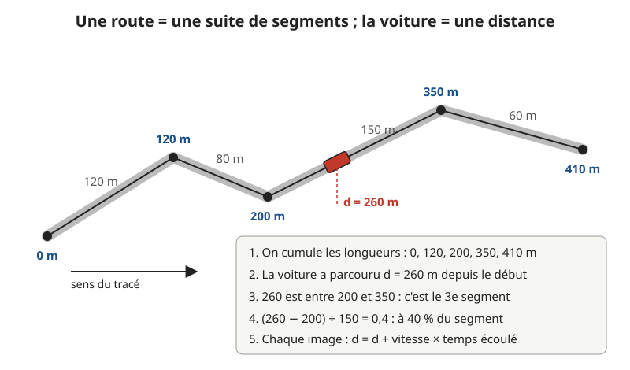
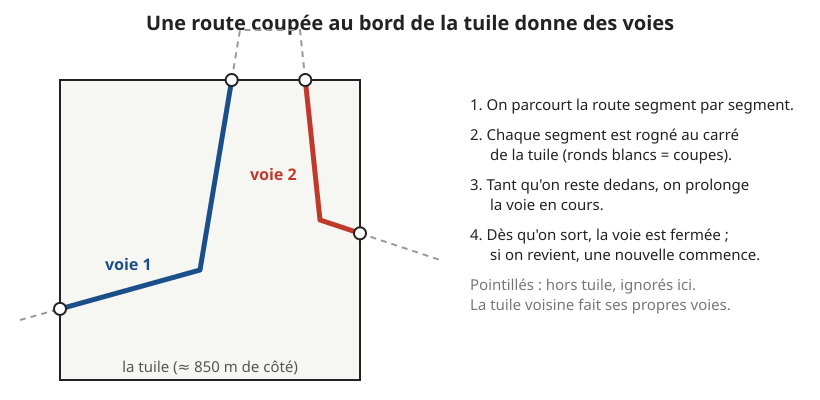
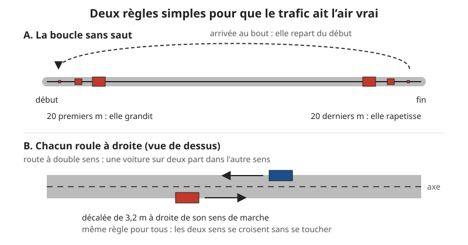

# Les voitures et les bateaux

> **En une phrase :** on récupère le tracé des routes et des fleuves dans le plan de l'IGN (l'institut qui produit les cartes officielles de la France), et chaque véhicule n'est qu'un nombre, « la distance déjà parcourue sur ce tracé », qu'on augmente un peu à chaque image affichée.

## L'idée

Imaginez un train électrique. Le train ne « sait » pas où il est sur la table : il sait seulement combien de centimètres de rail il a déjà parcourus. Connaissant le rail, on en déduit sa position.

On fait pareil. Une route est un rail : une suite de petits traits droits mis bout à bout. On appelle ça une [polyligne](../glossaire.md#polyligne) (une ligne brisée, faite de [segments](../glossaire.md#segment) droits). Une voiture, c'est juste un chiffre : « j'ai roulé 260 m depuis le début de cette route ». Pour la dessiner, on cherche sur quel segment tombent ces 260 m, et où exactement sur ce segment.

Personne ne conduit, personne ne freine, personne ne se croise vraiment. C'est un décor animé, comme les petits personnages d'une maquette de gare. Mais vu de haut, à l'échelle d'une ville, ça suffit à rendre la carte vivante.

Un mot revient souvent ici : l'**image**. L'écran ne montre pas un film continu, il redessine la carte de nombreuses fois par seconde, comme les pages d'un folioscope. Chaque dessin est une image. Entre deux images, chaque voiture avance d'un petit pas.

## Comment ça marche, en gros

**1. On découpe la France en tuiles.** Le plan de l'IGN arrive en [tuiles](../glossaire.md#tuile) (des carrés de carte, comme les carreaux d'un carrelage). Au niveau de détail le plus fin utilisé ici, une tuile fait environ 850 m de côté en France. Tout le trafic se calcule tuile par tuile. D'où viennent ces tuiles et comment on les lit : voir [les données](./donnees.md). Ce sont les mêmes tuiles que pour [les bâtiments](./batiments.md), lues au même moment.

**2. On trie les routes.** Le plan IGN est une [carte vectorielle](../glossaire.md#carte-vectorielle) : au lieu d'une image, il donne des formes (lignes, surfaces) avec des étiquettes. Chaque route porte une classe (sa catégorie : autoroute, route régionale...). On n'en garde que trois. Pour chacune, on fixe une vitesse (en mètres par seconde, « m/s ») et une densité (combien de voitures on met par kilomètre) :

| Classe | Vitesse | Voitures par km |
|---|---|---|
| Autoroute | 30 m/s (108 km/h) | 15 |
| Régionale | 13 m/s (≈ 47 km/h) | 10 |
| Locale | 10 m/s (36 km/h) | 4 |

Les autres classes (routes principales, voies non classées) n'ont pas de voitures, pas plus que les chemins, rangés à part dans le plan. Les ponts routiers sont gardés. Une étiquette indique aussi le sens de circulation : sens unique dans le sens où la ligne a été dessinée, sens unique à l'envers, ou double sens.

**3. On coupe au bord de la tuile.** Une route ne s'arrête pas au bord d'un carré. C'est comme découper une photo aux ciseaux : on prend chaque segment et on garde seulement le morceau qui est dans la tuile. Tant que la route reste dedans, on prolonge la même voie. Dès qu'elle sort, la voie est fermée ; si elle revient, une nouvelle voie commence. Une [voie](../glossaire.md#voie) est donc un morceau de route continu, entièrement dans une tuile.

**4. On compte les voitures.** On mesure la longueur de la voie, puis : voitures = longueur en km × densité, arrondi vers le bas. Une autoroute qui traverse toute la tuile (0,85 km) reçoit 0,85 × 15 = 12,75, donc 12 voitures. Une rue locale de 200 m : 0,2 × 4 = 0,8, donc aucune.

**5. Les bateaux, avec une astuce.** Le plan IGN dessine les fleuves comme des taches bleues (des surfaces d'eau), mais ne donne pas la ligne qui passe en leur milieu. En revanche, il a la ligne qui sert à écrire le nom du fleuve (« La Seine »), et celle-ci suit le milieu du cours d'eau. On la prend comme route pour les bateaux. Pour éviter les ruisseaux, on vérifie que le milieu de cette ligne tombe bien sur une surface d'eau : si oui, c'est un vrai fleuve. Bateaux : 4 m/s (≈ 14 km/h), 3 par km, toujours en double sens.

**6. On place chaque véhicule au hasard au départ.** Chaque voiture reçoit une position de départ au hasard sur sa voie, et une vitesse entre 75 % et 125 % de celle de sa classe : sur autoroute, entre 81 et 135 km/h. Le « hasard » est un [générateur pseudo-aléatoire](../glossaire.md#générateur-pseudo-aléatoire) (une petite formule qui produit une suite de nombres qui ont l'air quelconques) lancé avec un numéro tiré de la position de la tuile. Résultat : la même tuile donne toujours les mêmes voitures au même endroit. Sur une route à double sens, une voiture sur deux part dans l'autre sens.

**7. On avance à chaque image.** À chaque image (60 fois par seconde ou plus), on fait : nouvelle distance = ancienne distance + vitesse × temps écoulé depuis l'image d'avant. À 108 km/h et 60 images par seconde, la voiture avance de 0,5 m par image. Puis on retrouve son segment (on part du segment de l'image d'avant, c'est presque toujours le même ou le suivant) et sa position sur ce segment, comme sur le premier croquis.

**8. Au bout de la voie, on boucle.** Quand la distance dépasse la longueur de la voie, on repart de zéro. Pour que ça ne « saute » pas, la voiture rapetisse sur ses 20 derniers mètres jusqu'à disparaître, et regrandit sur ses 20 premiers mètres.

**9. On dessine toutes les voitures d'un coup.** Une voiture est une simple boîte. Le dessin est fait par la [carte graphique](../glossaire.md#carte-graphique) (la puce de l'ordinateur spécialisée dans l'affichage). Plutôt que de lui décrire 12 objets, on utilise l'[instanciation](../glossaire.md#instanciation) : on lui donne *une* boîte et une liste de positions, et elle la tamponne à chaque position, comme un tampon encreur. Pour chaque véhicule, la liste contient 4 nombres : où il est dans la tuile (2 nombres : est-ouest et nord-sud) et vers où il roule (2 nombres, une petite flèche qui pointe dans le sens de la marche). Astuce : la longueur de cette flèche sert aussi à dire la taille de la voiture (1 = taille normale, moins quand elle rapetisse au bout de la voie). 12 voitures = 48 nombres envoyés par image.

**10. Le [shader](../glossaire.md#shader) pose la boîte sur le relief.** Le shader (le petit programme qui tourne sur la carte graphique pour chaque [sommet](../glossaire.md#sommet), c'est-à-dire chaque coin de la boîte) fait le reste : il tourne la boîte dans le sens de la marche, la décale à droite de l'axe de la route (sa ligne du milieu), et la pose à la hauteur du terrain à cet endroit. C'est la même lecture de hauteur que pour les bâtiments, donc une voiture suit les collines sans calcul en plus. Voir [la construction du terrain](./terrain.md) pour savoir d'où vient cette hauteur.

**11. Tout grossir, comme sur une carte.** À la bonne échelle, une voiture ferait 2 à 4 pixels (les minuscules points qui composent l'écran), même au plus près. On la grossit donc deux fois : 8,8 m de long, 3 m de haut, 3,6 m de large, décalée de 3,2 m à droite de l'axe. Une péniche fait 56 × 5 × 11 m (grossie 1,75 fois), décalée de 18 m à droite du milieu du fleuve. C'est ce que font les cartes papier : une route dessinée y est bien plus large qu'en vrai.

**12. Quand les voit-on ?** Le panneau de réglages permet de montrer les bâtiments en volumes ou à plat. Les véhicules sont rangés avec les bâtiments en volumes : ils n'existent que dans cette variante. Avec le bâti à plat, il n'y a ni voitures ni bateaux. Comme les bâtiments, ils n'apparaissent que si la vue fait moins de 8 km de large : entre 8 et 5 km ils grandissent de rien à leur taille normale (le curseur de hauteur du bâti les grossit aussi). En dehors de la zone dessinée à l'encre (le [masque](../glossaire.md#masque)), ils s'effacent, et une tuile entièrement hors de cette zone n'est même pas dessinée. En mode nuit, il n'y a plus de zone limitée : ils sont visibles partout.

## Pourquoi on a fait comme ça

- **Une distance plutôt qu'une position.** Avec une distance, avancer est une addition, et rester sur la route est garanti, comme le train sur son rail. Avec une position libre sur la carte, la voiture pourrait dériver dans un champ, et il faudrait sans arrêt la « recoller » sur la route.
- **Le calcul sur le processeur, le dessin sur la carte graphique.** Le [processeur](../glossaire.md#processeur) (la puce généraliste de l'ordinateur) fait avancer quelques milliers de véhicules en moins d'un millième de seconde : il suffit de les passer en revue un par un. La carte graphique se charge de ce qu'elle fait de mieux, tamponner des milliers de boîtes.
- **Le tri des routes est fait à l'avance, à côté.** Découper et compter les voies se fait dans un [worker](../glossaire.md#worker) (un assistant qui travaille en parallèle sans bloquer l'affichage), en même temps que le calcul des bâtiments de la tuile. L'image ne saccade pas pendant le chargement.
- **Le hasard reproductible.** Revenir sur une ville montre le même trafic. C'est plus facile à régler (on compare toujours la même scène) et ça évite que les voitures changent de place d'un coup quand une tuile est rechargée.
- **Des boîtes.** La carte est un dessin à l'encre : on ne voit que la silhouette et les hachures. Un modèle 3D détaillé de voiture coûterait cher et ne se verrait pas.
- **Réglable au panneau de réglages.** Deux curseurs, « voitures » et « bateaux », choisissent la part de véhicules montrés (par défaut 80 % des voitures ; les réglages enregistrés montrent 60 % des bateaux). Baisser le curseur ne recalcule rien : on demande juste de tamponner moins de boîtes.

## Ce qu'on aurait pu faire autrement

- **Tout faire sur la carte graphique.** On pourrait envoyer les voies une seule fois et laisser la carte graphique calculer elle-même où est chaque voiture, à partir de l'heure. Plus rien ne serait envoyé à chaque image. Pas retenu : c'est nettement plus compliqué (la carte graphique est très forte pour faire le même petit calcul partout, beaucoup moins pour chercher « sur quel segment suis-je ? »), et à quelques milliers de véhicules le gain ne se voit pas. À faire s'il y avait des centaines de milliers de véhicules.
- **Une vraie simulation de trafic.** Des méthodes existent où chaque voiture garde ses distances avec celle de devant, freine aux carrefours et forme des bouchons (le « modèle du conducteur intelligent », ou des logiciels complets comme SUMO). Pas retenu : il faut connaître tout le réseau routier et ses carrefours, ce qui est beaucoup trop pour un POC (un prototype de démonstration) dont le but est l'ambiance, pas la circulation. À faire seulement si la carte devait montrer des bouchons ou des flux réalistes.
- **Le trafic réel.** Des données publiques de comptage existent sur certains grands axes. Pas retenu : seules quelques routes sont couvertes, il faudrait aller chercher ces chiffres en continu sur un autre service, et à cette échelle personne ne verrait la différence avec des voitures placées au hasard.
- **Des voies qui traversent les tuiles.** En recollant les morceaux de route des tuiles voisines, une voiture pourrait rouler sans fin d'une tuile à l'autre. Pas retenu : il faut garder les tuiles voisines en mémoire et raccorder les tracés bout à bout, pour un effet qui se remarque peu (l'apparition-disparition aux bords est discrète). C'est la première chose à faire en production si les bords deviennent visibles.
- **Le vrai axe des fleuves.** L'IGN publie une base dédiée aux cours d'eau, avec leur ligne centrale. En production, ce serait la bonne source, et elle donnerait aussi des bateaux aux rivières sans nom écrit. Ici, la ligne du nom suffit et ne demande aucun téléchargement de plus.

## Limites actuelles

- Les véhicules se traversent : ils ne se voient pas entre eux, ne s'arrêtent jamais, ignorent les carrefours.
- Une voiture ne passe jamais d'une tuile à l'autre : elle rapetisse au bord et réapparaît au début de sa voie.
- Les routes courtes n'ont souvent aucune voiture (une rue locale doit faire au moins 250 m pour en avoir une), et plusieurs classes de routes (principales, non classées, chemins) n’en ont jamais.
- Les voitures restent à plat : elles montent les pentes sans se pencher.
- Toute la liste de positions est renvoyée à la carte graphique à chaque image, pour chaque tuile visible. Une tuile hors de la vue fige ses véhicules : ils reprennent où ils en étaient quand elle revient.
- Pas de véhicules quand le bâti est à plat (variante sans volumes).
- Si l'image se fige (onglet en arrière-plan, gros ralentissement), on n'avance que d'un dixième de seconde au plus quand elle repart, pour éviter que les voitures fassent un bond.
- Un fleuve sans nom écrit sur le plan n'a pas de bateaux.

## Où c'est dans le code

| Étape | Fichier | Rôle |
|---|---|---|
| Tri, découpe et comptage des voies (étapes 2 à 5) | [src/graphics/terrain/Traffic.ts](../../src/graphics/terrain/Traffic.ts) | `roadLanes`, `boatLanes`, `lanesOf`, `clipSegment` ; tables `TRAFFIC`, `BOATS`, `DIRECTION` |
| Lancement dans le worker | [src/graphics/terrain/Landcover.worker.ts](../../src/graphics/terrain/Landcover.worker.ts) | `sendBuildings` : voies calculées avec le bâti de la tuile, puis envoyées |
| Départ au hasard, avance, boucle (étapes 6 à 8) | [src/graphics/terrain/Traffic.ts](../../src/graphics/terrain/Traffic.ts) | classe `Traffic` : `step`, `write`, `FADE_M` |
| Création des instances et mise à jour à chaque image (étapes 9, 12) | [src/graphics/nodes/buildings/Buildings.node.ts](../../src/graphics/nodes/buildings/Buildings.node.ts) | `_receive` (une `Traffic` par tuile, graine `x·31 + y`), `update` (boucle `movers`, réglages `cars` / `boats`, `technique` `extrusion` seulement, `_inMask`) |
| Boîte posée sur le relief, tailles (étapes 10, 11) | [src/graphics/materials/Traffic.material.ts](../../src/graphics/materials/Traffic.material.ts) | `createVehicleMaterial`, `CAR`, `BOAT` |
| Curseurs du panneau | [src/graphics/universes/impl/Main.universe.ts](../../src/graphics/universes/impl/Main.universe.ts) | `life.cars`, `life.boats` |
| Distances d'apparition | [src/graphics/config/buildings.config.ts](../../src/graphics/config/buildings.config.ts) | `maxExtentKm` 8, `fullExtentKm` 5 |
| Tests | [tests/graphics/terrain/Traffic.test.ts](../../tests/graphics/terrain/Traffic.test.ts) | découpe des voies, avance en boucle, choix des fleuves |

## Pour aller plus loin

- [Documentation three.js sur l'instanciation (InstancedMesh)](https://threejs.org/docs/#api/en/objects/InstancedMesh) : le principe du tampon, une forme dessinée à plusieurs endroits.
- [Spécification des tuiles vectorielles (Mapbox Vector Tile)](https://github.com/mapbox/vector-tile-spec) : le format dans lequel arrive le plan IGN.
- Liang et Barsky, « A New Concept and Method for Line Clipping », ACM Transactions on Graphics, 1984 : la méthode utilisée pour couper un segment au bord d'un carré.
- Park et Miller, « Random Number Generators: Good Ones Are Hard to Find », Communications of the ACM, 1988 : le générateur de hasard reproductible.
- [SUMO, simulateur de trafic libre](https://eclipse.dev/sumo/) : ce que serait une vraie simulation de circulation.
