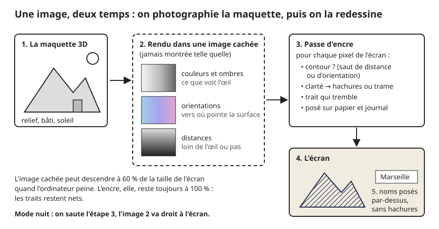
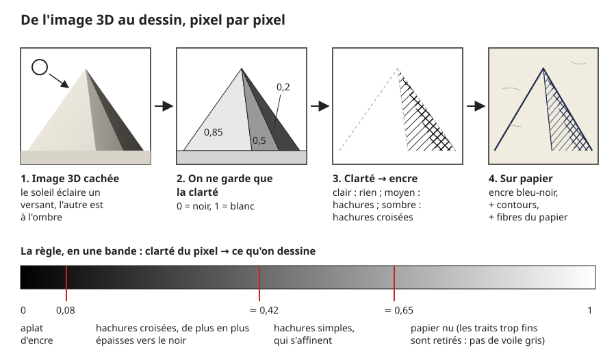
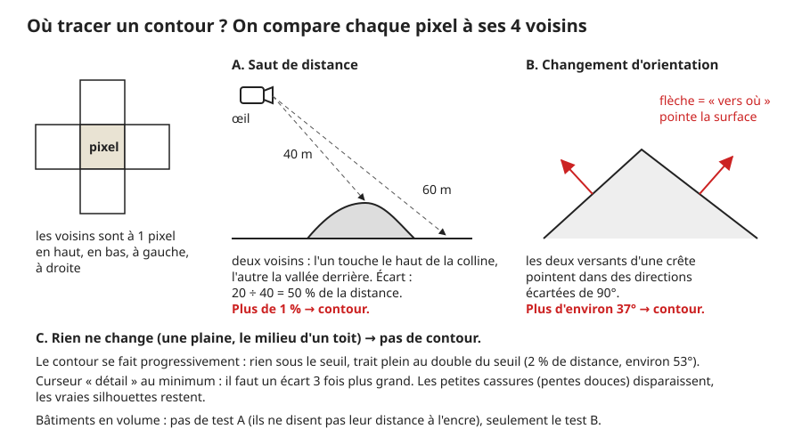
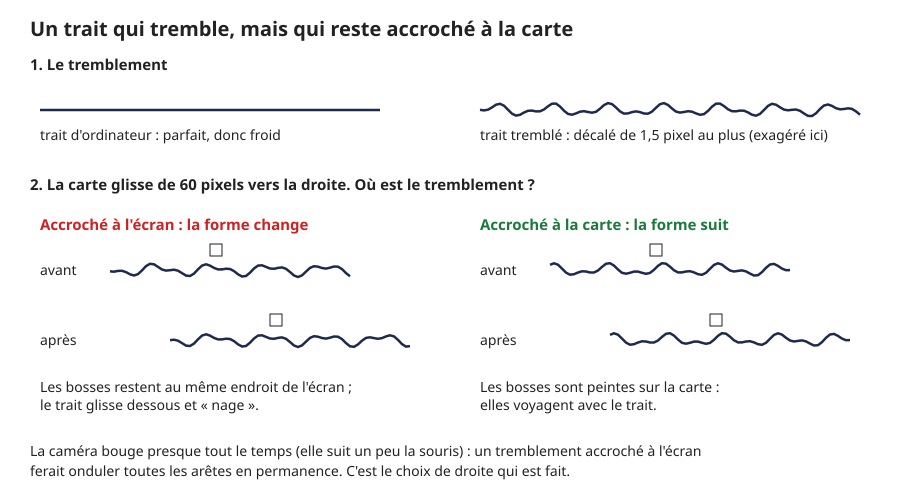

# De la 3D au dessin à l'encre

> **En une phrase :** on photographie d'abord la maquette 3D dans une image que personne ne voit, puis un second programme repasse sur chaque pixel de cette photo pour la redessiner à la plume : contours, hachures selon l'ombre, encre bleu-noir sur un vieux papier.

## L'idée

Imagine un graveur des années 50 qui doit illustrer une carte. Il ne dessine pas de mémoire : il pose une photo du paysage sous un **papier calque**, et il repasse dessus. Là où la photo est sombre, il serre ses hachures. Là où elle est claire, il laisse le papier blanc. Là où une forme s'arrête (un toit devant le sol, une crête), il trace un contour.

C'est exactement ce que fait l'ordinateur, en deux temps. Et il le refait sans cesse : jusqu'à 120 fois par seconde quand la carte bouge. Quand elle est immobile, il ralentit à 15 fois par seconde, ou 30 si des voitures ou des avions circulent.

1. **La photo.** La carte est d'abord une vraie scène 3D : un relief, des bâtiments, un soleil (voir [Construction du terrain](3d/terrain.md) et [Construction des bâtiments](3d/batiments.md)). L'ordinateur la calcule comme une photo (on dit qu'il la [rend](glossaire.md#rendu)), mais dans une [image cachée](glossaire.md#rendu-hors-écran) : une image gardée en mémoire et jamais affichée.
2. **Le calque.** Un second programme, la [passe](glossaire.md#passe) d'encre (une passe, c'est un passage complet sur toute l'image), lit cette photo et dessine le résultat à l'écran. On appelle ça du [post-traitement](glossaire.md#post-traitement) : on traite l'image *après* l'avoir fabriquée, comme un filtre photo, mais en beaucoup plus malin.

Ce second programme est un [shader](glossaire.md#shader) : un petit programme que la [carte graphique](glossaire.md#carte-graphique) (la puce qui dessine l'image) exécute pour chaque [pixel](glossaire.md#pixel) de l'écran, tous en même temps. Chaque pixel se pose la même question : « d'après la photo, dois-je être de l'encre ou du papier ? »

La photo cachée n'est pas une simple image en couleurs. Pour chaque pixel, elle retient trois choses :

- **la couleur et l'ombre**, ce que verrait un œil ;
- **l'orientation** de la surface, une [normale](glossaire.md#normale) : une flèche qui dit « vers où regarde ce bout de sol » (vers le ciel, vers l'est...) ;
- **la distance** à l'œil, la [profondeur](glossaire.md#profondeur) : ce bout de sol est-il à 40 m ou à 60 m de la caméra ?

Avec ces trois informations, le graveur-ordinateur sait tout ce dont il a besoin.

## Comment ça marche, en gros

### Avant l'encre : éclairer la maquette

1. **Un soleil bas.** La scène est éclairée par un soleil placé à 117° (compté depuis le nord, dans le sens des aiguilles d'une montre) et à 22° au-dessus de l'horizon. C'est un soleil de matin : bas, il fait de longues ombres, et un versant éclairé se distingue nettement de son voisin à l'ombre. Un soleil de midi écraserait le relief.
2. **Un ciel qui adoucit.** En plus du soleil, une lumière de ciel vient de partout (force 0,2), et le sol renvoie un peu de lumière vers le haut (0,35). Sans elles, les faces à l'ombre seraient noires, et un noir pur ne se hachure pas : il devient un aplat.
3. **Les ombres portées.** Une [ombre portée](glossaire.md#ombre-portée) est l'ombre qu'une montagne jette sur la vallée d'à côté. Pour la calculer, l'ordinateur regarde la scène *depuis le soleil* et note, sur une grille de 4 096 × 4 096 cases (16,7 millions), ce que le soleil touche en premier. Tout ce qui est derrière est à l'ombre. Cette grille couvre un carré fixe de 300 × 300 [unités](glossaire.md#unité) (l'unité, c'est la règle graduée de la scène 3D) autour du centre de la vue.
4. **Pas d'ombres sur une ville plate.** Si le relief de la vue fait moins de 40 m de dénivelé, il n'y a rien à ombrer : on arrête de calculer ces ombres. Ça économise 3 à 6 millisecondes par image. C'est beaucoup : à 120 images par seconde, chaque image doit être prête en 8,3 ms, donc on gagne d'un tiers aux deux tiers du temps disponible. Entre 40 et 120 m, l'ombre apparaît progressivement. Les bâtiments ont leurs ombres calculées à part, une fois par vue chargée, dans une image d'ombres que le sol relit (voir [Construction des bâtiments](3d/batiments.md)).

### Le sol imprime déjà son plan

5. **Le plan est imprimé, pas éclairé.** Avant même l'encre, le shader du sol peint dessus ce que la carte sait du terrain : les bois (hachures fines à 45°), les routes (laissées en blanc, cernées d'un trait), les bâtiments (à plat, en encre bleue). Ces informations viennent d'une [texture](glossaire.md#texture) de données, une image où chaque couleur veut dire « bois », « eau » ou « bâti » (voir [Les données](3d/donnees.md)). Ce plan est posé *par-dessus* la lumière : un soleil fort ne peut pas l'effacer.
6. **L'eau à la plume.** La mer et les rivières sont du papier presque nu, parcouru de traits parallèles à 45°, comme sur les cartes gravées (on parle de *water lining*). Le motif de base, qui se répète comme un papier peint, compte 30 traits. Plus on s'éloigne du rivage, plus ils s'espacent : à chaque palier de profondeur, **un trait sur deux disparaît**. Les traits restants ne bougent pas, ce qui évite que l'eau « grouille ». Près de la côte, les traits ondulent et changent d'épaisseur, comme un crayon qui appuie plus ou moins.
7. **Le sol prévient l'encre.** Le sol glisse un petit mot à la passe d'encre, dans une case libre de l'image cachée : « ici, il faut dessiner » ou « ici, laisse le papier ». C'est ce qui fait que la carte s'arrête dans une ellipse aux bords irréguliers (voir le [masque dans Construction du terrain](3d/terrain.md)), et que le lieu survolé passe à l'encre rouge.

### La passe d'encre, pixel par pixel

8. **Le trait tremble.** Une main ne trace jamais droit. Avant de lire la photo, chaque pixel décale un peu l'endroit où il la lit : au plus 1,5 pixel, selon un [bruit](glossaire.md#bruit) (une image de valeurs au hasard, préparée une fois). Ce bruit change doucement tous les 32 pixels, ce qui donne une ondulation et pas un grésillement. Surtout, il est **accroché à la carte**, pas à l'écran (voir le croquis plus bas).
9. **Les contours.** Chaque pixel se compare à ses 4 voisins, à 1 pixel de distance. Si la distance à l'œil saute de plus de 1 % (une colline devant la vallée, un arbre devant le sol), ou si l'orientation tourne de plus d'environ 37° (une crête, l'angle d'un toit et d'un mur), c'est un contour. Le trait apparaît progressivement : plein au double du seuil. Les bâtiments en volume ne passent que par le second test : ils disent à l'encre de ne pas regarder leur distance, et leurs contours viennent seulement des changements d'orientation.
10. **Les tons.** On mesure la clarté du pixel, de 0 (noir) à 1 (blanc). Piège : l'ordinateur compte la lumière comme une quantité d'énergie, alors que notre œil distingue beaucoup mieux les nuances sombres. Une ombre qui nous paraît « gris moyen » ne vaut qu'environ 0,2 en énergie. On corrige donc la clarté pour qu'elle colle à ce que l'œil voit. Sans cette correction, toutes les ombres tomberaient dans le noir.
11. **Clarté → hachures.** C'est la règle du graveur, résumée dans la bande du croquis ci-dessous :
    - au-dessus d'environ 0,65 : papier nu ;
    - entre 0,65 et 0,42 : hachures simples à 45°, qui s'épaississent quand le ton fonce ;
    - entre 0,42 et 0,08 : une seconde série de hachures croise la première ;
    - sous 0,08 : aplat d'encre.

    Deux hachures voisines sont à 5 pixels l'une de l'autre, mesurés perpendiculairement aux traits (environ 7 pixels le long d'une ligne horizontale). À un ton moyen, un trait couvre à peu près 45 % de cet écart, soit environ 2 pixels d'encre pour 3 de papier.
12. **Ou bien une trame.** Au lieu des hachures, on peut choisir une **trame de points**, comme une photo de journal imprimée : de petits ronds sur une grille, plus gros dans les ombres. Un réglage passe de l'un à l'autre en fondu.
13. **Plus fin au loin.** Comme dans un dessin d'atelier, le lointain est plus léger : entre 29 et 215 unités de la caméra, l'encre s'éclaircit jusqu'à 27 % de moins.
14. **Le papier.** Le fond est un papier crème (un beige très clair), avec des fibres et des taches. Cette feuille n'est pas une photo : elle est dessinée par le programme au démarrage, quand le navigateur a un moment libre. 6 000 petites fibres courbes et 90 taches rondes, sur un carré de 1 024 × 1 024 pixels qui se répète sans couture.
15. **Le journal.** Sous la carte, un vieux papier journal est posé **à plat sur le sol**, en perspective. Il s'efface vers l'horizon (entre 160 et 420 unités du point visé), sinon ses lignes de texte fileraient en traits serrés.
16. **L'encre se pose.** L'encre est bleu-noir, jamais tout à fait pleine : un grain la rend inégale, comme une photocopie. Là où le grain la troue, elle couvre jusqu'à 12 % de moins (avec le réglage actuel du grain). Le lieu survolé passe à l'encre rouge, avec un léger lavis sur le papier.

### Après l'encre

17. **Les noms par-dessus.** Les noms de villes, le panneau et l'écran d'accueil sont dessinés *après* l'encre, sur l'image finie. Sinon un texte serait hachuré comme une colline.
18. **L'apparition au crayon.** Quand un bâtiment ou un lieu arrive, il n'apparaît pas en fondu. Il arrive **tache par tache**. Imagine un relief de bosses et de creux imaginaires, accroché à la carte, qu'on remplit lentement d'encre : les creux se remplissent d'abord, puis les pentes, jusqu'à tout couvrir. Chaque point du bâtiment apparaît quand le niveau d'encre l'atteint. Ce relief imaginaire est un bruit, et le niveau d'encre est un seuil qui monte. Le bord reste franc, comme un dessin en cours.
19. **La page d'accueil.** Au démarrage, une page de papier couvre la carte. Elle se retire en coups de pinceau qui tournent depuis le centre (3 bras en spirale), avec le même principe de niveau qui monte sur un relief imaginaire.
20. **La résolution qui s'adapte.** Si l'ordinateur peine, l'image cachée descend jusqu'à 60 % de la taille de l'écran, par pas de 10 %. L'encre, elle, reste toujours à 100 % : les traits restent nets, seule la photo dessous est un peu plus floue. Ça ne se voit presque pas, puisque la photo n'est jamais montrée.

### Une variante : le mode nuit

Le panneau de réglages (la fenêtre de curseurs qui sert à régler le rendu) a un réglage « dessin » qui vaut 1 (encre) ou 0 (nuit). En mode nuit, on **saute la passe d'encre** : la photo 3D va directement à l'écran, sur fond noir, le sol s'efface vers le noir aux bords au lieu de s'effacer vers le papier, et le relief n'est plus découpé par l'ellipse de la zone dessinée. C'est une alternative existante, utile pour comparer la maquette brute et son dessin, et pour voir ce que la passe d'encre ajoute.

## Pourquoi on a fait comme ça

- **Parce que tout bouge.** On zoome en continu de la France entière à une rue. La caméra suit un peu la souris. Le soleil se règle. Un dessin fait à l'avance devrait exister pour chaque zoom, chaque angle et chaque lumière : des millions d'images. Un shader redessine la photo du moment, quelle qu'elle soit.
- **Parce qu'on règle en direct.** Épaisseur des traits, seuils des tons, force du papier : chaque réglage est un simple nombre que le shader relit à chaque image. On bouge un curseur, le dessin change tout de suite, sans rien recharger. Pour trouver un style, c'est irremplaçable.
- **Parce qu'une passe sur la photo, c'est la même règle partout.** Relief, bâtiments, arbres, voitures : tout passe par la même photo, donc tout est dessiné avec la même main. Pas besoin d'écrire un style par objet.
- **Parce que c'est rapide.** Le travail de l'encre est fixe : un calcul par pixel, environ 2 millions de pixels sur un écran Full HD (1 920 × 1 080 = 2 073 600), avec une quinzaine de lectures de la photo chacun. Peu importe que la scène contienne 10 ou 10 000 bâtiments.
- **Parce que le tremblement doit suivre la carte.** Un bruit fixé à l'écran ferait « nager » chaque arête dès que la caméra bouge, et elle bouge presque tout le temps. L'accrocher à la carte demande un petit calcul de position (le pixel retrouve le point du sol qu'il montre), mais c'est ce qui rend le trait vivant sans qu'il grouille.
- **Parce que le papier est dessiné, pas chargé.** Générer la feuille en code évite un gros fichier à télécharger, et on le fait quand le navigateur est libre, pour ne pas retarder la première image.

## Ce qu'on aurait pu faire autrement

- **Des cartes dessinées à l'avance.** C'est ce que faisaient les cartes « aquarelle » de Stamen : chaque morceau de carte est peint une fois sur un serveur, puis simplement affiché. Très beau, très léger pour le navigateur. Mais tout est figé : pas de relief en 3D qui tourne, pas de soleil réglable, et un stockage énorme pour couvrir tous les zooms. Incompatible avec une carte qu'on survole.
- **Des hachures collées aux surfaces.** Aujourd'hui, nos hachures sont posées sur l'écran : quand la carte glisse, elles restent en place et le paysage défile dessous (un défaut connu, l'effet « vitre de douche »). La recherche propose des hachures peintes directement sur les objets, qui bougent avec eux (Praun et coll., *Real-Time Hatching*, 2001). Il faut alors préparer des séries de textures de hachures et savoir les coller sur chaque surface, terrain compris. Trop élaboré pour un POC. C'est la première chose à faire en production.
- **Des hachures qui suivent la pente.** Les vieilles cartes d'état-major hachuraient le relief *dans le sens de la pente*, pas à 45°. C'est plus fidèle et plus lisible. Il faut calculer, pour chaque point, la direction de la pente et y faire tourner les traits, sans que ça fasse des nœuds. Pas fait par manque de temps.
- **De vrais traits sur les arêtes.** Au lieu de deviner les contours dans la photo, on peut repérer les arêtes dans la géométrie 3D et y tracer de vraies lignes. Plus précis, épaisseur maîtrisée, mais beaucoup plus de calcul et de code, surtout sur un terrain qui change à chaque image. La méthode « comparer les voisins dans la photo » (Saito et Takahashi, 1990) est simple et marche sur tout.
- **Plus de voisins pour les contours.** Comparer 8 voisins au lieu de 4 (méthode dite de Sobel) donnerait des contours plus doux en diagonale. Ça coûte deux fois plus de lectures par pixel. On a gardé 4 pour la vitesse.
- **Un filtre par intelligence artificielle.** Le « transfert de style » imite n'importe quel dessin à partir d'une image modèle. Beaucoup trop lent pour 120 images par seconde, et l'image scintille d'une image à l'autre.
- **Une bibliothèque toute faite.** La bibliothèque de post-traitement la plus utilisée avec three.js (pmndrs/postprocessing) ne fonctionne qu'avec l'ancien moteur graphique (WebGL). On utilise le nouveau (WebGPU). On a donc repris son principe (photo, filtres, dernier filtre à l'écran) dans une version maison plus petite.
- **Des ombres en plusieurs étages.** Notre grille d'ombre couvre un seul carré fixe. Les jeux vidéo utilisent plusieurs grilles emboîtées, fines près de la caméra, grossières au loin (*cascaded shadow maps*). Plus de code et plus de calcul : inutile tant que la vue reste proche du centre.

## Limites actuelles

- **Les hachures glissent.** Les hachures d'ombre, la trame et le papier sont posés sur l'écran. Le tremblement, le journal et le plan imprimé par le sol (hachures des bois, traits de l'eau) suivent la carte. En mouvement, le paysage défile sous les hachures d'ombre, et le papier glisse sur le journal.
- **Toutes les hachures sont à 45°.** Ni celles des ombres ni celles des bois ne suivent la pente ou la forme des objets.
- **Contours un peu crénelés.** Avec 4 voisins, un contour fait 1 à 2 pixels d'épaisseur et marche en escalier sur les diagonales. Au loin, de petits sauts de distance passent sous le seuil de 1 % et ne font pas de trait.
- **Ombres coupées au-delà du carré.** Au-delà de 150 unités du centre, plus d'ombre portée, et les ombres lointaines sont un peu pixelisées.
- **Démarrage en deux temps.** Le papier et les nuages sont dessinés au premier moment libre du navigateur (au plus tard après 3 secondes, environ 100 ms de calcul). Avant ça, le papier est uni et le ciel vide.
- **Changer de mode peut saccader.** En mode nuit, la photo 3D est dessinée directement à l'écran, sans ses informations en plus : la première fois, la carte graphique doit préparer de nouveaux programmes pour toute la scène, d'où un court à-coup possible.
- **Le mode nuit est brut.** Ce n'est pas un « dessin de nuit » : c'est la maquette 3D sans son dessin.

## Où c'est dans le code

| Étape | Fichier | Rôle |
|---|---|---|
| Soleil, ciel, ombres du relief | [Lights.node.ts](../src/graphics/nodes/lights/Lights.node.ts) | position du soleil, grille d'ombre, arrêt sur vue plate |
| Plan imprimé, eau à la plume, apparition au crayon, accroche à la carte | [Terrain.material.ts](../src/graphics/materials/Terrain.material.ts) | shader du sol, petit mot laissé à l'encre |
| Bruit peint | [NoiseMap.ts](../src/graphics/materials/NoiseMap.ts) | image de bruit chargée, pour la page d'accueil et le panneau |
| Enchaînement des passes | [EffectComposer.ts](../src/graphics/postprocessing/EffectComposer.ts) | photo cachée, résolution réduite, dernière passe à l'écran |
| Photo cachée (couleur, orientation, distance) | [RenderPass.ts](../src/graphics/postprocessing/passes/RenderPass.ts) | rend la scène avec ses informations en plus |
| Socle commun des passes | [Pass.base.ts](../src/graphics/postprocessing/passes/Pass.base.ts) | dessin plein écran, gestion des couleurs |
| Passe de filtres | [EffectPass.ts](../src/graphics/postprocessing/passes/EffectPass.ts) | assemble les effets en un seul programme |
| Tremblement, contours, papier et journal | [Ink.effect.ts](../src/graphics/postprocessing/effects/Ink.effect.ts) | le graveur, pixel par pixel |
| Hachures, trame, papier, encre, nuages dessinés | [InkStyle.ts](../src/graphics/postprocessing/effects/InkStyle.ts) | règles de style et textures générées |
| Page d'accueil qui se retire | [PageTransition.ts](../src/graphics/postprocessing/effects/PageTransition.ts) | coups de pinceau en spirale |
| Noms et panneaux par-dessus | [OverlayPass.ts](../src/graphics/postprocessing/passes/OverlayPass.ts) | dessine après l'encre, sans hachures |
| Branchement et mode nuit | [Main.universe.ts](../src/graphics/universes/impl/Main.universe.ts) | ordre des passes, réglage « dessin » |
| Résolution qui s'adapte | [DynamicQuality.helper.ts](../src/graphics/device/DynamicQuality.helper.ts) | baisse la photo de 100 % à 60 % |
| Réglages enregistrés | [debug.values.json](../src/graphics/config/debug.values.json) | valeurs du panneau : ce sont elles qui font le rendu |

Les nuages dessinés à l'encre sont expliqués dans [Le ciel](3d/ciel.md).

## Pour aller plus loin

- Takafumi Saito et Tokiichiro Takahashi, *Comprehensible Rendering of 3-D Shapes*, SIGGRAPH 1990 : l'article fondateur des contours tirés de l'image de profondeur.
- Emil Praun, Hugues Hoppe, Matthew Webb, Adam Finkelstein, *Real-Time Hatching*, SIGGRAPH 2001 : les hachures collées aux surfaces, l'alternative à nos hachures posées sur l'écran.
- [pmndrs/postprocessing](https://github.com/pmndrs/postprocessing) : la bibliothèque dont on a repris le principe des passes.
- [Three.js Shading Language](https://github.com/mrdoob/three.js/wiki/Three.js-Shading-Language) : le langage dans lequel nos shaders sont écrits.
- Eduard Imhof, *Cartographic Relief Presentation* (1965, traduit en 1982) : la référence sur la manière de dessiner le relief à la main, hachures selon la pente comprises.
