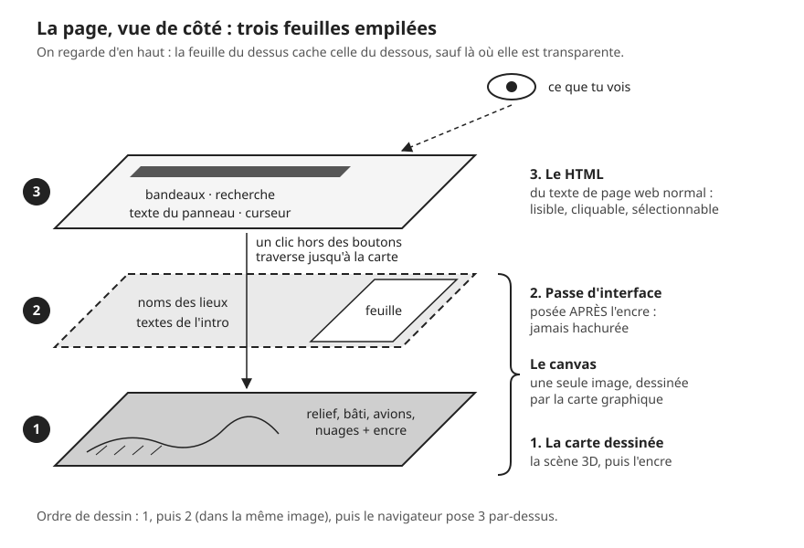
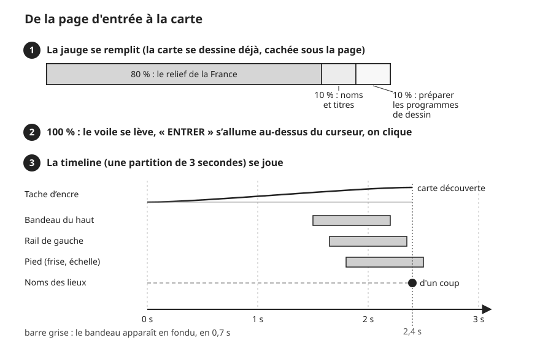
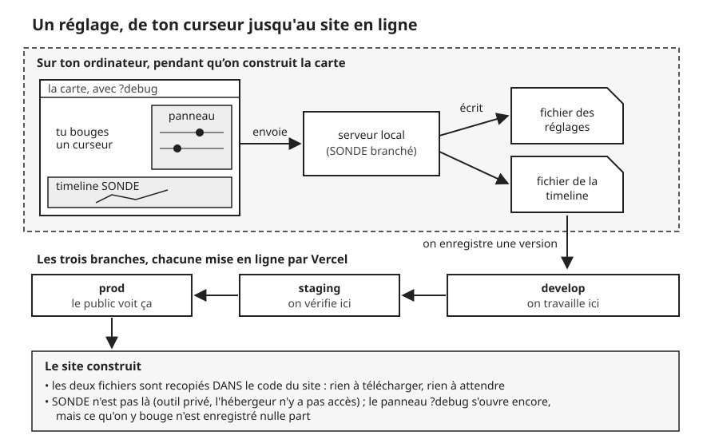

# L'application autour de la carte

> **En une phrase :** la carte 3D est une seule grande image dessinée par la carte graphique, posée tout au fond de la page ; une page web ordinaire (boutons, textes, recherche) est posée par-dessus comme un calque transparent, et les deux se parlent par quelques questions simples.

Ce chapitre ne parle pas de la 3D elle-même (pour ça, voir [La carte en 3D](./3d/README.md)). Il explique tout ce qui l'entoure : comment la page et la carte cohabitent, l'écran d'entrée, les bandeaux, le panneau des archives, le curseur, les réglages, et comment le site part en ligne.

## L'idée

Pense à une table lumineuse de dessinateur. Au fond, il y a le dessin : la carte. Par-dessus, on pose une feuille de calque sur laquelle on a écrit les titres, la légende, l'échelle. Le calque est transparent partout où il n'y a rien d'écrit : on voit le dessin à travers, et si on pose le doigt sur une zone vide, on touche le dessin.

Dans le navigateur, c'est pareil :

- le dessin, c'est le [canvas](glossaire.md#canvas) (une zone de la page où la carte graphique peint une image, pixel par pixel, 60 à 120 fois par seconde) ;
- le calque, c'est le [HTML](glossaire.md#html) (le langage des pages web : du vrai texte, des vrais boutons, que le navigateur sait afficher, lire à voix haute et rendre cliquables).

Il y a une subtilité : entre les deux, il existe une couche intermédiaire. Certains éléments d'interface (les noms des lieux, la feuille de papier du panneau, les titres de l'intro) sont **peints dans le canvas**, mais à la toute fin, après l'encre. C'est ce qu'on appelle la [passe](glossaire.md#passe) d'interface (une passe = une étape de dessin dans l'image ; on en enchaîne plusieurs, chacune par-dessus la précédente).

Pourquoi trois couches et pas deux ? Parce que certains effets ont besoin d'être dans l'image. Exemple : à l'entrée, une tache d'encre en spirale « efface » la page d'accueil et découvre la carte. Pour que les titres s'effacent avec la page, au pixel près, il faut qu'ils soient peints dans la même image que la page. Un texte HTML posé au-dessus resterait là, intact, pendant que tout le reste disparaît.

## Comment ça marche, en gros

### 1. La page et la carte se partagent l'écran

La page web est construite avec Vue, une boîte à outils qui découpe une interface en [composants](glossaire.md#composant) (des briques réutilisables : un bouton, un bandeau, un panneau), et Nuxt, qui assemble ces briques en site. Il n'y a qu'une seule page.

Au chargement :

1. Le navigateur affiche le HTML (textes de l'entrée, voile de chargement).
2. Le canvas, lui, ne peut démarrer que dans le navigateur : la carte graphique dont il a besoin est celle de ton ordinateur, pas celle du serveur (l'ordinateur distant qui envoie la page). On attend donc que la page soit affichée, puis on charge le moteur 3D, c'est-à-dire le programme qui fabrique l'image de la carte. Ici, c'est la bibliothèque three.js (du code prêt à l'emploi), qui parle à la carte graphique en [WebGPU](glossaire.md#webgpu), la façon moderne de lui donner des ordres.
3. Le moteur annonce « prêt ». À partir de là, l'interface peut lui poser des questions.

Les couches, du fond vers le dessus : la carte, les petits relevés posés sur la carte (étiquettes HTML), les bandeaux, la page d'entrée, le texte du panneau des archives, le voile de chargement, et tout en haut le curseur. Les bandeaux laissent passer la souris partout sauf sur leurs boutons : un glissement sur une zone vide arrive à la carte.

### 2. L'interface et la carte se parlent par questions

L'interface ne touche jamais aux objets 3D. Elle connaît seulement un **guichet** : une liste d'une dizaine de questions et d'ordres simples, exprimés en unités de géographe (longitude, latitude, kilomètres), pas en coordonnées 3D. Par exemple : « où regardes-tu ? », « vole jusqu'à Lyon », « cherche les lieux qui commencent par *Mar* », « où en est le chargement ? ».

Pour savoir ce qui change, l'interface **repose la question régulièrement**, c'est ce qu'on appelle un [sondage](glossaire.md#sondage) :

- toutes les 150 ms (millisecondes, des millièmes de seconde) pendant le chargement, pour la jauge ;
- toutes les 200 ms pour les bandeaux (échelle, coordonnées, fil d'Ariane) ;
- toutes les 400 ms pour savoir si le panneau des archives doit se ranger.

Une seule chose est poussée par la carte vers l'interface, sans qu'on demande : « on a cliqué sur un nom de lieu ». C'est un [abonnement](glossaire.md#abonnement) : le panneau dit « préviens-moi » une fois, et la carte le prévient à chaque clic.

Derrière le guichet, un seul objet fait le chef d'orchestre de la carte : il construit la scène (caméra, relief, bâti, avions, nuages, noms, panneau, intro), règle l'ordre des passes, et décide à chaque image s'il faut redessiner. Quand rien ne bouge, il ne redessine que 15 fois par seconde, ou 30 dès qu'il reste un peu de vie (voitures, bateaux, avions, ou le vent dans les arbres), au lieu de suivre la cadence de l'écran (jusqu'à 120) : une image fixe n'a pas besoin de faire chauffer la carte graphique. Le vent étant allumé par défaut, la carte au repos tourne en pratique à 30 images par seconde.

### 3. L'intro : charger, puis passer de la page à la carte

1. **Le voile.** Une feuille de papier couvre tout. Dessous, la carte se dessine déjà sur la vue « France entière » (1 150 km de large), mais personne ne peut la bouger : les gestes sont fermés tant que l'intro n'est pas jouée.
2. **La jauge.** Elle additionne trois choses, avec des poids choisis à la main : le relief compte pour 80 %, les noms de lieux et les titres pour 10 %, et la préparation des [shaders](glossaire.md#shader) (les petits programmes de la carte graphique) pour 10 %. Cette dernière étape existe parce que, la première fois qu'elle dessine la carte, la carte graphique doit « compiler » ses programmes, c'est-à-dire les traduire dans sa propre langue. Ça figeait l'écran une fraction de seconde en plein passage. On le fait avant, pendant que l'utilisateur attend de toute façon.
3. **L'entrée.** À 100 %, on attend 150 ms (le temps qu'une image complète soit peinte), puis le voile se fond en 0,7 s. Les titres « ARCHIVES », « France · 1958 à 2027 » sont placés par le HTML, mais rendus invisibles : c'est le canvas qui les peint à la même place, avec la même police. Le mot « ENTRER » s'allume au-dessus du curseur.
4. **Le clic.** Un clic n'importe où lance le passage. La [timeline](glossaire.md#timeline) (une partition : pour chaque valeur, à quel moment elle vaut quoi) joue 3 secondes :
   - de 0 à 2,4 s, la tache d'encre en spirale découvre la carte et efface la page avec ses titres ;
   - de 1,5 à 2,5 s, les bandeaux arrivent en décalé : le haut, puis le rail de gauche, puis le pied, chacun en 0,7 s ;
   - à 2,4 s, les noms des lieux apparaissent d'un coup.

La même partition pilote à la fois ce que peint la carte graphique (la tache d'encre) et le HTML (les bandeaux qui apparaissent en fondu). C'est la clé : un seul chef, une seule horloge, donc pas de décalage entre ce qui est peint et ce qui est écrit.

### 4. Les bandeaux (le « chrome »)

On appelle *chrome* tout ce qui encadre la carte sans en faire partie, comme le cadre d'un tableau.

- **En haut, le fil d'Ariane** dit où l'on regarde : « France / Auvergne-Rhône-Alpes / Rhône / Lyon ». Pour le savoir, on envoie le centre de la vue à l'API Géo de l'État. Une API, c'est un guichet sur internet : un programme y pose une question et reçoit une réponse. Celle-ci, publique et gratuite, répond « ce point est dans telle commune ». On ne l'appelle pas à chaque image : seulement après 500 ms d'immobilité et si le centre a bougé d'au moins 0,02°, soit environ 2 km. Un niveau ne s'affiche que si on est assez près : région sous 600 km de large, département sous 150 km, ville sous 25 km.
- **La recherche** cherche parmi les noms que la carte a déjà chargés, au niveau choisi dans le rail de gauche, décrit juste après (6 résultats au plus, dès 2 lettres ; Entrée prend le premier). Choisir un résultat fait voler la carte jusqu'au lieu, avec un cadrage qui contient tout son contour plus 25 % de marge, jamais plus serré que 3 km.
- **Le rail « Trois regards »** choisit quels contours la carte met en avant : communes, départements ou régions.
- **En bas, l'échelle** calcule ce que valent 148 pixels, puis prend la première distance « ronde » au-dessus (1, 2 ou 5 suivis de zéros : 1, 2, 5, 10, 20, 50, 100, 200 km...) ; la barre s'allonge ou raccourcit pour la représenter. Exemple : vue de 1 150 km sur un écran de 1 440 pixels, 148 pixels valent environ 118 km, arrondis à 200 km. La barre devrait alors mesurer 250 pixels, mais sa longueur est plafonnée à 237 (1,6 fois 148) : dans ce cas, elle est un peu trop courte pour son chiffre.
- **La frise 1958-2027** compte 14 barres. Deux clics bornent une période. Pour l'instant, la période choisie ne filtre rien.

### 5. Le panneau des archives

Cliquer un nom de lieu sur la carte fait deux choses : la carte vole vers ce lieu, et le panneau des archives s'ouvre à droite.

Le panneau est un bon exemple de la cohabitation des couches. Le **texte** est du HTML : lisible, sélectionnable, cliquable. La **feuille de papier** derrière lui est peinte dans le canvas, calée exactement sur le rectangle du panneau. Elle apparaît par taches d'encre en 0,9 s, comme un papier qui se consumerait à l'envers. La feuille publie sa progression, et chaque bloc de texte attend son tour pour s'écrire : l'en-tête quand la feuille en est à 22 %, les onglets à 34 %, la liste à partir de 42 %.

À la fermeture, le texte part d'abord (0,2 s), puis la feuille se consume pour de bon (environ 0,6 s ; le panneau reste en place 0,7 s pour la laisser finir). Le panneau se ferme aussi tout seul si on s'éloigne : quand le lieu est à plus de 1,2 fois la largeur de la vue (sauf pendant un vol, où la vue se resserre avant d'arriver). Pendant qu'il est ouvert, les bandeaux se rangent à sa gauche.

### 6. Le curseur dessiné

Le curseur est un cercle tracé « à la main » : 96 points, dont le rayon ondule très légèrement (moins de 2 % au total) selon trois vagues qui retombent pile sur leur départ, pour que le trait se referme sans couture. Il suit la souris avec un léger retard (il rattrape environ 63 % de l'écart en 55 ms), ce qui lui donne de l'inertie. Sa taille dit l'état (en rayon) : 30 pixels pendant le chargement, 44 quand on peut entrer, 12 sur la carte, 17 au survol d'un élément cliquable, 8 quand on attrape la carte.

Il est en HTML, tout en haut : peint dans le canvas, il passerait sous le panneau et les bandeaux. Les noms de lieux, qui sont peints dans le canvas, ne sont pas des éléments HTML : pour savoir qu'on les survole, le curseur regarde si la carte a mis la flèche de la souris en « main ».

### 7. Les réglages : le panneau de réglages et SONDE

Presque tout l'aspect de la carte se règle : relief, encre, lumière, caméra, bâti, eau... Ajouter `?debug` à la fin de l'adresse du site ouvre un panneau de curseurs (fabriqué avec la bibliothèque Tweakpane). Le panneau reste disponible tant que l'onglet est ouvert ; ajouter `?debug=0` le retire.

Le point important : **les valeurs du panneau sont le rendu**. Elles vivent dans un fichier [JSON](glossaire.md#json) (un fichier texte qui range des valeurs par nom) rangé avec le code. Au démarrage, la carte applique ce fichier, panneau ouvert ou non. Le panneau n'est qu'une façon de le modifier.

Deux variantes se choisissent ainsi et restent comparables en direct :

- **Le bâti** : « aucun » ou « volumes » (des blocs extrudés, voir [Les bâtiments](./3d/batiments.md)). Le réglage enregistré aujourd'hui est « volumes ».
- **Le mode nuit** : le curseur « dessin » passe de 1 à 0. L'encre est coupée, le fond devient noir, et la page passe en blanc les petits relevés de coordonnées posés sur la carte. Les noms de lieux, peints dans le canvas, gardent leur couleur d'encre.

Pendant qu'on travaille, le site tourne sur l'ordinateur grâce à un petit serveur local. SONDE, un outil maison branché sur ce serveur, ajoute la timeline à l'écran : on y déplace les [images clés](glossaire.md#image-clé) du passage (les moments où une valeur vaut tant) et on règle leurs courbes (la façon dont la valeur accélère ou ralentit entre deux images clés). À chaque modification, le serveur réécrit soit le fichier des réglages, soit celui de la timeline. Il suffit ensuite d'enregistrer ces fichiers dans git (l'outil qui garde l'historique de chaque version du projet) pour que tout le monde ait le même rendu. Ces écritures ne rechargent pas la scène : la carte garde sa position pendant qu'on règle.

### 8. La mise en ligne

Le code vit sur trois [branches](glossaire.md#branche) (des versions parallèles du projet) : *develop* où l'on travaille, *staging* où l'on vérifie, *prod* que le public voit. On passe de l'une à l'autre par des demandes de fusion (*pull requests*). Vercel (un hébergeur) construit et met en ligne chaque branche.

Pendant la construction, les deux fichiers de réglages sont recopiés à l'intérieur du code du site : en ligne, il n'y a rien à télécharger ni à attendre. SONDE est rangé dans un dépôt privé (un dépôt, c'est l'endroit en ligne où vit le code d'un projet), auquel Vercel n'a pas accès : le projet le traite comme facultatif, et le site se construit sans lui. Le panneau de réglages s'ouvre encore en ligne (pratique pour essayer un réglage sur un téléphone), mais rien de ce qu'on y bouge n'est enregistré.

## Pourquoi on a fait comme ça

- **HTML pour le texte, canvas pour l'encre.** Le texte en HTML reste accessible : un lecteur d'écran (le logiciel qui lit la page à voix haute pour les personnes malvoyantes) le trouve, on peut le sélectionner, le zoom du navigateur l'agrandit. Et il se met en page en quelques lignes de CSS (le langage qui donne leur style aux pages web). Le canvas sert seulement là où l'effet l'exige : une feuille qui brûle, des titres que la tache d'encre doit effacer. Le cadrage du projet le dit explicitement : ne pas tout peindre dans le canvas tant qu'un vrai besoin ne le justifie pas.
- **La passe d'interface après l'encre.** Si les noms étaient peints avant l'encre, ils seraient hachurés comme le relief et deviendraient illisibles.
- **Un guichet en kilomètres.** L'interface n'a pas besoin de savoir comment la 3D fonctionne. On peut refaire toute la carte sans toucher à un bouton.
- **Une seule timeline pour le HTML et la carte.** Deux horloges séparées finissent toujours par se décaler d'une image ou deux, et ça se voit sur un passage de 3 secondes.
- **Des réglages en fichier.** Ce qu'on voit en réglant est exactement ce qui part en ligne. Pas de base de données, pas de requête au démarrage, et l'historique git garde chaque version du rendu.
- **Attendre la fin du chargement pour entrer.** Des morceaux de relief (les tuiles, voir [La carte en 3D](./3d/README.md)) qui arrivent en plein passage font saccader l'animation. Mieux vaut quelques instants de jauge en plus.

## Ce qu'on aurait pu faire autrement

- **Tout dessiner dans le canvas**, interface comprise, comme certains sites primés. Rendu parfaitement homogène, mais il faut tout refaire à la main : la coupure des lignes de texte, le clic, le clavier, l'accessibilité. Beaucoup trop cher pour un POC (une preuve de concept : une maquette qui marche, faite pour valider l'idée). Même en production, on le réserverait à quelques pièces isolées.
- **Tout faire en HTML/CSS**, y compris la feuille du panneau et le passage. Plus simple, mais impossible d'obtenir une feuille qui partage le grain et les hachures de la carte, ou une tache d'encre qui efface les titres au pixel près.
- **Des évènements au lieu du sondage.** La carte pourrait prévenir l'interface à chaque changement au lieu d'attendre qu'on lui demande. C'est plus propre et plus économe, mais il faut gérer abonnements et désabonnements partout. Avec trois sondages à 150-400 ms, le coût est négligeable. En production, on passerait à une mémoire commune que l'interface surveille et qui la met à jour toute seule dès qu'une valeur change.
- **Une bibliothèque d'animation du marché** (GSAP, Theatre.js) au lieu d'un petit moteur de timeline maison. Elles savent tout faire, mais il faudrait les brancher sur SONDE et sur nos fichiers. GSAP a d'ailleurs été retiré du projet. Le moteur maison fait 240 lignes, suffit pour les 14 courbes de l'intro, et c'est exactement ce que SONDE sait afficher, éditer et enregistrer en fichier.
- **Retrouver la commune sans internet**, à partir des contours que la carte a déjà chargés, au lieu d'appeler l'API Géo. Plus rapide et hors ligne, mais il faudrait un test « ce point est-il dans ce contour ? » sur des milliers de communes. Pour un POC, un appel toutes les quelques secondes au plus suffit.
- **Des réglages dans un outil en ligne** (un CMS, c'est-à-dire un site d'administration où l'on change des valeurs sans toucher au code) pour que des non-développeurs les modifient sans passer par git. Utile avec une équipe ; pour une personne seule, c'est un outil de plus à maintenir pour rien.
- **Une page entièrement statique**, c'est-à-dire fabriquée une fois pour toutes et envoyée telle quelle. Aujourd'hui, un serveur prépare la page à chaque visite, alors qu'il n'y en a qu'une et qu'elle ne change pas. Ce serait plus simple à héberger ; la différence est faible sur Vercel, donc on ne s'en est pas occupé.

## Limites actuelles

- **Contenu factice.** Le panneau des archives montre 4 entrées d'exemple et des compteurs repris de la maquette. Les onglets « Presse, Scrutins, Personnalités » ne filtrent rien. La frise ne filtre rien. Les liens « Méthode » et « Mentions » de l'entrée ne mènent nulle part.
- **On n'entre qu'à la souris ou au doigt.** Le clavier ne lance pas le passage.
- **L'échelle est approximative.** Elle suppose que toute la largeur de l'écran représente la même distance, ce qui est faux quand la carte est inclinée en perspective. Et quand la distance ronde tombe loin au-dessus, la barre plafonnée ne la représente plus exactement.
- **Hors de France**, le fil d'Ariane s'arrête à « France ».
- **Le curseur recalcule sa position à chaque image**, même immobile, et disparaît sur les écrans tactiles.
- **Si WebGPU ne démarre pas**, un simple message s'affiche, sans solution de repli. Et si la carte graphique « décroche » en cours de route, rien ne la relance.
- **La liste des timelines est écrite à deux endroits** : un ajout oublié d'un côté ne s'affichera pas dans SONDE.
- **Un réglage renommé dans le code** laisse son ancienne valeur dans le fichier, sans avertissement.
- **La conversion des images** (leur passage dans un format plus léger), prévue au moment où l'hébergeur fabrique le site, ne fait rien en ligne : les images sources ne sont pas dans le dépôt, seules les versions déjà converties le sont.

## Où c'est dans le code

| Étape | Fichier | Rôle |
|---|---|---|
| Page unique, voile, jauge, clic d'entrée | [app/pages/index.vue](../app/pages/index.vue) | ordonne chargement, intro et montage de l'interface |
| Canvas et démarrage du moteur | [app/components/ThreeStage.client.vue](../app/components/ThreeStage.client.vue) | crée le canvas, charge three.js, suit sa taille |
| Accès au moteur | [app/composables/useThreeStage.ts](../app/composables/useThreeStage.ts) | garde le moteur actif pour l'interface et SONDE |
| Le guichet côté Vue | [app/composables/useMapNavigator.ts](../app/composables/useMapNavigator.ts) | trouve la carte qui répond aux questions |
| Le guichet (liste des questions) | [src/graphics/universes/MapNavigator.interface.ts](../src/graphics/universes/MapNavigator.interface.ts) | contrat en longitude, latitude, km |
| Chef d'orchestre de la carte | [src/graphics/universes/impl/Main.universe.ts](../src/graphics/universes/impl/Main.universe.ts) | scène, passes, jauge, intro, rendu à la demande, réglages |
| Bandeaux, recherche, échelle, frise | [app/components/MapChrome.client.vue](../app/components/MapChrome.client.vue) | chrome autour de la carte, appel à l'API Géo |
| Panneau des archives (texte) | [app/components/MapArchives.client.vue](../app/components/MapArchives.client.vue) | contenu, ouverture, fermeture |
| Panneau des archives (feuille) | [src/graphics/nodes/panel/Panel.node.ts](../src/graphics/nodes/panel/Panel.node.ts) | feuille peinte calée sur le HTML |
| Titres de l'intro peints | [src/graphics/nodes/intro/Intro.node.ts](../src/graphics/nodes/intro/Intro.node.ts) | recopie les titres HTML dans le canvas |
| Tache d'encre du passage | [src/graphics/postprocessing/effects/PageTransition.ts](../src/graphics/postprocessing/effects/PageTransition.ts) | masque en spirale à l'écran |
| Curseur | [app/components/MapCursor.client.vue](../app/components/MapCursor.client.vue) | cercle tracé à la main, inertie, tailles |
| Moteur de timeline | [src/graphics/timeline/Theatre.ts](../src/graphics/timeline/Theatre.ts) | lit et écrit les images clés |
| Timeline de l'intro | [src/graphics/timeline/IntroTheatre.ts](../src/graphics/timeline/IntroTheatre.ts) | 3 s, pistes lues dans le fichier |
| Courbes d'accélération | [src/graphics/timeline/ease.ts](../src/graphics/timeline/ease.ts) | formes des transitions |
| Pistes de l'intro | [src/graphics/config/timeline.tracks.json](../src/graphics/config/timeline.tracks.json) | écrit par SONDE |
| Valeurs du panneau | [src/graphics/config/debug.values.json](../src/graphics/config/debug.values.json) | écrit par SONDE, c'est le rendu |
| Lecture et écriture des réglages | [src/graphics/debug/debug.values.ts](../src/graphics/debug/debug.values.ts) | lit le fichier, envoie les modifications en dev |
| Branchement de SONDE | [app/sonde.config.ts](../app/sonde.config.ts) | timeline et accès au moteur, avec `?debug` |
| Configuration du site | [nuxt.config.ts](../nuxt.config.ts) | SONDE facultatif, fichiers écrits, polices, préconnexions |
| Styles des bandeaux et des noms | [app/assets/css/chrome.css](../app/assets/css/chrome.css), [app/assets/css/labels.css](../app/assets/css/labels.css) | entrée en décalé, thème nuit ou papier |
| Construction | [package.json](../package.json), [scripts/](../scripts/) | conversion des images, construction Nuxt |

## Pour aller plus loin

- [three.js, « Rendering on demand »](https://threejs.org/manual/#en/rendering-on-demand) : pourquoi et comment ne redessiner que quand quelque chose change.
- [MDN, propriété CSS `pointer-events`](https://developer.mozilla.org/en-US/docs/Web/CSS/pointer-events) : comment un calque HTML laisse passer la souris vers ce qui est dessous.
- [API Géo, découpage administratif des communes](https://geo.api.gouv.fr/decoupage-administratif/communes) : le service qui nourrit le fil d'Ariane.
- [Tweakpane](https://tweakpane.github.io/docs/) : la bibliothèque du panneau de réglages.
- Paul Heckbert, « Nice Numbers for Graph Labels », *Graphics Gems*, 1990 : l'origine de l'arrondi 1-2-5 de la barre d'échelle.
