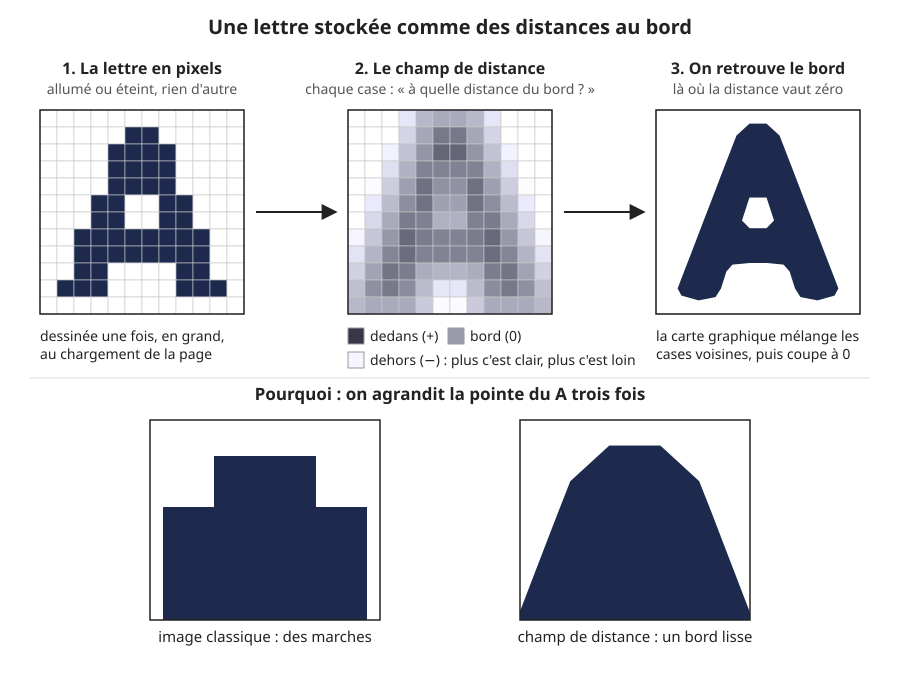
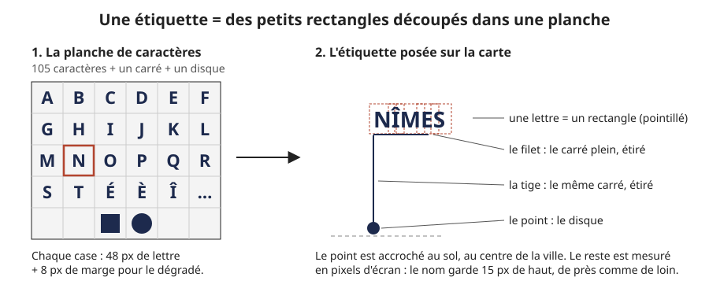
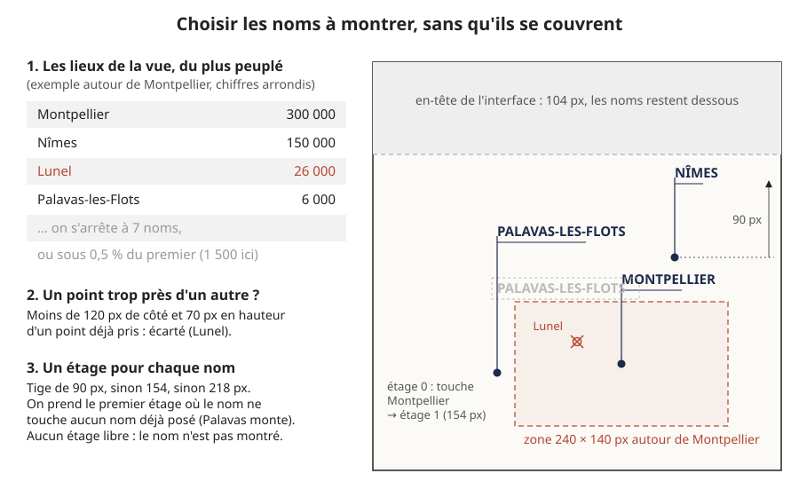
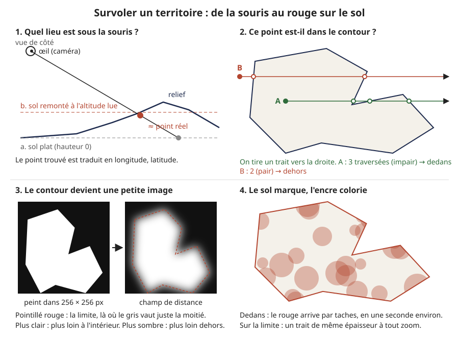

# Les noms et les lieux

> **En une phrase :** la carte connaît une liste de lieux (villes, départements, régions) avec leur position, leur population et parfois leur contour ; elle en choisit quelques-uns à nommer sans qu'ils se couvrent, écrit leurs noms avec des lettres stockées comme des distances au bord, et colorie en rouge le territoire que survole la souris.

## L'idée

Ce chapitre répond à quatre questions simples :

1. **Comment écrire un nom net**, qu'il fasse 15 pixels de haut sur une étiquette ou 200 pixels dans le titre d'accueil ?
2. **Quels noms montrer ?** Une vue sur l'Hérault contient des centaines de communes. On ne peut pas tout écrire.
3. **Comment chercher un lieu** et y aller ?
4. **Comment savoir quel territoire est sous la souris**, et le colorier ?

### Écrire net : stocker des distances au lieu des lettres

Une lettre, dans un ordinateur, c'est en général une petite image : une grille de [pixels](glossaire.md#pixel) allumés ou éteints. Si on l'agrandit, chaque pixel devient un gros carré et le bord fait des marches d'escalier. Si on la réduit, elle devient floue.

L'astuce s'appelle un [champ de distance signé](glossaire.md#champ-de-distance-signé) (en anglais SDF, *signed distance field*). Au lieu de ranger dans chaque pixel « allumé » ou « éteint », on y range **« à quelle distance du bord de la lettre suis-je ? »**. Un nombre positif à l'intérieur, négatif à l'extérieur, zéro pile sur le bord.

Pense à une carte de randonnée avec des courbes de niveau. Elle ne dessine pas la montagne : elle note l'altitude partout. Si tu veux le contour de la montagne à 1 000 m, tu suis la courbe des 1 000 m. Ici c'est pareil : la lettre n'est pas stockée, c'est la « courbe zéro » d'un relief de distances. Et une courbe se suit aussi bien de près que de loin.

Quand la [carte graphique](glossaire.md#carte-graphique) agrandit une image, elle mélange en douceur les pixels voisins. Mélanger « allumé » et « éteint » donne du gris flou. Mélanger des distances donne… une distance, juste au bon endroit. Le [shader](glossaire.md#shader) (le petit programme qui colorie chaque pixel) n'a plus qu'à dire : « distance positive, je mets de l'encre ; négative, je laisse le papier ». Le bord est lisse.

### Une étiquette, c'est un jeu de tampons

Toutes les lettres utiles sont rangées une fois pour toutes dans une grande planche, un [atlas](glossaire.md#atlas). Pour écrire « NÎMES », on découpe cinq cases de la planche et on les pose côte à côte. La tige, le petit trait sous le nom (le filet) et le point au sol sortent de la même planche : un carré plein étiré, et un disque.

Le point est accroché au sol, au centre de la ville. Tout le reste est mesuré en pixels d'écran, pas en kilomètres : le nom garde la même taille quel que soit le zoom, comme sur un plan imprimé.

## Comment ça marche, en gros

### 1. Fabriquer la planche de lettres (une fois, au démarrage)

1. On prend la police de la page (Manrope, en graisse 600 : une épaisseur de trait semi-grasse) et on écrit 105 caractères : chiffres, majuscules, minuscules, lettres accentuées françaises et quelques signes (`. , ' - ( ) ° / & ·`).
2. Chaque caractère est dessiné à 48 pixels de haut, avec 8 pixels de marge autour : une case de 64 × 64 pixels. On ajoute deux cases, le carré plein et le disque. 107 cases, rangées en 11 colonnes et 10 lignes : une planche de 704 × 640 pixels.
3. On calcule pour chaque pixel sa distance au bord le plus proche. La méthode est exacte et rapide : elle traite d'abord chaque ligne, puis chaque colonne, en une seule passe chacune.
4. On range cette distance dans un octet (un nombre de 0 à 255) : 128 sur le bord, 255 à 8 pixels à l'intérieur, 0 à 8 pixels à l'extérieur. La planche pèse donc 704 × 640 = 450 560 octets, environ 440 Ko, et se construit en une cinquantaine de millisecondes. Elle est gardée en mémoire et n'est jamais refaite. Le titre de l'accueil utilise la même méthode, avec sa propre planche dans sa propre police.
5. Au moment de dessiner, le shader cherche la valeur du milieu (128 sur 255, soit 0,5). Pour ne pas créer de marches, il adoucit le bord sur environ 0,7 pixel de part et d'autre, mesuré à l'écran. Résultat : le bord fait toujours à peu près un pixel et demi de flou, que la lettre soit petite ou grande.

### 2. Savoir quels lieux existent

Les lieux viennent d'internet, de trois sources publiques (voir aussi [Les données](3d/donnees.md)) :

1. **Les villes du monde** de Natural Earth : environ 7 300 villes avec la population de leur agglomération. On ne garde que celles de France.
2. **Les communes françaises** de l'API Géo de l'État (une [API](glossaire.md#api), c'est une adresse internet à laquelle un programme pose une question et reçoit une réponse). Charger toute la France pèserait 3,9 Mo. On procède donc département par département (10 à 100 Ko chacun) : quand la vue fait moins de 250 km de large, on plante 3 × 3 = 9 sondes dans la vue, on demande « dans quel département est ce point ? », et on charge les communes de chaque nouveau département, une seule fois.
3. **Les départements et les régions**, avec leur contour, dans deux fichiers simplifiés : 96 départements (556 Ko) et 13 régions (220 Ko), France métropolitaine.

Une même ville peut arriver deux fois, par Natural Earth et par l'API Géo, avec des populations différentes (l'agglomération contre la commune). Si deux lieux portent le même nom (accents, majuscules, espaces et tirets ignorés) à moins de 0,25° l'un de l'autre en longitude comme en latitude (environ 28 km du nord au sud), on n'en garde qu'un : le plus peuplé, qui récupère au passage le code officiel de la commune de l'autre (et son contour s'il en avait un).

Pour les départements et régions, il n'y a pas de population dans le fichier. On calcule la **surface** du contour et on s'en sert pour classer : un grand département passe devant un petit.

Tout est rangé dans une liste triée, du plus peuplé au moins peuplé. Un bouton de l'interface choisit ce qu'on nomme : communes, départements ou régions. Quand on change, les noms affichés sortent d'abord, la liste est vidée, puis les nouveaux entrent. On ne voit jamais deux jeux de noms mélangés.

### 3. Choisir les noms à montrer

Au plus toutes les 250 ms, quand la vue a bougé ou que de nouveaux lieux sont arrivés :

1. **On parcourt la liste dans l'ordre**, du plus peuplé au moins peuplé, en ne gardant que les lieux visibles et dans la partie nette du sol (pas dans la zone qui s'efface dans le papier, voir [Le dessin](dessin.md)).
2. **On s'arrête à 7 noms**, ou dès qu'on tombe sous 0,5 % de la population du premier. Autour de Montpellier (300 000 habitants), on ignore tout ce qui fait moins de 1 500 habitants.
3. **On écarte les points trop serrés.** Si un lieu tombe à moins de 120 pixels de côté *et* 70 pixels en hauteur d'un lieu déjà pris, il est sauté. Le plus peuplé passe toujours en premier.
4. **On donne un étage à chaque nom.** Le nom est posé au bout d'une tige verticale de 90 pixels. S'il touche un nom déjà posé (avec 6 pixels de marge de lecture), on essaie une tige de 154 pixels, puis de 218. Trois étages en tout. Si aucun n'est libre, le nom n'est pas montré. Un nom garde son étage d'une fois sur l'autre quand c'est possible, pour ne pas sauter.
5. **On anime.** Un nom qui arrive : le point se pose, la tige pousse, le nom s'encre en haut, en 460 ms. Les nouveaux entrent l'un après l'autre, de gauche à droite, toutes les 60 ms. Un nom qui part redescend en 220 ms.

En pratique, la carte garde 14 étiquettes prêtes à l'emploi : 7 affichées, et 7 qui peuvent être en train de sortir pendant que les suivantes entrent. (Le territoire survolé peut s'ajouter aux 7, voir plus bas.)

### 4. Chercher un lieu

1. On tape au moins 2 lettres dans la barre de recherche.
2. La carte cherche dans sa liste de lieux connus : d'abord ceux dont le nom **commence** par ce qu'on a tapé, puis ceux qui le **contiennent**, les plus peuplés d'abord. Accents, majuscules, espaces et tirets ne comptent pas : « ales » trouve Alès, « saint etienne » trouve Saint-Étienne. On ne cherche que dans le niveau affiché (communes, départements ou régions). On affiche les 6 premiers.
3. On clique : la carte vole vers le lieu. S'il a un contour (un département, une région, ou une commune déjà survolée), elle cadre tout le contour, avec 25 % de marge (jamais moins de 3 km de large). Sinon, elle s'arrête sur une vue de 3 km de large (ou reste plus près si on l'est déjà), assez près pour voir les bâtiments en relief (voir [La navigation](navigation.md)).

Cliquer sur un nom de la carte fait la même chose.

### 5. Quel territoire est sous la souris ?

1. **Trouver le point au sol.** Le relief n'existe que dans la carte graphique (voir [La carte en 3D](3d/README.md)) : le reste du programme ne connaît pas sa forme exacte. On tire donc un [rayon](glossaire.md#lancer-de-rayon) (une ligne droite imaginaire, comme un pointeur laser) depuis l'œil, à travers la souris, jusqu'à un sol plat imaginaire. On lit l'altitude du vrai relief à cet endroit, on remonte le sol plat à cette hauteur, et on tire une seconde fois. Deux essais suffisent pour tomber à peu près au bon endroit. Ce point est traduit en longitude et latitude.
2. **Trouver le contour qui le contient.** Un contour est une liste de points (longitude, latitude) qu'on relie dans l'ordre : un [polygone](glossaire.md#polygone). Pour savoir si un point est dedans, on tire un trait horizontal vers la droite et on compte combien de fois il traverse le bord. Impair : dedans. Pair : dehors. Pour aller vite, on vérifie d'abord si le point est dans le rectangle qui entoure le contour.
3. **Cas des communes.** Leurs contours ne sont pas chargés avec la liste : servir tous les contours d'un département le ferait passer de quelques dizaines de Ko à plusieurs Mo. Quand la souris reste immobile 140 ms, on demande à l'API Géo « quelle commune est ici ? », contour compris. On le garde ensuite.
4. **Ne pas colorier là où l'on est déjà.** Si le centre de la vue est dans ce territoire (ou à moins de 6 % de la largeur de vue de son bord), et que la vue n'est pas plus de 3 fois plus large que lui, on ne colore rien : on y est, le rouge ne dirait rien.
5. **Peindre le contour dans une petite image.** Le contour est dessiné en blanc dans une image de 256 × 256 pixels, cadrée sur lui avec 6 % de marge. Puis on la transforme en champ de distance, exactement comme les lettres : la limite vaut 0,5, l'intérieur plus, l'extérieur moins. On donne au sol cette image et le cadre (en longitude, latitude) où la poser.
6. **Le sol marque, l'encre colorie.** Pour chaque pixel, le shader du sol lit l'image à sa longitude et sa latitude. Au-dessus de 0,5 : dedans. Tout près de 0,5 : la limite, sur environ 1,1 pixel de part et d'autre (un trait d'à peu près 2 pixels). Le sol ne peint pas lui-même : il glisse une marque « dedans » ou « limite » à côté de chaque pixel. C'est la [passe d'encre](glossaire.md#passe-dencre) (l'étape finale qui redessine toute l'image en traits d'encre, voir [Le dessin](dessin.md)) qui lit cette marque : dedans, ses traits passent au rouge et le papier prend un léger voile rouge (12 %) ; sur la limite, elle trace le trait. Ce trait s'arrête à la côte, où le rivage dit déjà la limite.
7. **Le rouge arrive par taches.** Il ne monte pas en fondu : un [bruit](glossaire.md#bruit) (un motif de taches aléatoires, fixé sur le sol comme du papier moucheté) dit dans quel ordre les pixels basculent. À chaque image, il comble une part de ce qui reste à gagner : les deux tiers en une demi-seconde, presque tout en une seconde. En partant, il reflue de la même façon.
8. **Trois places à la fois.** Le sol sait colorier 3 territoires en même temps : celui qu'on survole et deux qui s'effacent encore. Ainsi, passer vite d'un département à l'autre ne coupe pas les transitions.

Deux détails pour que ce soit agréable :

- Le nom du territoire survolé est toujours affiché, en premier, dès que son point est à l'écran. Son étiquette rougit aussi, et son filet s'allonge.
- À moins de 28 pixels d'un nom, la carte cesse de pivoter légèrement avec la souris (cet effet de profondeur s'appelle la [parallaxe](glossaire.md#parallaxe) ; ici il se fige) : sinon le nom glisserait sous le pointeur et on ne pourrait pas cliquer dessus.

## Pourquoi on a fait comme ça

- **Le champ de distance** donne des lettres nettes à toutes les tailles avec une seule planche, calculée sur place à partir de la police de la page. Pas d'outil à lancer avant, pas de fichier de police spécial à livrer. Les étiquettes (15 px) et le titre d'accueil (très grand) utilisent la même méthode et le même shader.
- **Le même champ de distance sert au survol.** C'est le vrai gain caché : grâce à lui, le trait de la limite a toujours la même épaisseur à l'écran. Un trait dessiné directement dans l'image de 256 pixels ferait moins d'un pixel en vue France et plusieurs pixels en vue rapprochée.
- **Les noms sont dessinés par la carte graphique, sur leur propre calque, après l'encre.** Si on les dessinait avec le terrain, la passe d'encre les prendrait pour du relief et les hachurerait. Et comme le dessin du nom et sa zone cliquable sortent du même calcul de position, ils ne peuvent pas se décaler.
- **Le choix « le plus peuplé d'abord, puis écarter ce qui gêne »** est un algorithme glouton (il prend la meilleure option à chaque pas, sans revenir en arrière). C'est simple, rapide, prévisible : les grandes villes sont toujours nommées.
- **Les sources publiques chargées à la demande** évitent de préparer et d'héberger des données. Pour un [POC](glossaire.md#poc) (un prototype qui sert à prouver qu'une idée marche), c'est le plus court chemin.
- **Le test « pair ou impair »** est la méthode classique pour savoir si un point est dans un polygone : quelques lignes, aucun outil.

## Ce qu'on aurait pu faire autrement

- **Écrire les noms en HTML (le langage des pages web), par-dessus la carte.** C'est la méthode la plus simple, avec une typographie parfaite. Mais il faut recalculer et déplacer chaque nom à chaque image, en dehors de la carte graphique. Le texte peut alors traîner d'une image derrière le relief, et la zone cliquable s'écarter du dessin. Il serait aussi impossible de le faire apparaître à travers le cache qui dévoile la carte à l'accueil, comme on le fait avec le titre.
- **Une image par nom.** On écrirait chaque nom dans sa propre petite image. Simple, mais flou si on l'agrandit, et il faudrait une image par lieu.
- **Un champ de distance à trois couleurs (MSDF).** Il garde les angles des lettres bien vifs, même très agrandis, alors que notre version les arrondit un peu. Il demande un outil externe et un fichier préparé à l'avance. À 15 pixels, la différence ne se voit pas : pas retenu pour le POC. En production, si le titre d'accueil doit être très grand et très net, c'est l'option à prendre.
- **Préparer la planche à l'avance** et la livrer comme un fichier, pour économiser les 50 ms du démarrage. Pas prioritaire.
- **Un placement des noms plus malin.** On pourrait essayer 8 positions autour du point (au-dessus, à droite, en dessous…) et chercher la meilleure combinaison pour toute la vue, par exemple par recuit simulé (on essaie des permutations au hasard en gardant celles qui réduisent les chevauchements). Les cartes professionnelles le font. Trop élaboré pour un POC ; le glouton à étages suffit pour 7 noms.
- **Chercher sur internet plutôt que dans la liste locale.** L'API Géo sait chercher une commune par son nom. Aujourd'hui, on ne trouve que les lieux déjà chargés (voir les limites). **En production**, c'est la première chose à changer.
- **Utiliser des tuiles vectorielles** (des morceaux de carte livrés comme des formes et des textes, plutôt que comme des images ; voir [Les données](3d/donnees.md)) qui contiennent déjà les noms, les contours et un identifiant par objet. La carte graphique pourrait alors dire directement quel objet est sous la souris. C'est la voie d'une vraie application de cartographie ; beaucoup plus de travail que deux rayons et un test de contour.
- **Héberger nous-mêmes les fichiers de contours**, au lieu de les lire depuis un dépôt public qui peut changer sans prévenir.

## Limites actuelles

- **La recherche ne trouve que ce qui est déjà chargé.** En mode communes, ce sont les villes de Natural Earth et les communes des départements déjà vus. Un village de Bretagne, vu depuis Montpellier, est introuvable tant qu'on n'est pas passé par là.
- **7 noms au plus**, et le glouton peut sacrifier un nom important parce qu'un plus peuplé lui prend la place.
- **Deux communes homonymes proches** (moins de 0,25°, environ 28 km) sont fusionnées à tort.
- **Caractères manquants.** La planche ne contient que 105 caractères. Une lettre absente, comme le Ÿ de « L'Haÿ-les-Roses » ou le Œ, est simplement sautée dans le nom.
- **Les coins des lettres sont légèrement arrondis** s'ils sont très agrandis (c'est ce que corrigerait le MSDF).
- **Le point sous la souris est approximatif** sur un relief très marqué : deux essais de rayon ne suffisent pas toujours.
- **L'image du contour fait 256 × 256 pixels**, étirée sur le cadre du territoire. Un territoire très allongé perd du détail sur son grand côté. Et la fabriquer bloque une image : c'est pour cela que les animations ne comptent jamais plus de 40 ms par image, sinon le rouge sauterait d'un coup.
- **Départements et régions : France métropolitaine seulement.** Les outre-mer ne sont ni nommés ni coloriés à ces niveaux.
- **Pas de coloriage au survol du sol pendant un vol** (on peut encore viser un nom), et rien hors de France.
- **Tout dépend de services en ligne.** Sans réseau, ou si un service tombe, la carte n'a plus de noms.

## Où c'est dans le code

| Étape | Fichier | Rôle |
|---|---|---|
| Calcul des distances au bord | [DistanceField.ts](../src/graphics/text/DistanceField.ts) | transforme une image noir et blanc en champ de distance (lettres et contours) |
| Planche de lettres | [SdfFont.ts](../src/graphics/text/SdfFont.ts) | dessine les 105 caractères, le carré et le disque, calcule la largeur d'un texte |
| Encre des étiquettes | [Label.material.ts](../src/graphics/materials/Label.material.ts) | shader du texte : lit la distance, adoucit le bord, rougit au survol |
| Choix, étages, animation, survol | [Labels3D.node.ts](../src/graphics/nodes/labels/Labels3D.node.ts) | sélection des 7 noms, étages, entrées et sorties, rayon vers le sol, clic |
| Communes à la demande | [FrenchCommunes.helper.ts](../src/graphics/nodes/labels/FrenchCommunes.helper.ts) | les 9 sondes et le chargement par département |
| Sources des lieux | [PlaceSources.ts](../src/graphics/places/PlaceSources.ts) | Natural Earth, API Géo (département d'un point, communes, contour d'une commune) |
| Départements et régions | [AdminAreas.ts](../src/graphics/places/AdminAreas.ts) | fichiers de contours, surface et centre de chaque territoire |
| Liste des lieux | [PlaceIndex.ts](../src/graphics/places/PlaceIndex.ts) | tri par population, fusion des doublons, recherche, lieu contenant un point |
| Contours | [Rings.ts](../src/graphics/places/Rings.ts) | test pair ou impair, distance au bord, cadre |
| Image du contour | [AreaMask.helper.ts](../src/graphics/places/AreaMask.helper.ts) | peint le contour en 256 × 256 et le transforme en champ de distance |
| Les 3 places du rouge | [AreaAccents.helper.ts](../src/graphics/places/AreaAccents.helper.ts) | quel territoire occupe quelle place, montée et reflux du rouge |
| Marque sur le sol | [Terrain.material.ts](../src/graphics/materials/Terrain.material.ts) | lit l'image du contour, marque « dedans » par taches et « limite » |
| Rouge à l'encre | [Ink.effect.ts](../src/graphics/postprocessing/effects/Ink.effect.ts), [InkStyle.ts](../src/graphics/postprocessing/effects/InkStyle.ts) | lit la marque : traits rouges, voile sur le papier, trait de la limite |
| Niveaux nommés | [focus.config.ts](../src/graphics/config/focus.config.ts) | communes, départements, régions |
| Recherche et vol | [Main.universe.ts](../src/graphics/universes/impl/Main.universe.ts), [MapChrome.client.vue](../app/components/MapChrome.client.vue) | barre de recherche, cadrage sur le contour ou vue de 3 km |

## Pour aller plus loin

- Chris Green (Valve), *Improved Alpha-Tested Magnification for Vector Textures and Special Effects*, SIGGRAPH 2007. L'article qui a popularisé les champs de distance pour le texte dans les jeux.
- Pedro Felzenszwalb et Daniel Huttenlocher, *Distance Transforms of Sampled Functions*, Theory of Computing, 2012. La méthode exacte, ligne puis colonne, utilisée pour calculer les distances.
- Viktor Chlumský, [msdfgen](https://github.com/Chlumsky/msdfgen) : l'outil de référence pour les champs de distance à trois couleurs (MSDF), l'alternative écartée.
- W. Randolph Franklin, [PNPOLY, Point Inclusion in Polygon Test](https://wrfranklin.org/Research/Short_Notes/pnpoly.html) : le test pair ou impair expliqué par son auteur.
- Jon Christensen, Joe Marks, Stuart Shieber, *An Empirical Study of Algorithms for Point-Feature Label Placement*, ACM Transactions on Graphics, 1995. Comparaison des façons de placer des noms sans chevauchement, dont le recuit simulé. Les données : [Natural Earth](https://www.naturalearthdata.com/), [API Géo, communes](https://geo.api.gouv.fr/decoupage-administratif/communes), [france-geojson](https://github.com/gregoiredavid/france-geojson).
