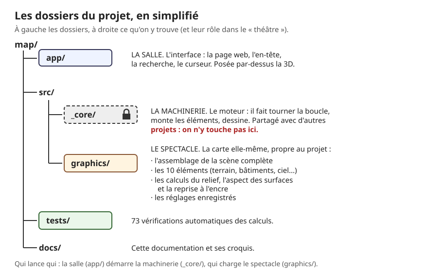
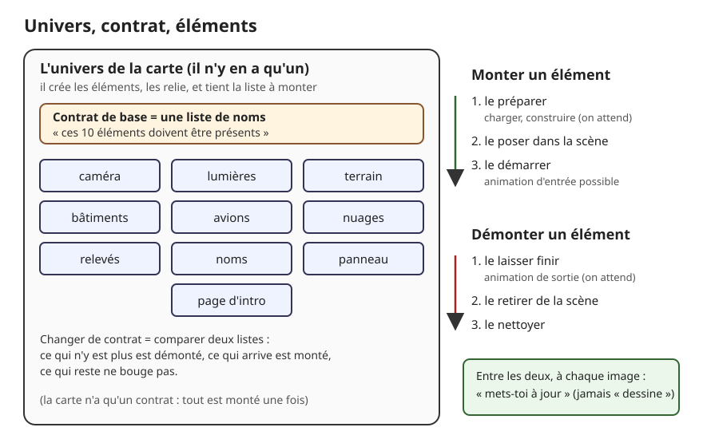
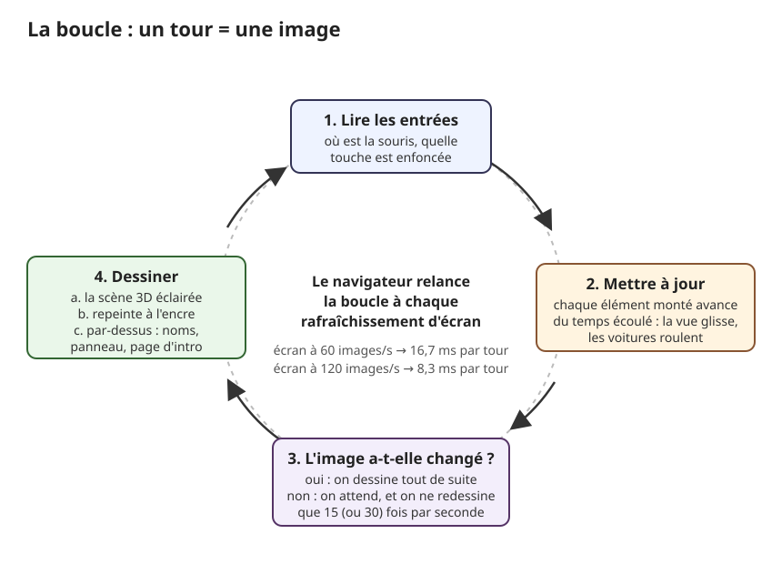

# Comment le code est organisé

> **En une phrase :** un petit moteur, qui ne sait rien de la carte, fait tourner une boucle : à chaque image, il lit la souris, fait avancer une dizaine d'éléments, puis dessine ; la carte n'est qu'un ensemble de ces éléments, et la page web est posée par-dessus.

Ce chapitre est pour toi si tu vas ouvrir le code pour la première fois. Il ne parle ni de relief ni d'encre : il explique la charpente qui porte tout le reste, et par où commencer à lire.

## L'idée

Pense à un théâtre. Il y a la **machinerie** : le rideau, les projecteurs, le régisseur qui donne le top à chaque seconde. Elle est la même quel que soit le spectacle. Puis il y a **le spectacle** : les décors, les acteurs, la mise en scène. Et enfin **la salle** : les sièges, le programme, les panneaux de sortie, ce que le public touche.

Le code est rangé exactement comme ça, en trois grands dossiers (leurs vrais noms sont sur le croquis) :

- **La machinerie.** C'est le [moteur](./glossaire.md#moteur) : le code qui fait tourner la scène, sans rien savoir de ce qu'elle montre. Il vient d'un modèle commun à plusieurs projets du studio. On ne le modifie pas ici : si on veut le changer, on change d'abord le modèle, puis on recopie la même version dans tous les projets.
- **Le spectacle.** C'est la carte : le terrain, les bâtiments, le ciel, l'encre, les réglages. Tout ce qui est propre à ce projet vit là.
- **La salle.** C'est l'interface : l'en-tête, la recherche de lieu, le curseur. C'est une page web classique, construite avec Vue (un outil répandu pour fabriquer des pages web), posée comme une vitre au-dessus de la 3D.

À côté, un dossier contient les vérifications automatiques (les tests, expliqués plus bas), et un autre cette documentation.

Le moteur repose sur trois idées. Une fois qu'on les a, le reste se lit facilement.

1. **La boucle.** Une animation, c'est une suite d'images fixes affichées très vite, comme un folioscope. Le moteur refait donc toujours les mêmes trois gestes : lire ce que fait l'utilisateur, faire avancer la scène, dessiner. Puis il recommence.
2. **Les éléments montables.** Chaque morceau de la scène (le terrain, les nuages, les noms de villes...) est un module indépendant qu'on peut **monter** (le faire entrer en scène) et **démonter** (le faire sortir). Dans le code, on les appelle des [nodes](./glossaire.md#node) (des « nœuds » : un élément de la scène avec son cycle de vie).
3. **Les univers.** Un [univers](./glossaire.md#univers) est une scène complète : une collection d'éléments, une caméra et une manière de dessiner. Un projet peut en avoir plusieurs et passer de l'un à l'autre, comme on change de décor entre deux actes. La carte n'en a qu'un.

## Comment ça marche, en gros

### Le démarrage

1. **La page s'affiche d'abord sans 3D.** Le moteur et three.js (la boîte à outils 3D, écrite par d'autres, sur laquelle tout repose) ne sont téléchargés qu'après, quand la zone de dessin est prête. Le premier écran arrive donc plus vite.
2. **On choisit la façon de parler à la carte graphique.** Le moteur demande [WebGPU](./glossaire.md#webgpu) (la façon moderne de faire travailler la carte graphique depuis un navigateur). Si le navigateur ne le connaît pas, three.js passe tout seul à [WebGL2](./glossaire.md#webgl2) (l'ancienne façon, disponible presque partout). Si aucun des deux ne marche, la page affiche « Le rendu 3D n'a pas pu demarrer sur cet appareil. » (sans accent dans le code) au lieu d'un écran noir.
3. **On charge les réglages.** Toutes les valeurs du [panneau de réglages](./glossaire.md#panneau-de-réglages) (exagération du relief, épaisseur du trait, couleur du papier...) sont lues dans un fichier enregistré, **toujours**, que le panneau soit ouvert ou non. Ce sont elles qui donnent son allure à la carte (voir plus bas).
4. **On active l'univers de la carte.** Il inscrit ses dix éléments, puis précharge deux images : un « bruit » (une image de taches grises au hasard, qui donnent son bord irrégulier au passage de l'intro et sa matière à la feuille du panneau d'information) et une texture de papier journal, posée sous la carte.
5. **On monte les éléments.** L'univers applique son [contrat](./glossaire.md#contrat) : une simple liste des éléments qui doivent être présents. Les dix sont montés : caméra, lumières, terrain, bâtiments, avions, nuages, relevés (le quadrillage de coordonnées drapé sur le relief, et la poussière en suspension), noms de lieux, panneau d'information, page d'intro.
6. **La boucle démarre.** La barre de chargement suit le travail : 80 % pour le terrain, 10 % pour les noms et la page d'intro, 10 % pour la préparation des [shaders](./glossaire.md#shader) (les petits programmes qui tournent sur la carte graphique et décident de la couleur de chaque point). On les prépare en avance : sinon, la première fois que le sol change d'aspect, l'image se figerait une fraction de seconde le temps de les préparer.

### Monter et démonter un élément

Chaque élément a quatre moments, toujours dans le même ordre :

1. **se préparer** : charger ses données, construire ses formes. Le moteur attend que ce soit fini ;
2. **entrer en scène** : le moteur le pose dans la [scène](./glossaire.md#scène) (l'ensemble des objets 3D que la caméra peut voir) et lui dit qu'il peut démarrer, par exemple une animation d'entrée ;
3. **se préparer à sortir** : jouer une animation de sortie, que le moteur attend ;
4. **sortir** : le moteur le retire de la scène, l'élément fait le ménage.

Changer de contrat, c'est comparer deux listes. Ce qui n'est plus dans la nouvelle liste est démonté, ce qui arrive est monté, ce qui est dans les deux ne bouge pas. Si on redemande un changement pendant qu'un autre est en cours, seule la dernière demande est gardée, puis rejouée à la fin.

### La boucle, image par image

Le navigateur prévient le moteur à chaque fois que l'écran se rafraîchit : 60 fois par seconde sur un écran classique, 120 sur un écran rapide. À 120 images par seconde, un tour de boucle a donc 1 000 ÷ 120 ≈ 8,3 millisecondes (un peu moins d'un centième de seconde) pour tout faire. Tenir ce rythme, c'est l'objectif du projet.

1. **Mesurer le temps.** Le moteur calcule le temps écoulé depuis l'image précédente, par exemple 8,3 ms. Il peut le multiplier par une vitesse : 0,5 pour un ralenti, 0 pour figer. C'est le seul endroit où le temps naît : ralentir ici ralentit tout en même temps (shaders, nuages, intro, caméra), comme le bouton ralenti d'un magnétoscope. SONDE, l'outil maison qui sert à régler les animations, s'en sert pour régler l'intro au ralenti.
2. **Lire les entrées.** Où est la souris, a-t-elle bougé, quelle touche est enfoncée.
3. **Mettre à jour.** L'univers transmet le temps écoulé à chaque élément monté, qui avance d'autant : la vue glisse vers sa destination, une voiture roule de quelques centimètres, un nuage dérive. Un élément ne dessine **jamais** lui-même : il décrit seulement où il en est.
4. **Décider s'il faut dessiner.** Si la caméra n'a pas bougé et que tous les éléments disent « je suis au repos », la nouvelle image serait identique à la précédente. On ne redessine alors que 15 fois par seconde, ou 30 s'il reste un peu de vie (voitures, bateaux, avions, vent). Sinon, on dessine à chaque tour.
5. **Dessiner.** Trois couches, l'une sur l'autre : la scène 3D éclairée, puis sa reprise à l'encre, puis par-dessus les noms de lieux, le panneau d'information et la page d'intro. Ces derniers viennent après l'encre, sinon elle les hachurerait comme du relief. Le détail est dans [Le dessin](./dessin.md).

### Les réglages

Les réglages ont deux vies.

- **Dans un fichier enregistré.** C'est ce que voit tout visiteur. Le fichier est glissé dans le site au moment où on le fabrique pour le mettre en ligne : la page n'a rien à aller chercher en plus.
- **Dans un panneau.** En ajoutant « ?debug » à la fin de l'adresse de la page, un panneau de curseurs s'ouvre, en trois onglets : Carte, Dessin, Rendu. Bouger un curseur change la carte tout de suite, mais seulement jusqu'au rechargement de la page. Le bouton « Save Settings » réécrit le fichier, et il ne marche que sur l'ordinateur où l'on développe le projet.

Chaque réglage est déclaré une seule fois et sert deux fois : appliqué sans panneau, puis branché sur le panneau s'il est ouvert. C'est ce qui garantit qu'ouvrir le panneau ne montre jamais une autre carte que celle des visiteurs.

Deux réglages changent franchement la carte. Ce sont des variantes existantes, pas des options cachées :

- **le bâti** : « volumes » donne à chaque bâtiment un vrai volume en 3D (son contour au sol, monté à sa hauteur), « aucun » laisse la carte à plat, le bâti seulement imprimé au sol. Voir [Les bâtiments](./3d/batiments.md) ;
- **le dessin** : à 1, la carte est repeinte à l'encre ; à 0, la passe d'encre est coupée et on voit la scène 3D telle qu'elle est éclairée, sur fond noir. C'est la « carte de nuit ».

### Les tests

Un [test automatique](./glossaire.md#test-automatique) est un petit programme qui pose une question au code et vérifie la réponse. Par exemple : « un degré de latitude vaut-il bien 111,195 km vers le nord ? », ou « une voiture reste-t-elle sur sa voie, dans son sens ? ». Il y en a 73, rangés en 16 fichiers.

Pour les lancer, il suffit de taper une commande (donnée dans « Où c'est dans le code ») dans un terminal, la fenêtre où l'on écrit des instructions à l'ordinateur. Ils tournent en une seconde environ, sans navigateur ni carte graphique, avec l'outil de test fourni avec Node.js (le programme qui fait tourner du JavaScript hors du navigateur). Chaque ligne verte est une question à laquelle le code a bien répondu.

Ils vérifient les **calculs** : conversion degrés vers kilomètres, assemblage des tuiles d'altitude, construction des bâtiments, trajets des voitures et des avions, mémoire des tuiles déjà téléchargées, minutage de l'intro. Ils ne vérifient pas **l'image** : savoir si la carte est belle, ça se regarde.

## Pourquoi on a fait comme ça

- **Séparer la machinerie du spectacle.** Le même moteur sert à plusieurs projets. Un bug corrigé dans le modèle est corrigé partout. Et pour comprendre la carte, on n'a presque jamais besoin d'ouvrir le moteur.
- **Des éléments qui ne dessinent pas.** Un seul endroit demande à la carte graphique de dessiner. On peut donc décider de ne pas dessiner du tout (le « rendu à la demande »), ou de dessiner la scène en plus petit quand l'ordinateur peine, sans toucher aux éléments.
- **Le rendu à la demande.** Une carte immobile n'a pas besoin de 120 images identiques par seconde. Passer à 15 laisse refroidir l'ordinateur et économise la batterie d'un portable.
- **Monter et démonter plutôt qu'allumer et éteindre.** Un élément démonté sort vraiment de la scène : la carte graphique ne le traite plus du tout. Et l'entrée ou la sortie peut être animée sans code spécial.
- **WebGPU, avec repli.** WebGPU est plus rapide et permet de mesurer précisément le temps que prend chaque dessin. Tous les shaders sont écrits dans TSL, le langage maison de three.js, qui sait se traduire tout seul pour WebGPU comme pour WebGL2. On écrit donc une seule fois, et un vieux navigateur affiche quand même la carte.
- **Des tests sans carte graphique.** Les calculs sont rangés à part du dessin. On peut les vérifier en une seconde, à chaque changement, sans ouvrir la page.

## Ce qu'on aurait pu faire autrement

- **Utiliser une charpente toute faite** (TresJS ou React Three Fiber, qui permettent de décrire la scène 3D comme une page web, ou un moteur complet comme Babylon.js). On aurait écrit moins de code de base. Pas retenu : le moteur maison existait déjà, il est partagé avec d'autres projets, et il laisse décider seul de quand dessiner, ce qui rend le rendu à la demande simple. Pour un nouveau projet sans moteur maison, TresJS serait un bon point de départ.
- **Laisser three.js gérer la boucle.** three.js a sa propre boucle prête à l'emploi. Pas retenue : le moteur doit pouvoir ralentir ou figer le temps à un seul endroit, pour tout le monde, et choisir de sauter des images.
- **Un temps fixe.** Les jeux avancent souvent la scène par pas réguliers (exactement 1/60 de seconde à chaque fois) au lieu du temps réellement écoulé. C'est plus stable, mais plus long à écrire, et surtout utile quand on simule de la physique (des chocs, des chutes), ce que la carte ne fait pas. En production, on ajouterait au moins un plafond au temps écoulé, dans le moteur (voir Limites).
- **WebGL seul.** Plus simple et compatible partout. Pas retenu : WebGPU tient mieux 120 images par seconde, et le repli vers WebGL2 est fourni gratuitement par three.js.
- **Des réglages stockés sur un serveur** (un ordinateur en ligne qui les garde). On pourrait les modifier depuis n'importe où, sans refabriquer le site. Trop lourd pour un POC (un prototype qui sert à prouver que l'idée tient) : un fichier rangé avec le code suffit, et on garde l'historique de chacune de ses versions.
- **Des tests d'image.** On prend une capture de la carte et on la compare, pixel par pixel, à une capture de référence. Utile en production pour détecter un changement d'aspect involontaire. Pas fait : le rendu change encore tous les jours, les références seraient périmées aussitôt.

## Limites actuelles

- **Le moteur n'est pas tout à fait indépendant.** Il va lire quelques fichiers de la carte, toujours au même endroit et sous le même nom (configuration de départ, liste des univers, noms des éléments, liste des images à charger, onglets du panneau, gestion de la souris). Un autre projet doit fournir des fichiers de même nom, sinon il ne démarre pas.
- **Pas de plafond au temps écoulé dans le moteur.** Si l'onglet reste caché une minute, la première image au retour reçoit « une minute s'est écoulée » d'un coup. Certains éléments se protègent eux-mêmes : voitures, bateaux, avions et nuages n'avancent jamais de plus de 100 ms par image, les noms et la page d'intro de plus de 40 ms. Le reste, comme un déplacement de la vue en cours ou le minutage de l'intro, fait un grand saut. Chaque élément doit penser à se protéger : c'est fragile.
- **Le redimensionnement arrive deux fois.** La page et le moteur surveillent chacun la taille de la fenêtre. Agrandir la fenêtre recalcule donc tout deux fois. Sans conséquence visible, mais du travail en double.
- **Un oubli se voit mal.** Un nouvel élément animé qui ne dit pas qu'il bouge sera dessiné à 15 images par seconde seulement : son animation paraîtra saccadée.
- **Le panneau est ouvert à tous.** N'importe qui peut ajouter « ?debug » à l'adresse. C'est voulu (régler depuis un téléphone), mais il ne peut rien enregistrer en ligne.
- **Du moteur qui ne sert pas.** Une partie du moteur n'est pas utilisée par la carte :
  - le clic sur un objet 3D. Ce calcul se fait sur le processeur (le « cerveau » général de l'ordinateur), qui ne connaît pas le relief : le relief n'existe que dans la carte graphique (voir [La 3D](./3d/README.md)). Le survol passe donc par les contours administratifs (commune, département, région), voir [Les lieux](./lieux.md) ;
  - les groupes d'éléments et les éléments cliquables ;
  - la réserve de shaders écrits à l'ancienne, vide ici : tout est écrit en TSL ;
  - les outils pour charger des objets 3D tout faits, des sons, des vidéos ;
  - une mémoire de la taille d'écran, remplie mais jamais consultée, et plusieurs interrupteurs de mise au point.

  On les garde parce que le moteur doit rester la copie exacte du modèle commun. Les retirer ici créerait une version à part, impossible à remettre à jour. Leur coût est minime : un peu de code téléchargé, presque rien d'exécuté. Les défauts relevés sont listés dans l'ancien document technique (voir « Où c'est dans le code ») et seront corrigés dans le modèle d'abord.

## Où c'est dans le code

| Étape | Fichier | Rôle |
|---|---|---|
| Règle du moteur partagé | [src/_core/README.md](../src/_core/README.md) | règle de portage, journal des modifications |
| Point d'entrée de la page | [app/components/ThreeStage.client.vue](../app/components/ThreeStage.client.vue) | crée la zone de dessin, charge le moteur, message si la 3D échoue |
| Démarrage, WebGPU / WebGL2 | [src/_core/systems/ThreeDevice.ts](../src/_core/systems/ThreeDevice.ts) | `_createRenderer`, puis `init` : ordre du démarrage |
| Choix de WebGPU | [src/graphics/device/device.config.ts](../src/graphics/device/device.config.ts) | `backend: "webgpu"` |
| La boucle | [src/_core/systems/RAF.ts](../src/_core/systems/RAF.ts) | `_tick` : temps écoulé, vitesse (`setRate`), entrées, mise à jour, dessin |
| Chef d'orchestre | [src/_core/systems/Runtime.ts](../src/_core/systems/Runtime.ts) | relie entrées, sortie et boucle |
| Entrées | [src/_core/systems/Input.ts](../src/_core/systems/Input.ts) | état de la souris et du clavier |
| Activation d'un univers, dessin | [src/_core/systems/Output.ts](../src/_core/systems/Output.ts) | `activateUniverse`, `render` |
| Univers et contrats | [src/_core/universes/Universe.base.ts](../src/_core/universes/Universe.base.ts) | `registerContract`, `applyContract` : comparaison des listes |
| Monter, démonter | [src/_core/nodes/NodeGraph.ts](../src/_core/nodes/NodeGraph.ts) | `mount`, `unmount`, `update` des seuls éléments montés |
| Ce qu'est un élément | [src/_core/nodes/Node.interface.ts](../src/_core/nodes/Node.interface.ts) | les quatre moments, plus `update`, `resize`, `dispose` |
| Liste des univers | [src/graphics/universes/universes.manifest.ts](../src/graphics/universes/universes.manifest.ts) | un seul : `MAIN`, par défaut |
| L'univers de la carte | [src/graphics/universes/impl/Main.universe.ts](../src/graphics/universes/impl/Main.universe.ts) | crée les dix éléments, la chaîne de dessin, le contrat ; rendu à la demande (`IDLE_FPS`, `LIVELY_FPS`) ; réglages (`_settings`) |
| Noms des éléments | [src/graphics/nodes/Node.id.ts](../src/graphics/nodes/Node.id.ts) | les dix identifiants et celui du contrat |
| Les éléments | [src/graphics/nodes/](../src/graphics/nodes/) | un dossier par élément : `terrain/`, `buildings/`, `sky/`, `labels/`... |
| Valeurs des réglages | [src/graphics/config/debug.values.json](../src/graphics/config/debug.values.json) | ce que voit tout visiteur ; réécrit par « Save Settings » |
| Onglets du panneau | [src/graphics/debug/debug.config.ts](../src/graphics/debug/debug.config.ts) | Carte, Dessin, Rendu et leurs dossiers |
| Panneau et mémoire des réglages | [src/_core/debug/DebugManager.ts](../src/_core/debug/DebugManager.ts) | `bind` : applique la valeur enregistrée puis crée le curseur |
| Tests | [tests/graphics/](../tests/graphics/) | 16 fichiers `*.test.ts` ; à lancer avec `pnpm test` (script `test` de [package.json](../package.json)) |
| Défauts et code inutilisé, en détail | ancien document technique, retiré de la doc : `git show ebde7c6:docs/architecture.md` | sections « Modules du _core non utilisés par map » et « Défauts du _core à remonter au template » |

### Par où commencer la lecture

1. **L'univers de la carte** (`Main.universe.ts`). C'est le sommaire : il crée tout, relie tout et décide quand dessiner. Lis le constructeur, puis la mise à jour.
2. **Un élément simple** : les lumières (`Lights.node.ts`, 70 lignes). On y voit la forme commune à tous : un constructeur, des réglages, une mise à jour.
3. **La boucle** (`RAF.ts`), courte, pour voir le rythme.
4. **Un test** au choix, par exemple la projection (`GeoProjection.test.ts`) : chaque phrase de test dit en français ce que le code doit faire.
5. Ensuite seulement, un gros élément : le terrain, avec [La 3D](./3d/README.md) ouverte à côté.

## Pour aller plus loin

- MDN, [requestAnimationFrame](https://developer.mozilla.org/fr/docs/Web/API/Window/requestAnimationFrame) : comment le navigateur cadence la boucle.
- Glenn Fiedler, [« Fix Your Timestep! »](https://gafferongames.com/post/fix_your_timestep/) : temps réel, temps fixe, et pourquoi plafonner le temps écoulé.
- Documentation three.js, [WebGPURenderer](https://threejs.org/docs/pages/WebGPURenderer.html) : le moteur de dessin et son repli WebGL2.
- Documentation Node.js, [Test runner](https://nodejs.org/api/test.html) : l'outil qui fait tourner les tests.
- [Tweakpane](https://tweakpane.github.io/docs/) : la bibliothèque du panneau de réglages.
