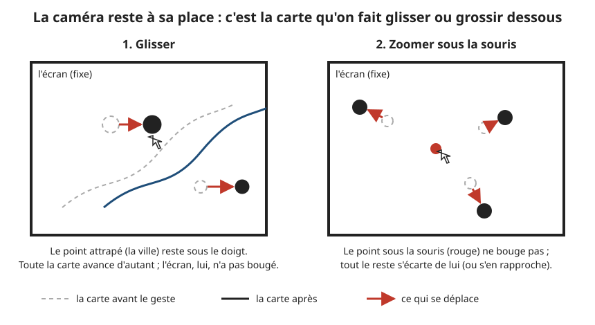
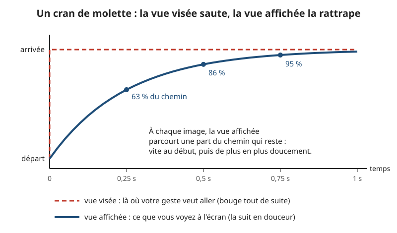
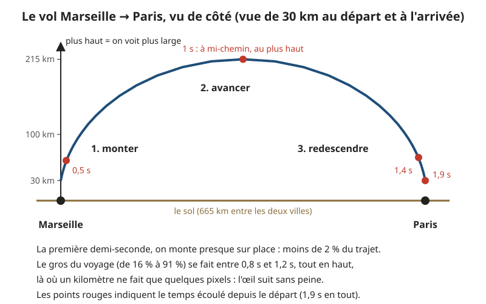

# Se déplacer : glisser, zoomer, voler

> **En une phrase :** la caméra ne voyage jamais au-dessus de la France ; vos gestes changent deux chiffres (le centre de la vue et sa largeur en kilomètres), et la vue affichée rattrape en douceur la vue que vous visez.

## L'idée

Imaginez une table lumineuse avec une loupe fixée au-dessus. La loupe ne bouge pas. Pour regarder Lyon plutôt que Marseille, vous faites glisser la carte sous la loupe. Pour voir plus large, vous ne levez pas la loupe : vous remplacez la carte par une version à plus petite échelle.

C'est exactement ce que fait le projet. La [caméra](glossaire.md#caméra) (le point de vue d'où l'on « filme » la scène 3D) ne voyage pas : elle reste toujours à la même distance du centre de la scène et se contente de pivoter un peu sur place (voir la section 7). Le terrain lui-même est un drap fixe : sa grille de points ne voyage pas, chaque point relit l'altitude du nouvel endroit qui passe sous lui (voir [Construire le terrain](3d/terrain.md)). Ce qui change, ce sont deux nombres :

- **le centre de la vue** : une longitude et une latitude ;
- **la largeur de la vue** : combien de kilomètres de France tiennent dans le carré central, de 2 km à 12 000 km.

Glisser change le centre. Zoomer change la largeur. Voler vers une ville change les deux, selon une trajectoire calculée.

Deuxième idée, aussi importante : il y a **deux vues**. La **vue visée**, c'est là où votre geste demande d'aller ; elle change à l'instant. La **vue affichée**, c'est ce que vous voyez ; elle court après la vue visée et la rattrape en un quart de seconde environ. C'est ce petit retard qui rend le mouvement fluide, comme une caméra sur un rail qui freine en douceur au lieu de s'arrêter net.

## Comment ça marche, en gros

### 1. Glisser : le point attrapé reste sous le doigt

1. Vous appuyez sur la carte. Le programme trace un rayon (une ligne droite) depuis la caméra, à travers le pixel sous votre doigt, jusqu'au sol. Il note le point touché : c'est le point attrapé.
2. Vous bougez. Il trace un nouveau rayon sous la nouvelle position du doigt, et mesure l'écart entre les deux points au sol.
3. Il déplace le centre visé de cet écart, en sens inverse. Résultat : le point attrapé revient sous votre doigt.
4. Garde-fou : un seul mouvement ne peut pas déplacer la carte de plus de 20 unités, soit un cinquième du carré central (l'unité est la mesure interne de la scène 3D ; le carré central en fait 100). Quand on vise presque l'horizon, un rayon rasant touche le sol très loin, et un petit geste ferait faire un bond énorme.

Pendant que l'intro est affichée, les gestes sont coupés : sinon vous déplaceriez la carte sans la voir.

### 2. Lancer : l'inertie

1. Pendant que vous glissez, le programme garde en mémoire les mouvements des 90 dernières millisecondes.
2. Au moment où vous lâchez, il en tire une vitesse : la distance parcourue pendant ces 90 ms, divisée par leur durée. Si vous vous êtes arrêté plus de 90 ms avant de lâcher, il ne reste rien en mémoire : pas de lancer.
3. La carte continue sur sa lancée, puis freine. À chaque instant, la vitesse perd une part fixe d'elle-même : elle est divisée par deux toutes les 0,26 s environ.
4. Calcul de la distance de glisse : la carte parcourt en tout la vitesse de départ multipliée par 0,38 s. Lâchée à 50 unités par seconde, elle glisse encore 50 × 0,38 = 19 unités, un peu moins d'un cinquième du carré central.

### 3. Zoomer : le point sous la souris ne bouge pas

1. Un cran de molette multiplie la largeur visée par environ 1,16 (vers l'arrière) ou par 0,86 (vers l'avant). La valeur exacte dépend de la souris : une molette de pavé tactile envoie de tout petits crans, très nombreux.
2. Avant de changer la largeur, le programme note le lieu exact sous la souris (sa longitude et sa latitude).
3. Il change la largeur, puis recalcule le centre pour que ce lieu se retrouve au même endroit de l'écran. Tout le reste s'écarte de lui, ou s'en rapproche.
4. Avec deux doigts (pincement), c'est pareil : le point fixe est le milieu des deux doigts, et le facteur de zoom est le rapport entre l'ancien et le nouvel écart des doigts.

### 4. Le lissage : la vue affichée rattrape la vue visée

À chaque image, la vue affichée parcourt une part du chemin qui lui reste vers la vue visée. Cette part dépend du temps écoulé depuis l'image précédente, pas du nombre d'images : la carte se comporte pareil sur un écran à 60 images par seconde et sur un écran à 120.

Le réglage est de 250 ms. Concrètement, après un cran de molette :

| Temps écoulé | Chemin parcouru |
|---|---|
| 0,25 s | 63 % |
| 0,5 s | 86 % |
| 0,75 s | 95 % |
| 1 s | 98 % |

Quand il reste moins d'un dix-millième de la vue à parcourir, la vue se pose d'un coup. Sinon elle s'approcherait éternellement sans jamais arriver, et l'application continuerait à redessiner pour rien.

Le zoom est lissé « en proportion », pas en kilomètres (on parle d'échelle logarithmique) : passer de 10 à 20 km prend autant de temps que de 1 000 à 2 000 km. Pour l'œil, les deux sont « deux fois plus large ».

### 5. Voler vers une ville : monter, avancer, redescendre

Quand vous choisissez un lieu dans la recherche, que vous cliquez sur un nom de la carte, ou sur le bouton « France », la carte ne glisse pas : elle vole. Si elle glissait de Marseille à Paris en restant à 30 km de large, elle ferait défiler 665 km de paysage flou en deux secondes. Illisible.

1. **On calcule la vue d'arrivée.** Pour un lieu dont on connaît le contour, on prend le rectangle qui le contient, agrandi de 25 %, et jamais moins de 3 km de large. Sans contour, on arrive à 3 km de large (ou on garde la vue actuelle si elle est déjà plus serrée). Le bouton « France » vise une vue de 1 150 km.
2. **On calcule une trajectoire.** Elle suit une formule publiée par deux chercheurs, van Wijk et Nuij, en 2003. L'idée : prendre de la hauteur (élargir la vue) juste assez pour que le départ et l'arrivée tiennent ensemble dans le champ, avancer là-haut, puis redescendre. La formule garantit que la vitesse **perçue** reste constante : un kilomètre vu de haut fait peu de pixels, on peut donc en parcourir beaucoup sans que l'œil s'y perde.
3. **On règle l'ampleur de la montée.** Un seul réglage contrôle la hauteur du saut. Mapbox (une grande bibliothèque de cartes) utilise 1,42 ; ici, on a pris 0,8, plus plat. Marseille → Paris à 30 km culmine à environ 215 km de large, au lieu de montrer la France entière.
4. **On fixe la durée.** 0,4 s de base, plus 0,23 s par unité de longueur du trajet, entre 0,9 s et 3,2 s. Marseille → Paris à 30 km de large : 1,9 s. Le même trajet à 3 km de large, plus long à parcourir en zoom : 3,2 s, le maximum.
5. **On adoucit le départ et l'arrivée.** Le temps est « étiré » pour démarrer doucement et finir doucement (comme une voiture qui accélère puis freine), au lieu de partir à fond.
6. **Pendant le vol, on charge l'arrivée en priorité.** Les altitudes fines ne sont demandées que pour la vue d'arrivée ; les vues traversées n'ont droit qu'à l'aperçu grossier (un relief basse définition chargé une fois pour toutes), qui suffit vu de haut. Le plan de l'occupation du sol (où sont les forêts, les villes, les champs, l'eau) est demandé autour de l'arrivée, à la largeur de la vue du moment, pour que la descente ne montre pas un simple carré. Et la grille du terrain (le maillage de points qui porte le relief) n'est pas refaite en vol : la refaire ferait sauter l'image.

Pendant le vol, la vue affichée est pilotée directement par la trajectoire, sans lissage. Un geste pendant le vol l'interrompt et repart de là où vous êtes.

### 6. Les bornes : où la carte s'arrête

- **Largeur de vue** : jamais moins de 2 km (plus près, les données d'altitude ne sont pas assez fines) ni plus de 12 000 km.
- **Centre de la vue** : entre 56° sud et 60° nord. Au-delà, il n'y a plus de données de relief, et on verrait le bord du monde.
- **En vue très large**, le centre est encore resserré : il faut que toute la zone dessinée reste dans ces données, bord compris.

Point subtil : la vue visée est bornée **exactement comme** la vue affichée. Sinon, en tirant la carte contre un bord, la vue visée partirait au-delà, la vue affichée ne pourrait jamais l'atteindre et ne se poserait jamais.

### 7. Ce que fait quand même la caméra

La caméra ne voyage pas, mais elle n'est pas figée. Elle fait quatre petites choses, toutes autour du même point visé au centre de la scène :

1. **Elle s'incline selon le zoom.** De près, elle regarde en biais, 70° depuis la verticale avec les réglages du panneau (52° dans le code sans le panneau). De loin, elle se redresse jusqu'à 25°, presque à la verticale. Le passage suit une courbe qui se redresse vite dès qu'on s'éloigne : à 40 km de large, on est déjà à 38°.
2. **Elle tourne de près.** Sous environ 7 km de large, glisser à l'horizontale fait tourner la vue autour du point regardé, au lieu de la déplacer. Entre 7 et 23 km, c'est un mélange. Au-delà de 23 km, on ne tourne plus. Dès qu'on dépasse 7 km, la vue commence à revenir nord en haut, d'autant plus vite qu'on s'éloigne ; au-delà de 23 km, ce retour prend environ une demi-seconde.
3. **Elle suit un peu la souris.** Elle se décale de 6 % de sa distance en largeur et de 3,5 % en hauteur selon la position du pointeur. On a l'impression de pencher la tête au-dessus d'une maquette. Ce mouvement se fige quand le pointeur approche d'un nom de lieu, sinon le nom s'enfuirait pendant qu'on essaie de le viser.
4. **Elle penche dans les virages.** Elle prend un léger roulis (une inclinaison sur le côté) selon la vitesse de rotation, le déplacement latéral et la souris, comme un caméraman qui suit le mouvement.

Une seule règle de sécurité : si le relief sous la caméra monte plus haut qu'elle, elle est remontée à 0,5 unité au-dessus du sol.

### 8. La qualité dynamique : baisser la résolution si l'ordinateur rame

Le relief est l'étape la plus longue à calculer dans chaque image. Si l'ordinateur n'arrive plus à suivre, le programme dessine la scène en plus petit, puis l'agrandit. Le trait d'encre, les hachures et le grain du papier, eux, restent à pleine résolution (le nombre de pixels de l'écran) : ce sont eux qui donnent sa netteté au dessin.

1. **Il attend 3 secondes d'animation.** Au début, la préparation des [shaders](glossaire.md#shader) (les petits programmes qui tournent sur la carte graphique, la puce qui dessine l'image) et le chargement des données ralentissent tout. Ça ne compte pas.
2. **Il mesure la vitesse normale de l'écran.** Pendant ces 3 s, il garde les intervalles les plus courts entre deux images et en déduit la fréquence de l'écran : 60, 120, 144 images par seconde... Il ne suppose pas 60.
3. **Il compte par tranches d'une seconde, seulement en mouvement.** Au repos, l'application dessine moins souvent exprès : ça ne dit rien de la puissance. Une image qui met plus de 0,25 s est une pause (onglet caché), pas une lenteur.
4. **Il descend vite.** Si deux secondes de suite sont 12 % plus lentes que la normale, la résolution baisse de 10 %. Exemple sur un écran à 120 images par seconde : la normale est 8,3 ms par image ; au-delà de 9,3 ms en moyenne deux secondes de suite, on baisse.
5. **Il remonte prudemment.** Il faut six secondes de suite presque à la normale (moins de 3 % plus lentes) pour tenter de remonter de 10 %. Si l'essai échoue, il ne réessaie pas avant 20 secondes.
6. **Il ne descend pas sous 60 %.** À 60 % de la largeur et de la hauteur, on dessine 0,6 × 0,6 = 36 % des pixels, presque trois fois moins.
7. **Il s'en souvient.** Le réglage trouvé est gardé dans le navigateur pour la visite suivante.

Les seuils différents à la descente et à la montée évitent que la résolution oscille sans arrêt entre deux valeurs (c'est ce qu'on appelle une hystérésis : comme un thermostat qui chauffe à 19° et coupe à 21°, pas tout à 20°).

Au panneau de réglage, la case « qualité auto » coupe ce mécanisme, et le curseur « résolution » fixe la finesse de toute l'image à la main.

## Pourquoi on a fait comme ça

- **Caméra fixe, carte qui bouge.** La France fait 1 000 km. Si la caméra voyageait vraiment, sa position s'écrirait avec de très grands nombres. Or la carte graphique ne garde qu'environ sept chiffres significatifs : sur de grands nombres, elle arrondit, et l'image tremble. En gardant tout près du point zéro de la scène, les nombres restent petits et précis. Et la grille du terrain n'a pas à suivre le déplacement : elle n'est refaite que pour changer de finesse quand la vue s'arrête (de 256 à 1 024 carreaux par côté selon le relief, voir [Construire le terrain](3d/terrain.md)).
- **Deux vues et un lissage.** Les événements de la souris arrivent par à-coups, à leur propre rythme, pas à celui de l'écran. Sans lissage, la carte saccade. Avec, elle file comme sur un rail. Le réglage de 250 ms vient d'une référence visuelle du projet (le site du domaine Chartogne-Taillet), dont la carte a ce temps de réponse.
- **Un lissage qui dépend du temps, pas des images.** Un lissage du type « avance de 10 % par image » irait deux fois plus vite sur un écran qui affiche 120 images par seconde que sur un écran à 60. Ici, le temps écoulé entre dans le calcul : même ressenti partout.
- **Le point sous la souris qui ne bouge pas.** C'est ce que font toutes les bonnes cartes en ligne. Sans ça, zoomer sur Lyon depuis une vue de la France obligerait à zoomer, recentrer, zoomer, recentrer.
- **La formule de vol de van Wijk et Nuij.** Elle est connue, publiée, utilisée par Mapbox, et tient en une vingtaine de lignes. Inventer une trajectoire maison aurait pris plus de temps pour un moins bon résultat.
- **La qualité dynamique.** La priorité de ce [POC](glossaire.md#poc) (un prototype qui sert à prouver que l'idée marche) est la fluidité (viser 120 images par seconde). Mieux vaut un relief un peu moins net qu'une carte qui saccade.

## Ce qu'on aurait pu faire autrement

- **Une vraie caméra qui voyage** (comme dans un jeu vidéo, ou avec les commandes de caméra toutes faites de three.js, la bibliothèque 3D du projet). Plus simple à brancher au début, mais l'image tremble loin du point zéro, et il aurait fallu déplacer la grille du terrain avec elle. Pas retenu : la caméra fixe est plus robuste pour une carte. Les grands globes 3D règlent ce problème autrement, en recentrant régulièrement toute la scène autour de la caméra ; c'est plus de travail pour le même résultat ici.
- **Une bibliothèque de carte complète** (Mapbox, MapLibre, Cesium) qui gère gestes, vols et bornes toute seule. Gros gain de temps, mais elle impose sa propre façon de dessiner la carte ; or tout l'intérêt du projet est le dessin à l'encre. On a seulement repris son idée de vol.
- **Des ressorts physiques** pour le lissage et l'inertie (une masse, un ressort, un amortisseur). Plus « vivant », avec un léger rebond possible. Plus de réglages à trouver, et un rebond sur une carte gêne plus qu'il n'aide. Le lissage simple suffit pour un POC.
- **Viser le vrai relief avec le rayon**, au lieu d'un sol plat à l'altitude zéro (voir Limites). Il faudrait garder une copie des altitudes côté processeur (la puce principale de l'ordinateur, qui gère les gestes), ou demander à la carte graphique ce qu'il y a sous chaque pixel. Faisable, mais plus lourd, pour un défaut qui ne se voit qu'en montagne de près. En production, ce serait l'une des premières améliorations.
- **Une qualité dynamique plus fine** : baisser d'abord d'autres réglages (la précision du calcul du relief, la finesse des ombres) avant la résolution. Ce serait mieux en production, mais chaque réglage a son effet sur le dessin et il faudrait les régler un par un. Baisser la résolution de la seule scène est simple et marche partout.

## Limites actuelles

- **Le rayon vise un sol plat.** Pour savoir quel point vous attrapez, le programme suppose un sol à l'altitude zéro, pas le vrai relief. En montagne, de près, le point attrapé glisse un peu sous le doigt.
- **Le pas de molette varie selon la souris** et le système : une molette « à crans » et un pavé tactile ne donnent pas le même ressenti.
- **Pas de clavier.** On ne peut pas se déplacer avec les flèches ni zoomer avec + et -. C'est un manque d'accessibilité à combler en production.
- **Le vol ne suit pas le relief.** Il gère la largeur de vue, pas les montagnes. Pas un problème en pratique : la caméra est toujours assez haute, et remontée si besoin.
- **La qualité dynamique ne remonte qu'en mouvement.** Si vous restez immobile, elle garde la dernière valeur.
- **Le réglage gardé d'une visite à l'autre** peut être trop bas si la première visite a été lente pour une raison passagère (autre logiciel lourd ouvert en même temps). Il remontera de lui-même, par paliers.

## Où c'est dans le code

| Étape | Fichier | Rôle |
|---|---|---|
| Gestes (glisser, molette, pincement, lancer) | [TerrainGestures.helper.ts](../src/graphics/nodes/cameras/TerrainGestures.helper.ts) | transforme les mouvements du pointeur en déplacement, zoom et vitesse de lancer |
| Caméra | [MapCamera.node.ts](../src/graphics/nodes/cameras/MapCamera.node.ts) | inclinaison, rotation de près, retour au nord, suivi de la souris, roulis |
| Vue visée, vue affichée, glisse, vol, bornes | [Terrain.node.ts](../src/graphics/nodes/terrain/Terrain.node.ts) | `moveBy`, `zoomAt`, `fling`, `flyTo`, `_ease`, `_glideStep`, `_fly`, `_viewOf` |
| Trajectoire de vol | [FlightPath.ts](../src/graphics/terrain/FlightPath.ts) | formule de van Wijk et Nuij : largeur de vue et avancée au sol le long du vol |
| Bornes du centre | [GeoProjection.ts](../src/graphics/terrain/GeoProjection.ts) | `clampCenter` : garde le rectangle de vue dans le monde et dans les données |
| Réglages (largeurs mini et maxi, lissage) | [terrain.config.ts](../src/graphics/config/terrain.config.ts) | `minExtentKm`, `maxExtentKm`, `easeMs`, `centerBounds` |
| Raccourcis de vue | [views.config.ts](../src/graphics/config/views.config.ts) | Paris, France, Monde ; largeur d'arrivée sur une ville (3 km) |
| Niveaux nommés | [focus.config.ts](../src/graphics/config/focus.config.ts) | communes, départements, régions |
| Branchement gestes, vols, qualité | [Main.universe.ts](../src/graphics/universes/impl/Main.universe.ts) | `flyTo`, `goToPlace`, gestes coupés sous l'intro, réglage « qualité auto » |
| Qualité dynamique | [DynamicQuality.helper.ts](../src/graphics/device/DynamicQuality.helper.ts) | mesure la cadence, baisse ou remonte la résolution de la scène |
| Valeurs du panneau | [debug.values.json](../src/graphics/config/debug.values.json) | clé `camera` : inclinaison de près (70°) et roulis réellement utilisés |

## Pour aller plus loin

- Jarke J. van Wijk et Wim A. A. Nuij, « Smooth and efficient zooming and panning », IEEE InfoVis 2003 : l'article d'origine de la trajectoire de vol.
- La documentation de la fonction « flyTo » de Mapbox GL JS : la même formule, en production, avec ses réglages.
- Freya Holmér, « Lerp smoothing is broken » (conférence vidéo, 2024) : pourquoi un lissage doit dépendre du temps écoulé et pas du nombre d'images.
- [MDN, Pointer events](https://developer.mozilla.org/en-US/docs/Web/API/Pointer_events) : comment le navigateur unifie souris, doigt et stylet.
- [Les bases](00-les-bases.md), section caméra, et [la vue d'ensemble 3D](3d/README.md) : ce que « la scène », « la caméra » et « le shader » veulent dire ici.
